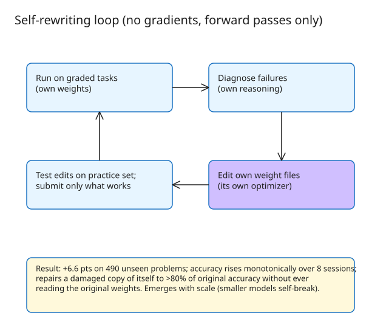

# Language Models That Rewrite Their Own Weights (arXiv 2611.21885)

A preprint (Vasudev, Pathak, Kumbhar, Chien, Zhao, Goyal, Wang et al.; UIUC, CMU, Rutgers, Princeton, Stanford, Yale) demonstrates **models directly editing their own weight files** — no human-written optimizer, no backprop: a 27B open-weight model improves itself and repairs damage to itself using only forward passes.

## The setup

The model is given **its own weights as input, its own computation graph as a program it can manipulate, and a toolkit for editing weight files**. It then: (1) runs on graded tasks, (2) uses its reasoning to diagnose failures, (3) modifies its own weight files **using itself as the optimizer**. Critically, every session it must *submit* an edited copy — submissions are accepted only if the edits work on **practice problems**, so each session inherits only self-authored changes that demonstrably helped.

## Results

- **+6.6 points over its unmodified base on 490 unseen problems** — accuracy rises monotonically from session 1 through the final accepted session (one evaluation run: 57.2% → 63.8% across seven accepted sessions; sessions 3–7 were withdrawn submissions).
- **Self-repair**: when its own weight copy is damaged, it restores **80% of its original accuracy** — without ever reading the pre-damage weights to copy from.
- **Scale-dependent**: the behaviour **emerges with scale** (smaller models self-break); larger models produce net-positive rewrites.

## Why it matters (authors' framing)

Prior "self-improvement" meant a model changing **external artifacts** — prompts, tools, training code, harnesses, or the data another model trains on. This closes a different loop: the model improving **the very system it is**, by direct weight modification, through experience, without gradient descent or human-designed optimizers. If recursive gains hold, capability growth stops being bottlenecked by human-designed training pipelines — a new axis of scaling and a new class of safety questions (who audits a model's self-edits? can gains be reversed?).

## Independent context (from search, same day)

Coverage (MarkTechPost, 2026-11-19) notes the gains are **task-specific, not general**: no transfer to untouched categories, and the self-repair is recovery of a broken copy, not superintelligence. Treat headline claims accordingly — and note this is a **preprint**, not peer-reviewed.

## Open questions worth tracking

- Do session-over-session gains compound indefinitely or plateau? (Only one reported run shown.)
- What stops a model from "improving" toward reward hacking, given practice-set gating is the only acceptance filter?
- Auditing: the edits are *files* — diffable and testable, which is at least tractable compared to opaque fine-tunes.

## References

- [Language Models Can Rewrite Their Own Weights (arXiv 2611.21885)](https://arxiv.org/abs/2611.21885)
- [MarkTechPost coverage](https://www.marktechpost.com/2026/11/19/language-models-can-rewrite-their-own-weights-self-improving-models-with-forward-passes-only/)
- Related in KB: Agent-driven model optimization, When agents train agents
