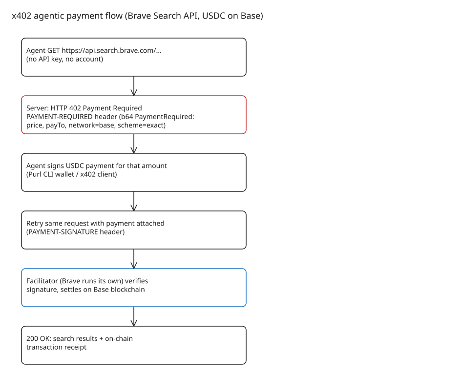

# x402 and the Brave Search API: HTTP 402 as a Pay-Per-Request Auth Model for Agents

The Brave Search API added support for the open **x402 protocol** (developed by Coinbase, now stewarded by the x402 Foundation): AI agents pay **USDC on the Base blockchain per request** instead of managing API keys, accounts, or plans. It is the clearest production example so far of using the long-dormant HTTP status code **402 Payment Required** as a machine-to-machine payment handshake.

## The protocol in one handshake

x402 layers a payment exchange on plain HTTP (see the [protocol repo](https://github.com/x402-foundation/x402)):

1. Client (agent) makes an ordinary HTTP request to a resource server.
2. Server replies **`402 Payment Required`** with a `PAYMENT-REQUIRED` header carrying a base64-encoded `PaymentRequired` object: accepted scheme/network, price, `payTo` address, and facilitator details.
3. Client signs a stablecoin payment (e.g. USDC `exact` scheme) for that amount.
4. Client **retries the same request** with the signed payment attached.
5. A **facilitator** verifies the signature and settles it on-chain; the server returns `200 OK` — plus a transaction receipt.

Steps 1–2 are optional if the client already knows the accepted payment terms. Design properties worth stealing for any API:

- **Payment replaces authentication.** Every request carries its own payment proof — no key issuance, rotation, revocation, or per-agent onboarding flow.
- **The price is discovered, not documented.** The 402 response *is* the pricing endpoint.
- **Stateless and agent-native.** An autonomous agent with a funded wallet can consume the API with zero interactive sign-up.

## What Brave actually ships

- **Endpoints**: `LLM Context` (agentic grounding), plus `web`, `news`, `image`, `video`, and `local` search.
- **Price**: $0.005 per request ($5 per 1,000), matching published API rates; gas on Base covered for a limited time.
- **Settlement**: USDC on Base; Brave runs **its own facilitator**, so trust in the verifier stays with Brave; more networks/stablecoins planned.
- **Onboarding path**: fund a wallet with Base-native USDC and query — Stripe's CLI wallet **[Purl](https://github.com/stripe/purl)** is the suggested quick start.
- **Docs**: [Brave agent-payments guide](https://api-dashboard.search.brave.com/documentation/guides/agent-payments).

## When this model fits (and when it doesn't)

**Fits**: autonomous agents that must buy metered data mid-task (search, grounding, scraping APIs, tool marketplaces); one-off integrations where account/API-key lifecycle management costs more than the usage itself.

**Doesn't fit**: workloads needing rate-limit identity, SLAs, invoicing, or team billing — key/quota plans still own those. Brave keeps both paths; x402 is additive, not a replacement.

Security notes for adopters: the `PaymentRequired` response is attacker-influenced routing data — pin expected `payTo`/facilitator values client-side; handle 402 idempotently (a retried request must not double-charge — x402 payments are one-time signed artifacts); and treat wallet funds as an API budget with per-agent caps.

## Ecosystem context

- **Governance**: Coinbase launched x402 in May 2025; **Cloudflare co-founded the x402 Foundation** with Coinbase ([launch announcement](https://blog.cloudflare.com/x402/)), which now stewards the spec — a strong signal the `X-PAYMENT`-era early spec has stabilized under the `PAYMENT-REQUIRED`/`PAYMENT-SIGNATURE` header convention in the foundation repo.
- **Adoption is broader than Brave**: other API providers already sell pay-per-query via x402 (e.g. [Robtex DNS data](https://robtex.com/en/x402)), and Circle offers a [discovery API for the whole x402 agent marketplace](https://www.circle.com/blog/discover-the-whole-agent-marketplace-in-one-call) — relevant when designing agent-side "find and pay" flows.
- **See also in this KB**: [x402: The HTTP Payment Standard Built for AI Agents](../../aimachinelearning/agentarchitecture/explanation-x402-http-payment-standard-for-ai-agents.md) — the protocol primer (flow, facilitator model, agent-economy rationale) that this note's Brave case study builds on.

## References

- [Brave: The Brave Search API now accepts agentic payments via the x402 protocol](https://brave.com/blog/search-api-agentic-payments/)
- [x402 protocol specification and flow (x402-foundation)](https://github.com/x402-foundation/x402)
- [x402 whitepaper — open standard for internet-native payments](https://www.x402.org/x402-whitepaper.pdf)
- [HTTP 402 core concept in x402 docs](https://docs.x402.org/core-concepts/http-402)
- [Purl CLI wallet by Stripe](https://github.com/stripe/purl)
- [Brave Search API agent payments documentation](https://api-dashboard.search.brave.com/documentation/guides/agent-payments)
