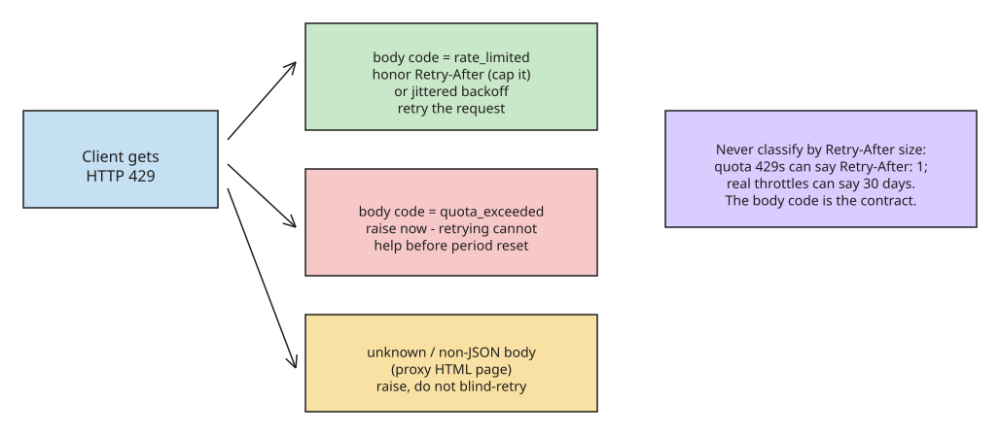

# Two Kinds of 429: RFC Semantics, RateLimit Header Drafts, and How HTTP Clients Actually Honor Retry-After

A `429` can mean "slow down for a second" (burst throttle) or "you've used up this month's allowance" (billing quota). The status code is identical and **no mainstream HTTP client tries to tell them apart**. The article reads the specs, then points real clients at a local test server returning a 429 with `Retry-After: 1` vs `Retry-After: 2592000` (30 days).

## What the specs actually give you

- **RFC 6585** defines 429: the user "sent too many requests in a given amount of time"; the response SHOULD explain the condition and MAY include `Retry-After`. It never says how to count or over what period — a monthly quota fits the definition as well as a per-second burst. Its own example is `Retry-After: 3600` for a 50/hour limit. Rule people forget: **a 429 MUST NOT be stored by a cache**.
- **RFC 9110 §10.2.3** defines `Retry-After` as either an HTTP date or a **non-negative decimal integer** of seconds (`1.5` is invalid). That section only spells out semantics for 503/redirects; its use on 429 comes from RFC 6585.
- **`RateLimit` / `RateLimit-Policy`** are still an Internet-Draft (`draft-ietf-httpapi-ratelimit-headers`, IETF HTTPAPI WG) and the syntax is moving:
  - Draft-11 (2026-05-23): `RateLimit: "default";r=50;t=30`
  - Draft-12 (2026-11-20): `RateLimit: default;a=50;w=30` — `a` (available quota) is **required**. A draft-12 client receiving draft-11 output finds no `a`, and malformed `RateLimit` fields MUST be ignored.
  - Both drafts agree on one client rule: **if both `RateLimit` and `Retry-After` are present, `Retry-After` wins**.
- The draft also proposes a problem type `https://iana.org/assignments/http-problem-types#quota-exceeded` with a `violated-policies` array — not yet in the IANA registry, and it doesn't settle the disambiguation question either (a 10/s policy is a "quota policy" just as much as a monthly one).

## Measured client behavior (defaults, Node 26.3.0 / requests 2.34.2 + urllib3 2.8.0 / got 16.2.0 / ky 2.2.0)

| Client | `Retry-After: 1` | `Retry-After: 2592000` (30d) |
|---|---|---|
| `fetch` (Node) | 429, no retry | 429, no retry |
| `requests`, default session | 429, no retry | 429, no retry |
| `requests` + `Retry(total=3)` | GET waits 1 s, then 200 | GET asks to sleep **6 hours** (stubbed) |
| `got` | GET waits 1 s, then 200 | throws `HTTPError` 429 at once |
| `ky` | GET waits 1 s, then 200 | still waiting after 5 s |

Key mechanics behind the table:

- **urllib3** treats 413/429/503 as retryable *when they carry* `Retry-After` — even with an empty `status_forcelist`. Same 429 without the header: one request, done. **POST is never retried** (not in the default retryable-method list) — same for got and ky.
- urllib3's `Retry` has **`retry_after_max` defaulting to 6 hours** (21,600 s observed via a stubbed `time.sleep`); the sleep then repeats until `total` is exhausted. `Retry(retry_after_max=60)` capped the sleep at 60 s and still retried.
- **got** aborts retries above Node's timer limit (~2,147,483,647 ms ≈ 24.8 days); it also skips the retry when the server asks for longer than `retry.maxRetryAfter` (falls back to `timeout.request` when unset).
- **ky 2.2.0** defaults `maxRetryAfter: Infinity` and caps the scheduled delay at ~24.8 days, then retries. `maxRetryAfter: 2000` did *not* make it give up — it waited 2 s and retried. **got and ky use the same option name for opposite semantics**: got = "don't retry if the server asks for longer than this"; ky = "never wait longer than this, then retry". `totalTimeout: 3000` is what actually stops ky.
- With no `Retry-After`, ky falls back to checking `RateLimit-Reset`, `X-RateLimit-Retry-After`, `X-RateLimit-Reset`, `X-Rate-Limit-Reset`.

## Why "big Retry-After = quota" fails, and what works

Classifying by the size of `Retry-After` breaks in production: a real SDK sends `Retry-After: 1` on a **quota** 429 in the last second of a billing period (and a 1-second wait there can legitimately succeed), and a quota with no period end may send **no `Retry-After` at all**.

What works is a **stable machine-readable code in the body**:

```
HTTP/1.1 429 Too Many Requests
Content-Type: application/json
Retry-After: 1
RateLimit-Policy: "per_second";q=10;w=1, "per_minute";q=300;w=60
RateLimit: "per_second";r=0;t=1, "per_minute";r=290;t=2

{"error":"rate_limited","retry_after":1}
```

```
HTTP/1.1 429 Too Many Requests
Content-Type: application/json
Retry-After: 1036800

{"error":"quota_exceeded","retry_after":1036800}
```

(Note the `RateLimit` values use draft-11 syntax with no `a`, so a draft-12 parser must ignore them; `RateLimit-Policy` still parses under draft-12. For *how long to wait*, clients should still obey `Retry-After`.)

A robust client dispatches on the body code: `rate_limited` → honor `Retry-After` or jittered exponential backoff, bounded by a max wait; `quota_exceeded` → raise immediately (a retry cannot help before the period resets); unknown code → raise. Parse defensively: the body may be an HTML error page from an intermediary proxy, so error-code extraction should return `None` rather than raise.

## Server-side design guidance

For **both** kinds of limit: return 429, **say in the body which limit the caller hit**, and set `Retry-After` to match. For a quota, `Retry-After` is usually seconds-until-reset — but it can be 1, or absent. Don't rely on header names or timing heuristics to communicate quota vs throttle; the RFCs cover the status and the wait, not the *which-limit* question — that's yours to solve in the body.



## References

- **Two kinds of 429, and what requests, got and ky do with Retry-After (DEV.to)**: https://dev.to/jackmally/two-kinds-of-429-and-what-requests-got-and-ky-do-with-retry-after-5aki
- **draft-ietf-httpapi-ratelimit-headers (IETF datatracker)**: https://datatracker.ietf.org/doc/draft-ietf-httpapi-ratelimit-headers/
- **API rate limit headers and 429 handling cheat sheet**: https://cheatography.com/superlede/cheat-sheets/api-rate-limit-headers-and-429-handling/
- **Per-customer API rate limiting deck**: https://speakerdeck.com/superlede/per-customer-api-rate-limiting
