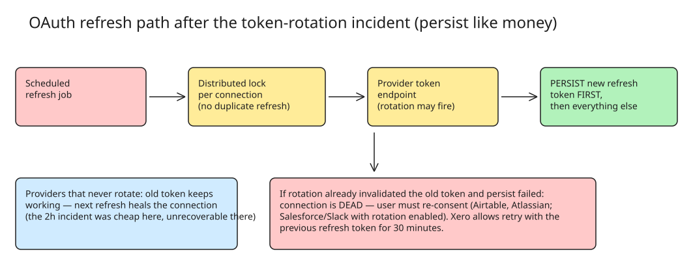

# OAuth Provider Divergence: Operational Lessons from Running Auth for 1,000+ APIs

OAuth 2.0 is a standard; OAuth *providers* are not interchangeable. Nango (open-source integration platform, github.com/NangoHQ/nango) grew from ~400 to 1,000+ API integrations and learned — partly through a production incident — that most auth failures come from undocumented per-provider behavior that only surfaces at scale.



## The incident that shaped the design

In May 2025 a merged PR contained an `if` condition that never fired: refreshed credentials were never persisted to the database. Reverted in under two hours, but in that window scheduled jobs refreshed and **discarded** tokens for hundreds of connections. For most providers the old refresh token still worked, so the next refresh healed the connection. For providers with **refresh-token rotation** (Airtable, Atlassian; Salesforce/Slack when rotation is enabled) the old token was already invalidated at issuance of the replacement — those connections were dead and every end user had to pass the consent screen again.

**Design rule that came out of it: treat refresh tokens like money, not cache.** Persist the new token before anything else can fail; the persistence path has its own regression tests; platform-level refresh anomalies page on-call. Refreshes are serialized per connection behind a **distributed lock** (a duplicate refresh can itself be destructive — see Airtable below).

## Provider behavior matrix (from production, not docs)

| Provider | Divergent behavior |
|---|---|
| Airtable | Refresh with stale token/wrong creds → 400/401 **and full revocation of the user's authorization**; duplicate refresh beyond a short documented grace period also revokes; old access token invalidated the instant refresh succeeds (long jobs break mid-run) |
| Xero | Retry with the **previous** refresh token is allowed for up to 30 minutes after a failed/lost refresh — the "bounded grace period" pattern done right |
| Exact Online | 10-minute access tokens; token endpoint **rejects any refresh attempt more than 30s before expiry** — the generic "refresh 15 min early" rule failed 100% of refreshes; required per-provider expiration buffers |
| Zendesk | `expires_in` included in the token response **only if explicitly requested**; without it, tokens still expire silently under default policy (RFC 6749 makes `expires_in` optional) |
| Salesforce | No expiry in token response; documented path is the introspection endpoint — which started intermittently returning `unsupported_token_type` in June 2024 |
| NetSuite | Refresh tokens expire after 7 days → full re-consent (why many teams use token-based auth instead) |
| Google | Refresh tokens live indefinitely **except**: app in "Testing" status, six months unused, or a user exceeding 100 live refresh tokens per client → exercise stale credentials on a cron |
| Zoho CRM | Token endpoint returns **HTTP 200 with the error in the body** |
| Workday / Dayforce | Missing permission policy → no error at all, just empty data |
| LastPass | Everything is HTTP 200 (even wrong passwords), failure as plain text; credential check literally greps the body for `"Authorization Error"` |

Salesforce introspection call used before deciding to refresh:

```http
POST /services/oauth2/introspect HTTP/1.1
Host: yourInstance.my.salesforce.com
Authorization: Basic <base64 of client_id:client_secret>
Content-Type: application/x-www-form-urlencoded

token=<access_token>&token_type_hint=access_token
```

Response carries `active`, `exp`, `scope` — but is itself unreliable, so a failed introspection must fall back to "refresh anyway".

## Systemic lessons

1. **Token rotation makes ordinary bugs irreversible.** A cache-style bug in the rotation path permanently destroys connections. Persistence-first ordering and per-connection locking are the mitigation.
2. **You can't reliably know when access tokens expire.** `expires_in` is optional per spec; some providers omit it, some reject early refreshes, some need introspection. Build per-provider expiration buffers.
3. **Auth failures don't always look like failures.** 200-with-error-in-body, silent empty data, plaintext failures. Nango maintains per-provider heuristics: 276 of ~935 registry providers declare a verification endpoint Nango calls to prove credentials still work.
4. **Providers make silent breaking changes.** 16% of provider-config commits are fixes. Figma moved credentials from request body to `Basic` header and changed the OAuth host, announced only by email; Shopify switched offline tokens to expiring ones with no notice. There is no reliable feed — you learn from failed flows.
5. **Sometimes you build around the provider, not with it.** Salesforce Data Cloud (unavailable in test orgs, two chained token exchanges) was implemented against a mock server built from documented responses; LastPass's "REST" API puts the action in the body of one URL, forcing base-URL-only support in their proxy; a working fix for Asana's `client_id is missing or invalid` error came from a support forum, not Asana's docs.

## If you build an API: the ten requests

Return `expires_in` always, in seconds. If you rotate refresh tokens, offer a short bounded grace period for the previous token (Xero's 30 min). Return errors more specific than `invalid_grant`. Treat auth changes as breaking changes — version, announce, never retroactively. Document revocation triggers (password resets, token caps, inactivity). Offer test access without a sales call. Keep auth docs public and accurate. **Make 200 mean success.** Prefer conventional behavior where the spec leaves room. Keep REST as the source of truth, not SOAP/WSDL sidecars.

The full per-provider registry lives in one file: `packages/providers/providers.yaml` in the NangoHQ/nango repo.

## Standards context: where the spec stands on these issues (RFC 9700)

The divergences above live in gaps that the standards process has since addressed at the protocol level — RFC 9700, *Best Current Practice for OAuth 2.0 Security* (supersedes RFC 6819, incorporated into OAuth 2.1):

- **PKCE is now mandatory for all authorization-code flows**; Implicit and Password grants are formally deprecated — so a provider still pushing those flows is behind the BCP, not merely "quirky".
- **Sender-constrained tokens (DPoP or mTLS)** are recommended where possible — relevant to the rotation incident: a stolen or double-used refresh token is far less useful when bound to a key held by the legitimate client.
- Exact redirect-URI matching and mix-up-attack prevention are requirements, not options.
- What RFC 9700 still does **not** fix is precisely Nango's pain: refresh-token lifetime policy, rotation grace windows, and error-response conventions remain provider discretion, which is why the per-provider matrix and verification-endpoint heuristics remain necessary engineering, not paperwork.

## References

- [What we learned operating auth for 1,000+ APIs (Nango blog)](https://nango.dev/blog/lessons-from-operating-api-auth-for-900-apis/)
- [Nango open-source repository](https://github.com/NangoHQ/nango)
- [RFC 6749 — The OAuth 2.0 Authorization Framework (expires_in is optional, §5.1)](https://datatracker.ietf.org/doc/html/rfc6749#section-5.1)
- [RFC 9700 — Best Current Practice for OAuth 2.0 Security](https://www.rfc-editor.org/rfc/rfc9700.html)
- [OAuth 2.0 Security Best Current Practice overview (oauth.net)](https://oauth.net/2/oauth-best-practice/)
- [Xero OAuth2 FAQ — refresh token retry window](https://developer.xero.com/faq/oauth2)
