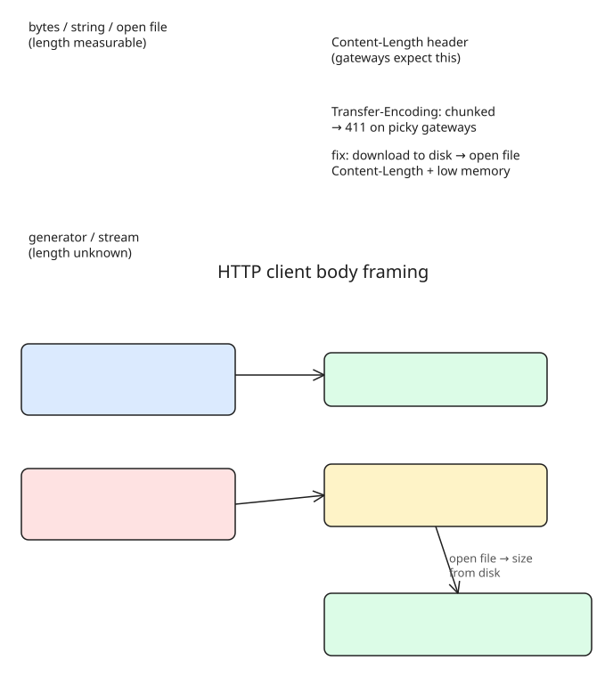

# Client Body Framing: How 'requests' Chooses Content-Length vs Chunked (and the 411 That Followed)

**The incident** (Sergey Shinder): a monthly job PUTs the previous month's claims CSV to an insurer's upload API. To fix pod OOM on a 900 MB file, a colleague switched from reading the whole S3 body into memory to **streaming a generator through Python `requests`** (1 MB at a time). Memory dropped to near zero, tests passed. Then every upload failed with **411 Length Required**.

## Why: the client library changed the wire format
`requests` frames the body based on whether it can work out its length:
- **bytes / string / real file** → measurable → sends a `Content-Length` header.
- **generator / unknown-length stream** → sends `Transfer-Encoding: chunked` (size-prefixed pieces, terminated by an empty chunk).

HTTP/1.1 servers are *supposed* to accept chunked. This insurer's gateway didn't — 411 is the status a server returns when it refuses a body without a declared length. **Nothing in our code mentioned either header**; only the partner noticed the change.

The tests missed it because the mock HTTP server accepted *any* request and asserted on the bytes sent, not *how* they were sent.

## The fix
Download the file to the pod's local disk and pass `requests` an **open file**: `requests` reads the size from the filesystem → `Content-Length`, and streams from disk → memory stays as low as the generator case.

## Hardening
- Run each upload against a **local server configured to reject chunked bodies**, and assert on the **headers** as well as the bytes.
- The shared integration client **refuses chunked uploads unless the partner's configuration declares chunked accepted**.
- A 411 will never succeed on the fifth retry — alert the team on the **first failure**, not after retries run out.

**Lesson**: changing how a program *holds* a file can silently change the *wire format*. When integrating with partner gateways, pin the framing explicitly (open file or precomputed length) and test against the real contract — headers included — not a lenient mock.

## Further reading

- [MDN: 411 Length Required](https://developer.mozilla.org/en-US/docs/Web/HTTP/Reference/Status/411) — the normative description (RFC 9110 `status.411`): the server refused the request without a defined `Content-Length`. Note the MDN example of a chunked `POST /translate/de` rejected with `411` and a JSON error body — exactly the shape a gateway returns when chunked framing is disallowed.
- [Requests: Advanced Usage](https://docs.python-requests.org/en/latest/user/advanced.html#chunked-requests) — how `requests` decides the wire format: pass a generator (or any length-less iterator) for the body and it sends `Transfer-Encoding: chunked`; pass a bytes/str body and it computes `Content-Length`. This is the switch the library flipped in the incident described above.
- [http.dev: 411](https://http.dev/411) — quick field guide including the practical fix: when the target rejects chunked bodies, buffer the full payload, measure its byte length, and resend with `Content-Length`.

## References
- [We streamed our claims file to save memory and the insurer's gateway asked how long it was (DEV.to)](https://dev.to/sergey_shinder_ab2d943365/we-streamed-our-claims-file-to-save-memory-and-the-insurers-gateway-asked-how-long-it-was-12c1)
- [HTTP 411 Length Required (MDN)](https://developer.mozilla.org/en-US/docs/Web/HTTP/Status/411) — server refuses a body without a declared length
