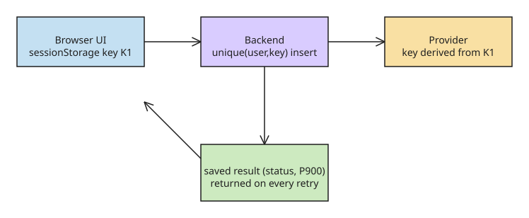

# Idempotency Keys and the Double-Charge Trap: Key Lifecycle for Payment Retries

**The problem:** you click *Pay*, the server charges the card, but the response is lost (network drop, timeout, tab freeze). The UI thinks it failed, the user clicks *Pay* again, and the customer is **charged twice**. The root cause is a semantics mistake: **a timeout means "I don't know what happened", not "the payment failed".**

**Idempotent** = doing the same thing twice has the same effect as doing it once. "Set notifications OFF" is idempotent; "add USD 50" is not (twice = USD 100); "create a payment" is not — unless it carries a key.

An **idempotency key** is a unique ID for *one payment attempt*. The UI sends it with the request; if the same key arrives again, the backend says "I've already handled this one" and returns the **saved result** instead of charging again.

- **UI's job:** create the key once, keep it, resend the *same* key on every retry.
- **Backend's job:** remember each key and its result, so repeats are never re-executed.

## Key lifecycle

1. **Create or reuse.** On *Pay*, check whether the order already has a key (earlier attempt, pre-refresh). Found → reuse (this is a retry of the same payment). Missing → generate with `crypto.randomUUID()` and store it under `payment-key:{orderId}`.
   - Use `crypto.randomUUID()` — random and practically collision-free. Never `Date.now()`, `Math.random()`, or the amount: two different payments could produce the same value.
2. **Save BEFORE sending.** `sessionStorage.setItem("payment-key:O100", key)`. If the page crashes mid-request the key survives and the next attempt reuses it. Disable the Pay button while in flight (UX help only — the key is the real protection).

   | Storage | Survives refresh? | Use it? |
   |---|---|---|
   | variable / React state | No | current screen only |
   | **sessionStorage** | Yes (same tab) | **recommended** — cleared when tab closes |
   | localStorage | Yes (across restarts) | avoid — leftover keys on shared devices, shared across tabs |
   | cookie | Yes | avoid — sent with every request for no reason |

3. **Send only order ID + key.** `POST /orders/O100/pay` with `Idempotency-Key: K1`. The backend loads the amount from the order itself — **never trust a price sent by the browser**.

## Backend decision table

The backend stores one row per key (`user, key, order, status, result`) and the **insert must be atomic** (unique constraint on `user + key`) so that two identical concurrent requests race down to a single charge.

| Backend finds | Backend does |
|---|---|
| key not found | new payment: save `processing`, charge, save result, respond |
| key = `processing` | another request is already charging → `409` "in progress, check again" |
| key = `succeeded` / `declined` | return the **saved result**, do not charge again |
| key exists for a different order | reject (`422`) — key misuse |

**Why the backend stores it:** the UI *cannot* know whether the first request was charged — only the backend can remember.

## Provider-side idempotency

The backend passes the payment provider its **own provider key derived from K1**, saved *before* the call. If the backend crashes after the provider charged but before saving the result, the retry reuses that provider key and the provider returns the original charge instead of creating a new one. Then the row is updated to `succeeded` with the provider result.

## UI response handling

| UI gets | Meaning | UI action | Key |
|---|---|---|---|
| `200` | paid | show receipt | **remove** |
| clear card decline | not charged | show error, let user retry | **remove** (next try gets a new key) |
| `409` | still charging | "Processing…", poll again | **keep** |
| timeout / 5xx | unknown | "Checking payment status…", retry | **keep** |

The rule: **only remove the key when the final outcome is known.**

Retry after timeout with the *same* key, increasing delays (1s, 2s, 4s). Both outcomes are safe:

- first request never arrived → key is new → charged once now;
- first request already charged → `succeeded` → saved result returned.

**The UI never needs to know which case happened** — that is the whole point. A page refresh finds the key in `sessionStorage` and resends it; the backend returns the saved result or `409`, never a second charge.

## UI code sketch

```js
function getOrCreateKey(orderId) {
  const name = `payment-key:${orderId}`;
  let key = sessionStorage.getItem(name);
  if (!key) {
    key = crypto.randomUUID();
    sessionStorage.setItem(name, key); // save BEFORE sending
  }
  return key;
}

async function pay(orderId) {
  const key = getOrCreateKey(orderId);
  const res = await fetch(`/orders/${orderId}/pay`, {
    method: "POST",
    headers: { "Idempotency-Key": key },
  });
  // 200/decline -> remove key; 409/timeout -> keep key, retry
}
```

## Diagram



## Related KB notes

- How to implement the request-deduplication algorithm
- Why replayed responses are stale by design

## References

- [Idempotency Keys — The Double-Charge Trap — DEV.to](https://dev.to/zeeshanali0704/idempotency-keys-the-double-charge-trap-106o) (primary source)
