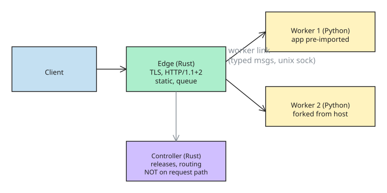

# Muru's Edge/Host/Worker/Controller Design: Separating the Server From the Python Interpreter

**Muru** is Graham Dumpleton's (creator of mod_wsgi, 20 years prior) new AI-assisted **Rust server for running ASGI and WSGI Python apps** in development and production, being documented publicly in a daily post series through November 2026 (surfaced via Simon Willison's link blog). Its architecture is the interesting part: it generalizes the mod_wsgi *daemon mode* idea into four strictly separated process roles, so that traffic-serving, lifecycle management, and the Python interpreter can each be replaced independently.

## The four process roles

```
muructl run app:application --processes 2        # Rust binary: edge + controller (dev mode)
 └── python -m muru.host --app app:application --release r1 ...
      ├── worker (forked, interpreter pre-warmed)
      └── worker (forked)
```

| Role | Language | Job | On request path? |
| --- | --- | --- | --- |
| **Edge** | Rust | Accept connections, TLS, HTTP/1.1 + HTTP/2, routing policy, static files, compression, error pages | Yes (client-facing) |
| **Host** | Python | Import the app **once**, fork workers, replace dead workers | No |
| **Worker** | Python + Rust shim | Run the app; WSGI gets `environ`, ASGI gets `scope` | Yes (app side) |
| **Controller** | Rust | Start/stop hosts, tell the edge where to route, track releases | **Never** |

Because the edge never runs Python, a slow application request cannot stall connection acceptance — the classic gunicorn/uwsgi failure mode where workers saturated in Python block the accept queue.

## The worker link: typed messages, not re-serialized HTTP

The edge forwards requests to workers over a **Unix socket** ("worker link") — but *not* as HTTP text. The edge has already parsed the request; method, path, headers, and connection metadata travel as small **typed messages**, body streams on demand. Nothing is re-serialized to HTTP text just to be re-parsed. Backpressure is end-to-end: a slow client propagates through edge and worker to the app (which waits with the interpreter released); a rejected request never reads the upload; file responses go from the edge straight from disk.

Cost analysis (Dumpleton's own): one extra byte-copy plus tens of microseconds per request when both processes are on the same machine — noise next to real Python request handling. This is the same shape as mod_wsgi daemon mode (Apache child → Unix socket → daemon process). **The real payoff is not performance** — it is lifecycle independence: the edge keeps accepting while the app is replaced; workers recycle without dropped connections; multiple releases (even on different Python versions) run side by side.

## Releases, not restarts

Deployment units are **releases** the controller swaps in and out: traffic policy moves requests between releases (canary deploys *without a service mesh*), the `queue` time in access logs reflects edge-side queuing when all workers are busy, and the daemon/controller can be restarted or upgraded while the edge serves on its last-received routing. Even replacing the **edge itself** is non-refusing: the new edge process takes over the listening sockets from the old one. In containers (`muructl serve`), edge + controller + host + workers all run under one main process, one app per container.

This directly addresses Dumpleton's two-decade-old mod_wsgi pain point: under Apache, the parent owns every child's lifecycle, worker count is fixed by config, and significant changes mean a restart. In Muru, the thing that decides *what should run*, the thing *serving traffic*, and the *Python processes* are three independent units.

## Related design points from the series

- **Import once, fork many** — workers are forked from an already-imported host (copy-on-write startup); a follow-up post covers *when lazy imports help*.
- HTTPS in development, WSGI and ASGI in the same server, per-request toolbar with tracing, scaling from what workers report, and scale-to-zero.
- AI-assisted development with human judgment as the gate: *"The AI may be doing a lot of the work on the surface, but deciding what isn't good enough yet is still down to me, and twenty years of getting things wrong with mod_wsgi turns out to be useful for that."*



## Why it matters

If Muru matures the way mod_wsgi did, it becomes the default answer for "how do I run Python web apps without a gunicorn + nginx + supervisor + service-mesh pile": one binary giving canaries, hot reload, multi-release, and scale-to-zero, with the client-facing plane in Rust. For comparison: gunicorn keeps HTTP parsing in the Python worker process; uvicorn does too; neither has releases or an off-path controller. Even if you never deploy it, the **edge/controller separation + typed worker link** is a reusable architecture lesson for any polyglot server platform.

## References

- Simon Willison's link post: [Muru](https://simonwillison.net/2026/Nov/21/muru/)
- Repository: [muruhq/muru on GitHub](https://github.com/muruhq/muru)
- Architecture post: [Muru: how it fits together](https://grahamdumpleton.me/posts/2026/11/muru-how-it-fits-together/)
- Series start: [Twenty years of mod_wsgi, and what comes next](https://grahamdumpleton.me/posts/2026/11/twenty-years-of-mod-wsgi/) and [A first look at Muru](https://grahamdumpleton.me/posts/2026/11/a-first-look-at-muru/)
