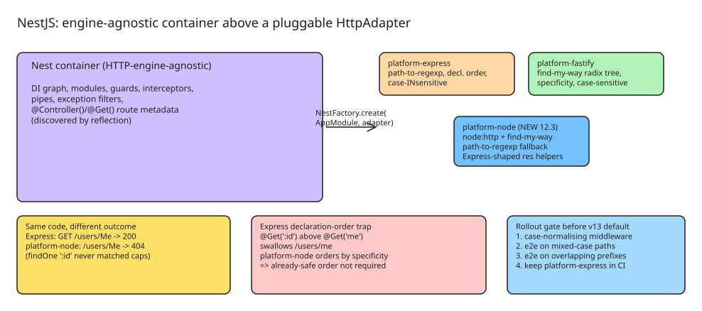

# Why @nestjs/platform-node Silently Changes Your Routing

**The incident:** a team upgrades `@nestjs/core` and swaps `NestFactory.create(AppModule)` for `NestFactory.create(AppModule, new NodeAdapter())` — NestJS 12.3's new Express-free adapter (merged Oct 27, 2026, PR #18063), chasing the ~50% throughput gain its author measured against Express. Everything passes locally; in production `/users/Me` (a stray capital from an abandoned mobile build) starts returning 404. Nobody touched routing. The adapter changed a routing assumption Express never enforced.



## The mental model: the adapter sits below everything Nest-specific

Nest's container — DI, modules, guards, interceptors, pipes, filters, and the `@Controller()`/`@Get()` decorators that describe routes — is **HTTP-engine-agnostic**. None of it knows whether a real HTTP server is Express, Fastify, or raw `node:http`. That knowledge lives in one pluggable object, the `HttpAdapter`, passed as the second argument to `NestFactory.create()`:

```ts
// main.ts — the swap is a one-liner at the composition root, nowhere else
import { NodeAdapter } from '@nestjs/platform-node';
const app = await NestFactory.create(AppModule, new NodeAdapter());
await app.listen(3000);
```

The adapter's job: take route metadata the container discovered via reflection and register it with the concrete engine — translating `@Get(':id')` into an Express route, a Fastify route, or a `platform-node` route. Everything above it never needs to know which adapter is underneath. **That is exactly why this class of bug exists**: routing and request/response shape are the adapter's responsibility, so it's the one place where swapping an "implementation detail" changes observable behavior.

## What platform-node actually is

Not "Nest without a web framework" — Nest with a *minimal, purpose-built* one that feels like Express but routes like Fastify. Built directly on `node:http`/`node:https` (no Express/Fastify dependency), it ships:

- **Routing via `find-my-way`** — Fastify's radix-tree router — with `path-to-regexp` (Express's matcher) as a fallback for patterns `find-my-way` can't express.
- **An Express-style middleware stack**, so `app.use()` largely just works.
- **Express-shaped helpers**: `res.status()/.send()/.json()/.set()/.redirect()/.cookie()/.sendFile()`, `res.locals`, `req.get()`, `req.is()`.
- **Built-in body parsers** (JSON, URL-encoded, text, raw) with `body-parser`-style options (`limit`, `inflate`, `strict`, `verify`, `rawBody`); prototype-poisoning rejected by default.
- **CORS, HTTPS, static assets, view engines, multer-based uploads** (`FileInterceptor`, `FilesInterceptor`, `FileFieldsInterceptor`) carried over from `platform-express`.

It exists so teams don't have to rewrite Express-style middleware and `@Res()` handlers the way adopting Fastify often requires.

## The two routing assumptions that change

### 1. Matching by specificity, not declaration order

Under Express, the router matches in **declaration order**:

```ts
@Controller('users')
export class UsersController {
  @Get(':id')          // declared first => swallows /users/me under Express
  findOne(@Param('id') id: string) { ... }

  @Get('me')           // Express requires this to be declared BEFORE ':id'
  findMe(@CurrentUser() user: User) { ... }
}
```

`find-my-way` sorts the radix tree by **specificity**: static segments beat parameterized ones, so `/users/me` wins over `/users/:id` regardless of declaration order. Code that carefully ordered handlers for Express stays correct (and the ordering habit becomes unnecessary) — but conversely, code that *relied* on first-match-wins shadowing behaves differently.

### 2. Case-sensitive paths — the production trap

Express's default treats `/Users/me` and `/users/me` as the same route. `platform-node` matches **case-sensitively**. Nothing in the controller changes, a legacy client sends one capital letter, and 200 becomes 404. Fastify users already live with case-sensitivity; Express users upgrading do not expect it.

## Version timeline (verify against npm dist-tags before acting)

- `@nestjs/platform-node` landed in **12.3.0** (opt-in), published through 12.6.x; `@nestjs/core` and `@nestjs/platform-node` `latest` are 12.6.3, with the 11.x line on the `legacy` tag (11.2.12).
- Official NestJS docs confirm: Express remains the default when no adapter is passed; **`NodeAdapter` becomes the default in v13** — so these behavior changes will be made *for* you unless you migrate deliberately.
- The adapter's own docs state limitations honestly: it is not 100% Express parity.

## Migration gate before v13

1. Add a **case-normalising middleware** (or explicit aliases) if any legacy client may send mixed-case paths.
2. E2E-test **mixed-case variants** of every public route (`/users/Me`, `/Users/me`).
3. E2E-test **overlapping static/param prefixes** (`/users/me` vs `/users/:id`) under both adapters — the specificity flip can rescue you or surprise you depending on assumptions.
4. Keep `platform-express` in CI as a parity reference during the transition.
5. Read the adapter's stated limitations instead of assuming Express parity; benchmark before betting on the ~50% figure for your workload.

## References

- [NestJS platform-node (12.3): The Adapter That Reorders Your Routes (DEV.to)](https://dev.to/parsajiravand/nestjs-platform-node-123-the-adapter-that-reorders-your-routes-5amf)
- [NestJS official docs — HTTP adapters / performance (confirms v13 default)](https://docs.nestjs.com/http/performance)
- [NestJS team: "NestJS can now run without Express" (DEV.to)](https://dev.to/nestjs/looking-for-an-express-alternative-nestjs-can-now-run-without-express-4533)
- Related in KB: [Learning Fastify's Request Lifecycle](../../../tutorials/backendengineering/httpframeworks/tutorial-fastify-request-lifecycle-hooks.md)
