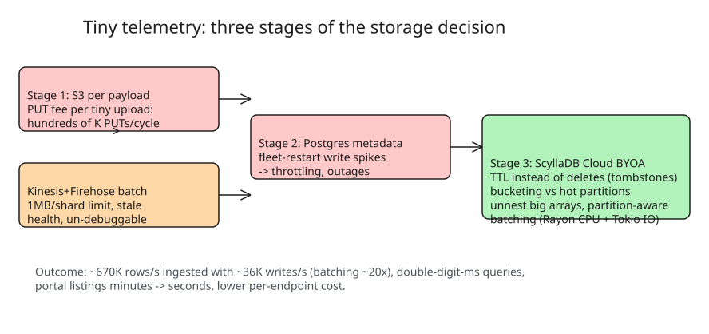

# The Tiny-Data Trap: Red Canary's Path from S3 PUT Costs and Postgres Write Spikes to ScyllaDB

Red Canary's LinuxEDR sensors run on hundreds of thousands of endpoints (VMs, laptops, EC2) and continuously emit **tiny payloads** — file changes, process launches, network connections, self-reported health checks. Storing many small objects is a distinct architecture problem from storing few large ones, and the team (Andres Medina, Monster Scale Summit talk "Using ScyllaDB to Store Large Amounts of Small Data") walked through every failed intermediate before landing on a write-optimized wide-column store.

## Stage 1 — S3 per-PUT economics

S3 charges a flat fee **per PUT**, i.e. per payload upload. With hundreds of thousands of endpoints each uploading its own small payloads, the request line item dominates: hundreds of thousands of PUT charges per flush cycle.

The obvious fix — **batch before upload** via Kinesis + Firehose until a size threshold is reached — cut costs but introduced three new problems:

1. **Hard limits:** Firehose/Kinesis enforce ~1 MB per shard; the merged files didn't fit.
2. **Stale visibility:** health data used to land immediately; now it waited on a threshold.
3. **Debugging pain:** endpoint IDs mashed into large blobs make per-endpoint lookup in a big customer fleet very hard.

## Stage 2 — Postgres overwhelmed by correlated write spikes

Endpoint metadata lived in Postgres and could not absorb the workload shape: when a large customer restarts a chunk of its fleet, tens of thousands of endpoints check in within the same window — a write spike that took the database down until the team **throttled incoming requests**. The workload was append-only, time-series reads ("active endpoints for customer X in period Y") at a scale Postgres wasn't sized for.

## Stage 3 — ScyllaDB, and the four lessons that generalize

Selection criteria: sustain growing throughput, improve time-to-visibility, minimal admin burden. They chose **ScyllaDB Cloud with BYOA** — the cluster runs in their own AWS account, in a separate account from the remaining data, so the vendor manages it without access to their data. Migration was staged: replace Postgres first (lower risk), then S3; health data served as the safe proving ground for eventually moving detection data too.

The transferable engineering lessons:

- **Tombstones poison ephemeral partitions.** Deleting a check-in row in ScyllaDB leaves a timestamped tombstone (which prevents repair-time data resurrection). Ephemeral endpoints (spin up for an hour, scale down) produced partitions *mostly tombstones*, and queries had to iterate through all of them. Fix: they don't need deletes at all — set a **short TTL** on the table and tune tombstone GC to evict faster; latency recovered.
- **Bucketing defeats hot partitions.** Data volume per customer spans dozens to hundreds of thousands of endpoints. Each customer's rows are split into numbered **buckets** that ScyllaDB distributes across shards; reads fan out to all buckets in parallel.
- **Unnest large arrays.** Process-memory telemetry arrived as very large arrays per event; storing them inline created giant rows. They unnested the array into an **auxiliary table** keyed to the same partition, keeping queries simple while bounding partition size.
- **Partition-aware batching + CPU/IO separation in Rust.** Batches are far cheaper when every statement targets the same partition. The ScyllaDB Rust driver doesn't expose a *bound statement* (prepared statement with pre-serialized values), so getting a token meant serializing twice. Medina forked the driver to add bound statements/batches: token lookup without re-serialization, CPU work on **Rayon** workers, I/O on **Tokio** — average file-processing time dropped **~150 ms → ~50 ms (−60 %)**.

Measured outcomes: ~670 K rows/s ingested with only ~36 K writes/s (≈20× write amplification saving from batching), double-digit-millisecond ScyllaDB queries, and portal endpoint listings for the largest customers dropping from minutes to seconds — while per-endpoint cost fell significantly.

## Decision rule of thumb

Batching-into-object-storage wins when payloads are naturally large and access is bulk/scan-shaped. When access is **point-lookup-shaped** (debug one sensor, list one customer's endpoints) and per-request pricing or shard limits penalize tiny files, a write-optimized log-structured store with sane partitioning beats merged files on cost *and* freshness. Test it on the least critical data first.

## References

- [S3 vs. ScyllaDB for tiny telemetry: What Red Canary learned the hard way — The New Stack](https://thenewstack.io/scylladb-s3-tiny-telemetry/)
- [Using ScyllaDB to Store Large Amounts of Small Data — ScyllaDB tech talk (Andres Medina, Red Canary LinuxEDR)](https://www.scylladb.com/tech-talk/using-scylladb-to-store-large-amounts-of-small-data/)
- [Monster SCALE Summit 2026 talk recording](https://www.youtube.com/watch?v=cpMqUxF6PhY) · [Summit on-demand library](https://www.scylladb.com/monster-scale-summit/)
