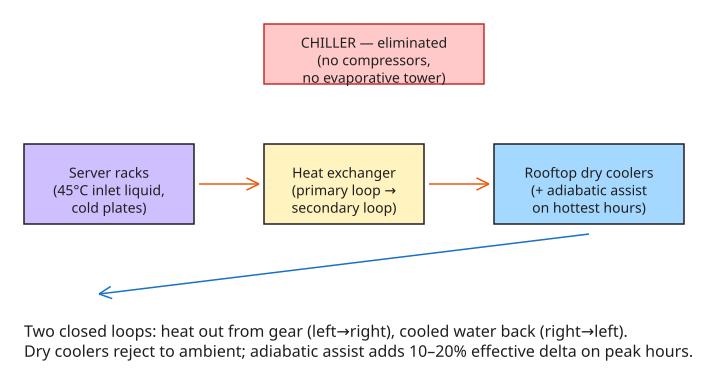

# Why 45°C Liquid Inlets Kill the Chiller: High-Temperature Dry Cooling for AI Datacenters

At SC26 (Chicago), liquid cooling dominated the floor — and the number that matters is one Nvidia dropped earlier in 2026: **45°C (113°F) liquid inlet temperature** for its parts. Most liquid-cooled systems have lived at 30–35°C inlets because that's what the chips tolerated. The 10–15°C jump changes the facility architecture: **the chiller disappears**.

## The two-loop, chiller-free architecture

With a 45°C-capable chip fleet, heat rejection becomes two closed loops:

1. **Primary loop** takes heat from the server gear (cold plates / manifs) and passes it through a heat exchanger.
2. **Secondary loop** carries the warm water to **rooftop dry coolers**, which can reject nearly any incoming fluid temperature down below 45°C, and returns it.

Chillers — "huge rooftop refrigerators" that cool water *below* what dry cooling achieves — become unnecessary for new builds. They are expensive capital equipment (compressors, pumps, cooling-tower fans), maintenance-heavy, and electricity-hungry. For the rare hours when ambient approaches 113°F, **adiabatic assist** (water trickled through a mesh around the dry coolers) drops effective temperature another **10–20%**.

## The measured payoff

| Dimension | Conventional chiller + evaporative tower | 45°C dry-cooler loops |
| --- | --- | --- |
| Cooling share of facility energy | 20–40% of total, chiller plant a large share | cooling energy **−50–70%** → **10–20% lower total datacenter power** (depends on starting PUE & climate) |
| Water | millions of gallons/yr at mid-size sites | essentially zero outside water; adiabatic assist only on hottest hours → **−80–95% annual water** |
| Capex | sized/replaced mechanical refrigeration plant | simpler dry coolers, far fewer moving parts |
| Marginal tuning | — | one cooling vendor's testing: **3–4% cooling energy cost decrease per +1°C inlet temperature** |

The water numbers are what make 45°C such a big deal — and they answer many (not all) objections from anti-datacenter campaigns: much lower energy use, water down 85–90%, lower cost.

## Why it isn't free

- **New builds need real engineering**: loop sizing, dry-cooler selection, running at the new set points without surprises (headroom still required — vendors confirm 45°C is being used as a *design basis*, not a guaranteed operating point).
- **Brownfield is harder**: many facilities have pipes, pumps, and heat exchangers sized for air cooling or 30–35°C liquid; raising inlet temperature means re-checking flow rates and pressure drops.
- **Ecosystem risk**: nothing public yet from AMD/Intel/Arm on matching 45°C inlets — cooling vendors are compliant and expect others to follow; if competitors lag, the chip that set the standard gets the TCO advantage.

## What it means

Free cooling — previously a cool-climate privilege — becomes the default for most regions. The cost argument for mechanical refrigeration on new AI/HPC builds gets hard to defend in most climates; the interesting engineering shifts from "how do we chill water" to loop design, set-point control, and retrofitting legacy hydronic infrastructure.

## References

- [45°C inlets just killed the chiller. Most people haven't noticed yet (Dan Olds, The Register, SC26)](https://www.theregister.com/hpc/2026/11/26/45c-inlets-just-killed-the-chiller-most-people-havent-noticed-yet/5311831)
- [AI datacenters may gulp NYC's daily water supply at peak (The Register — adiabatic assist context)](https://www.theregister.com/on-prem/2026/03/10/ai-datacenters-may-gulp-nycs-daily-water-supply-at-peak/5228973)
- Related in KB: [PACER — GPU power-excursion (EDPp) management](explanation-pacer-gpu-power-excursions-edpp.md)
