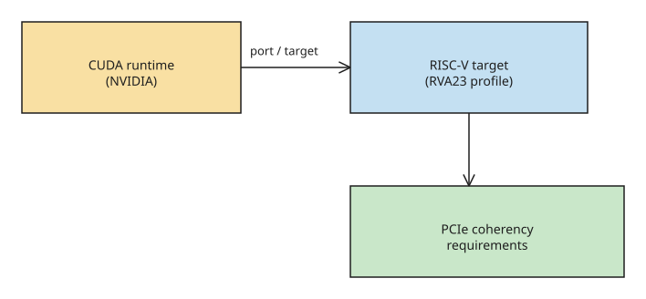

# Hot Chips 2026: CUDA Targets RISC-V

CUDA supports x86-64 and aarch64 today. At Hot Chips 2026, Nvidia presented
extending CUDA to **RISC-V** — opening the door for RISC-V CPUs to feed GPU
compute. The talk is a requirements list: Nvidia wants a server-grade CPU and
platform, not a lowest-common-denominator target.

## Baseline: RVA23 + server specs

Nvidia requires an **RVA23** CPU plus adherence to the RISC-V **server SoC** and
**server platform** specifications. Those cover RAS (reliability, availability,
serviceability), a specialized security processor, and other baselines — which
fulfils most of the server-grade expectation.

## Requirements beyond the profile

- **Vector extensions with predication.** Without a guaranteed extension, CUDA
  cannot use performance-enhancing paths and would ship inefficient code.
  Predication lets it avoid branches.
- **ACPI.** Needed for hardware discovery plus power/perf/thermal management.
  RISC-V lacked ACPI when the port started; the UEFI forum added RISC-V ACPI in
  2025, and the RISC-V BRS (Boot and Runtime Services) spec — ratified last
  year — includes ACPI.
- **PCIe coherency.** The memory-ordering hazard: the CPU writes data that sits
  in a cache; a CUDA DMA read then pulls stale data from DRAM (and the reverse
  on write-back). Without coherency the CUDA stack must explicitly invalidate
  caches — hard to do cleanly. RISC-V's server SoC spec *recommends* coherency;
  Nvidia wants a **guarantee**.
- **Peer-to-peer PCIe.** Without it, buffers copied between two devices bounce
  through CPU memory, costing performance and adding synchronization.

Nvidia did not publish the full list (it fits "two pages"), but the shape is
clear: a RISC-V host must be a real server platform — coherent, ACPI-aware,
vector-capable, with P2P — before CUDA will run on it.

## Ecosystem context (verified 2026-08-28)

The timing of this port lines up with the RISC-V ecosystem's push into data
centers: at the **RISC-V Summit Europe 2026** (Bologna), RISC-V International
CEO Andrea Gallo declared "RISC-V is now", citing the official ratification of
the **RISC-V Server Platform Specification 1.0** — based on the RVA23 profile —
which brings industry-standard boot and runtime services (**UEFI, ACPI 6.6**) to
RISC-V servers so system software runs consistently across server hardware. The
same summit reported RISC-V adoption expanding beyond embedded into data
centers, edge AI, and space applications, with Meta, Google, Nvidia, Qualcomm,
and Alibaba all adding RISC-V technology to their portfolios. In other words:
the ACPI/BRS gap that blocked the CUDA port is exactly what the ratified server
platform spec now closes — which is why a server-grade RISC-V host for CUDA is
now a realistic procurement target rather than a research project.

## SiFive partnership and NVLink Fusion (verified 2026-11-08)

Two follow-on developments from the Hot Chips 2026 announcement (Aug 23–25, Stanford):

- **SiFive partnership.** Nvidia is partnering with SiFive, which planned a
  live CUDA-on-RISC-V demo at Hot Chips; the example CPU specs on Nvidia's
  slide (high core count, server-class) correspond to that SiFive system.
- **NVLink Fusion licensing.** Nvidia's talk covered two platforms — CUDA and
  NVLink Fusion. Licensing NVLink to third-party chip designers means a RISC-V
  server-vendor could, in principle, build a coherent accelerator platform on
  Nvidia's interconnect + software stack without x86 or Arm as the host CPU.
- **Origin of the port.** The plan was first announced as a "strategic
  technology disclosure" at **RISC-V Summit China 2025**. Nvidia VP Frans
  Sijstermans: "We wouldn't have considered this without RVA23" — the profile
  gives the stable, predictable hardware target the port requires (Nvidia had
  first looked at a RISC-V port in 2022 and found the ecosystem immature).
  Canonical has likewise pivoted Ubuntu-for-RISC-V entirely to RVA23.
- **Realistic outlook.** Existing RISC-V consumer hardware almost certainly
  won't meet the requirements (ACPI adoption is the sticking point — spotty on
  Arm even after years in the spec). The first CUDA-capable RISC-V hosts will
  be server systems, not hobbyist SBCs.

## References

- [Hot Chips 2026: CUDA Targets RISC-V (Chips and Cheese)](https://chipsandcheese.com/p/hot-chips-2026-cuda-targets-risc)
- [NVIDIA on RVA23: "We Wouldn't Have Considered Porting CUDA to RISC-V Without It" (RISC-V International)](https://riscv.org/blog/nvidia-cuda-rva23/)
- [NVIDIA RISC-V for NVIDIA GPUs at Hot Chips 2026 (ServeTheHome)](https://www.servethehome.com/nvidia-risc-v-for-nvidia-gpus-at-hot-chips-2026/)
- [RISC-V server SoC specification](https://docs.riscv.org/reference/server-soc/_attachments/riscv-server-soc.pdf)
- [RISC-V server platform spec v1.0](https://github.com/riscv-non-isa/riscv-server-platform/releases/tag/v1.0)
- [RISC-V Europe Summit 2026: Beyond Embedded Electronics (EE Times)](https://www.eetimes.com/risc-v-europe-summit-2026-beyond-embedded-electronics/)

## Related
- [[explanation-perplexity-portable-computer-local-agent]]
- [[How-to-Install-JAX-for-CPU-GPU-and-TPU-Targets]]
- [[explanation-openai-jalapeno-chip-first-benchmarks]]
