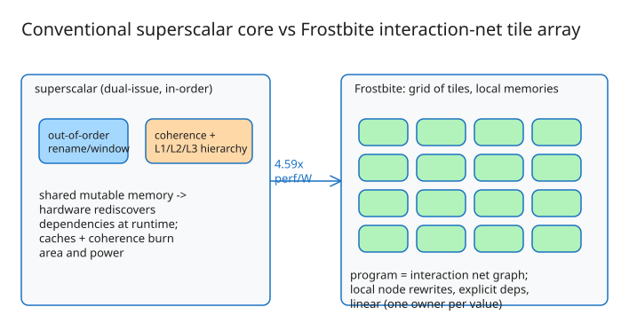

# Frostbite: An AI-Designed CPU on Interaction Nets (4.59x perf/W Claim)

Architect Labs (an AI chip startup) published the design process behind **Frostbite** (working title, not a product name): a **general-purpose CPU designed end-to-end by a swarm of AI agents**, claiming **4.59x performance per watt** over a state-of-the-art dual-issue in-order core that was itself silicon-verified. Claims are vendor-stated; treat as marketing-grade until independent benchmarks appear.

## The architectural bet: interaction nets instead of superscalar machinery

Conventional cores pay for **shared mutable memory** by rediscovering dependencies at runtime: caches, coherence, prefetching, speculation, scoreboard logic — work done in hardware, every cycle, burning area and power. Frostbite drops the whole superscalar apparatus and runs on **interaction nets** (Yves Lafont, 1990): computation as **local rewrites of interacting nodes** — no global shared state, explicit dependencies, locality by construction.

Implementation: a **grid of tiles, each with its own local memory**, no cache hierarchy. The program is **itself an interaction net** — a graph with no cycles, no aliases, and exactly one owner per value (**linearity enforced by the graph**). A step fires when two nodes interact: read their ports, emit new nodes. Dependencies are explicit in the graph, so no runtime scheduler is needed. Instructions are encoded as node types; a tile steps one instruction from its local store, **no scoreboard**. Control flow is **branch elimination**: a condition is evaluated, taken and not-taken paths run in parallel, results selected afterwards (the "select" is an ordinary interaction).

## How the agents designed it (the verification story is the interesting part)

Design and verification were **interleaved, not sequential**:

- **ASL** — an agent-first spec language (a theorem prover in the loop) where each component is a mathematical object; agents state architectural claims as theorems and attempt proofs.
- **Arcmodel** — a performance model in ASL that is ~1–5% accurate against the final design but **~200x faster than RTL**, letting agents iterate at high speed; ASL specs then **lower to executable Rust and synthesizable Verilog** so early claims survive into silicon.
- **Formal proof**: interaction semantics proved in **Lean** (800k+ lines); every instruction formally checked against its ASL semantics; all proofs machine-verified.
- **Vine** — the implementation language (Rust-like, linear-by-default) so linearity is checked at compile time.

The agents ran as **swarms around a shared design workspace** — each with its own context window — coordinating through **the specification itself**: claim a component, write a theorem, try to prove it, and only when it passes can that block be built on. They also ran **real benchmarks** (compression, graph analytics, math kernels, ML, compilers, string processing), and when a benchmark exposed a bottleneck, the agent that owned that part of the design proposed a fix and tested it — architecture and benchmarks co-evolving.

## Evaluation caveat

The 4.59x figure: geometric mean across **25 workloads, 15 of which were not shown to the agents during design** (a genuine held-out set) — compared against a "state-of-the-art dual-issue in-order core, silicon-verified" whose identity is **not disclosed**. No published PPA (area/timing) numbers; RTL, area, timing and ISA are "released over the coming weeks". Independent verification is impossible today.

## Roadmap

An **FPGA playground in the browser** to run the CPU and watch the interaction graph rewrite; a minimal OS + toolchain; a compiler reaching the ISA (with an agent-visible IR); then the RTL and ISA release with the benchmark suite. The stated vision: chip design as **conversation** — "describe a chip in plain English, iterate, get a manufacturable design in days." Worth noting the authors explicitly keep humans on the critical path for product direction and "taste".

## References

- [Architect Labs: 4.59x perf/W — What AI Agents Designed When They Redesigned the CPU](https://architectlabs.com/blog/frostbite)
- [Interaction nets (Wikipedia, Lafont 1990)](https://en.wikipedia.org/wiki/Interaction_nets)
- Related in KB: The last CPU company, RISC-V as CUDA's fourth target
