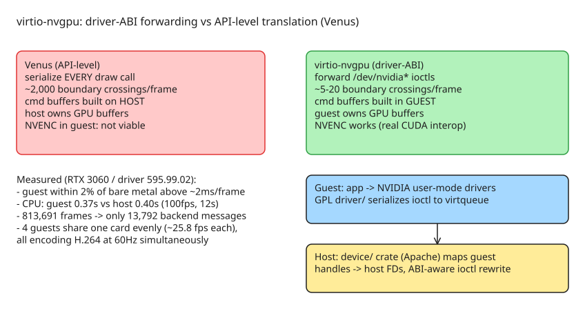

# virtio-nvgpu — Near-Native NVIDIA GPU Access in KVM Guests via Driver-ABI Forwarding

**[Experimental]** A virtio device that gives a Linux KVM guest near-native access to an NVIDIA GPU by forwarding the **NVIDIA kernel driver's ioctls at the driver ABI level**, bypassing graphics-API translation entirely. The guest runs NVIDIA's *own* unmodified user-mode drivers (same Vulkan, same NVENC) talking to the same physical card. Target use case: **headless streaming** — a compositor inside the VM renders, composites and encodes frames on the GPU, then sends compressed video out; the host keeps the card.

## Why existing approaches fall short for this workload

| Approach | Problem |
|---|---|
| **virtio-gpu + Venus** (API-level translation) | Serializes *every* Vulkan/GL call and replays it host-side. Games issue 1,000–5,000 draw calls/frame; at 60 fps the frame budget is 16.6 ms and serialization alone eats 6–18% of it before any GPU work. Host CPU burns on serialize/transport/replay. Guest-side NVENC not viable: GPU buffers are host-owned, so there's no `CUdeviceptr` in the guest without a full CPU readback+copy. |
| **DRM native context** (Intel/AMD) | The right model — guest runs the real driver, builds command buffers locally, only submissions cross the boundary. But it **does not exist for NVIDIA**. |
| **VFIO passthrough** | Native performance and full driver stack in-guest, but dedicates the *whole* GPU to one VM — often unacceptable multi-tenant. |

virtio-nvgpu's key difference: translation happens at the **kernel-driver level** (ioctls to `/dev/nvidia*`), not the graphics-API level. The guest's NVIDIA user-mode libraries build GPU command buffers **locally in the guest**; individual draw calls are never serialized.

## Measured results (RTX 3060, driver 595.99.02)

Guest vs bare-metal host under an identical headless Vulkan load:

| Host frame time | Guest delta |
|---|---|
| 39 ms | −0.4% (within noise) |
| 9.9 ms | −0.7% |
| 2.0 ms | +1.7% |
| 0.5 ms | +7.1% (a wake costs ~0.02 ms; frame is half of one) |
| 0.05 ms | +40.8% |

**Above ~2 ms/frame — every frame a game draws — the guest is within 2% of bare metal.** CPU cost: unpaced at ~100 fps for 12 s, host used 0.40 s vs **guest 0.37 s** — nothing is forwarded in a render loop because NVIDIA's user-mode driver submits through memory it has mapped, and that memory *is* the host's. Over 813,691 frames the backend served only 13,792 messages (~1 crossing per 59 frames, nearly all device setup).

**Multi-tenant:** four guests on one RTX 3060 → 25.84 / 26.49 / 25.57 / 25.79 fps (103.7 total vs 102.9 for a single guest), p50 frame times equal to four decimal places, all four encoding H.264 at exactly 60 Hz with no NVENC session limit reached. Four is what was *run*, not a discovered limit.

## Architecture: what crosses the boundary and what doesn't

```
Guest VM (headless)
─────────────────────
  Game / application
    │ Vulkan or OpenGL
    ▼
  Wayland compositor (guest-side)
    │ composites all windows; CUDA zero-copy import of composed frame
    ▼
  NVENC hardware encoder (guest-side)
    │ H.264/H.265 bitstream (~100 KB/frame)
    ▼
  Stream to remote client

Guest kernel driver (GPL): registers /dev/nvidiactl, /dev/nvidia0..N,
/dev/nvidia-uvm. On ioctl() → serialize request onto control virtqueue.
On mmap() → map shared-memory region with correct caching attributes.
Copies raw bytes; makes NO ABI decisions.

Device crate (Apache-2.0, no VMM in deps): receives requests, maps guest
handles to host device FDs, performs ABI-aware translation of ioctl
parameters (rewriting embedded pointers/FDs), issues them against the
host's devices. Buffer/window bookkeeping lives here.

Events: a second virtqueue runs the other way — host watches each opened
descriptor and signals when it becomes readable; this is how a guest
waiting on the GPU gets woken (without it, the guest polls a descriptor
the kernel reports as permanently ready and spins).
```

Only compressed bitstream leaves for streaming; buffer handles, fences, CUDA device pointers and NVENC sessions are real driver-level resources inside the guest.

## Repository layout — three license zones by design

| Directory | License | What it is |
|---|---|---|
| `driver/` | **GPL-2.0** | Guest kernel module; registers `/dev/nvidia*`, forwards ioctl+mmap over virtqueue. Deliberately not ABI-aware (must touch kernel symbols → GPL). |
| `device/` | **Apache-2.0** | The virtio device as a Rust crate with **no VMM in its dependency list**; every VMM concern is a trait (descriptor chains as Read/Write, event queue, guest/host memory mapping). Optional capabilities degrade rather than fail to build. Layout follows `chromeos/virtio-media`. |
| `isolate/` | Apache-2.0 | **A design note, not code yet** — the sandboxed per-guest helper that will hold real device FDs and issue unprivileged `ioctl(2)`. Today the backend holds them itself in the VMM's process; adopting isolate means inheriting a *process model*, not just a library dep. |
| `gen/` | — | Generated ABI tables, checked in **and** reproducible. |
| `protocol/` | BSD-3-Clause OR GPL-2.0+ | Wire format + ABI definitions shared by both halves; dual-licensed so the GPL driver and Apache crate include the same headers. |

## What works / what's not done (as of disclosure)

**Known to work:** guest enumerates the card (`nvidia-smi` reports real power/memory, `deviceUUID` is the host's); Vulkan renders (`vulkaninfo` exits 0, offscreen draws pixel-correct); a Wayland client presents through an in-guest compositor; NVENC via Vulkan Video on the client's own device; imported buffers are host memory mapped through a shared window.

**Not done:** more than four guests or heavier-than-vkcube-720p loads (eight untried); two cards / two driver versions (RTX A2000 on 615.71.09 renders but is unbenchmarked); CUDA beyond enumeration; the isolate, per-version driver shares and multi-tenant envelope are unbuilt. Shipped ABI profiles: 535.129.03, 580.178.04, 595.71.05 (matched by range; older refused).

## Diagram: API-level vs driver-ABI forwarding



## References

- [nestrilabs/virtio-nvgpu — GitHub repository](https://github.com/nestrilabs/virtio-nvgpu)
- [BENCHMARKS.md — measurement method and what the numbers do not support](https://github.com/nestrilabs/virtio-nvgpu/blob/dev/BENCHMARKS.md)
- [ARCHITECTURE.md — how it works in prose](https://github.com/nestrilabs/virtio-nvgpu/blob/dev/ARCHITECTURE.md)
- [chromeos/virtio-media — layout template (GPL driver beside VMM-agnostic Rust device crate)](https://chromium.googlesource.com/chromiumos/platform/virtio-media/)
