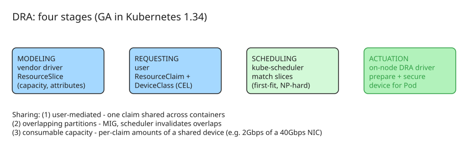

# Kubernetes Device Management: Dynamic Resource Allocation (DRA) GA

The Device Management Working Group (chairs: Kevin Klues/NVIDIA, Patrick Ohly/Intel, John Belamaric/Google) drives **Dynamic Resource Allocation (DRA)**, which [graduated to GA in Kubernetes 1.34](https://kubernetes.io/blog/2025/09/01/kubernetes-v1-34-dra-updates/). This note explains why the legacy device model broke, how DRA's four-stage model works, what the APIs look like, and where the project is heading.

## Why the legacy model is limited

The Device Plugin API treats devices as **opaque integers**: a pod can request "2 GPUs" but cannot say *which* GPUs, how they must be interconnected, whether they can be shared, or how they should be partitioned. Modern AI/ML workloads break that model — they span multiple nodes, need specific interconnect topologies (NVLink domains, 3D tori for TPUs), and increasingly share or partition hardware dynamically. Scheduling under these constraints is **NP-hard**, and DRA's flexibility makes the search space even larger.

## The four-stage model

DRA replaces integer counting with a structured framework split into four stages:

| Stage | Actor | API | What happens |
| --- | --- | --- | --- |
| **Modeling** | Vendor driver | `ResourceSlice` | Drivers advertise granular device capabilities, capacity, and attributes per node |
| **Requesting** | Workload user | `ResourceClaim` (+ `DeviceClass`, `ResourceClaimTemplate`) | Users express hardware needs (GPU memory, interconnect, partitioning) via CEL selectors |
| **Scheduling** | kube-scheduler | — | Matches claims against advertised slices; first-fit over lexicographically sorted slice/pool names |
| **Actuation** | On-node driver | — | "Handshake" that prepares and secures the device for the Pod |

All APIs live in the `resource.k8s.io` group; the stable `v1` version is default in 1.34+. Pod specs gain a `resourceClaims` field.

### Key API kinds

- **`ResourceSlice`** — published by drivers per node: resource pool, devices with attributes/capacity, and which nodes can access them.
- **`DeviceClass`** — an admin-defined category of claimable devices, with inherited selectors and configuration parameters. Requiring a class is the control point: users can only request what an admin has allowed.
- **`ResourceClaim`** — one or more `DeviceRequest`s, each referencing a `DeviceClass` and optionally narrowing via CEL `DeviceSelector` expressions over device attributes.
- **`ResourceClaimTemplate`** — lets Kubernetes generate a per-Pod claim for a workload; the claim is deleted when the Pod terminates.

## Sharing and capacity semantics

Three sharing models, all scheduler-aware:

1. **User-mediated (explicit) sharing** — point multiple containers/Pods at the *same* `ResourceClaim`; the device is shared if it supports it.
2. **Overlapping partitions** — e.g. MIG partitions on NVIDIA GPUs: the slice models the partitions, the scheduler picks one and automatically invalidates overlapping ones. Works with requests like "any GPU with ≥ 20 GB", satisfied by a full GPU or a MIG slice.
3. **Consumable capacity (platform-mediated)** — analogous to Pods sharing a node: each Pod has its own claim asking for an amount (e.g. 2 Gbps of a 40 Gbps NIC); the scheduler allocates slices of the device's total capacity, with `requestPolicy` constraints controlling increments. Drivers advertise this via `allowMultipleAllocations` in `ResourceSlice`; users specify amounts via `capacity` in the claim.

Other expressiveness features: **prioritized alternatives** in device requests ("1× A100 80GB, else 2× A100 40GB") to improve obtainability and utilization, and **extended-resource mapping** so existing `resources.limits`-style workloads can consume DRA devices without modification.

## KEP pipeline (as of 1.36)

| KEP | Feature | 1.33 | 1.34 | 1.35 | 1.36 |
| --- | --- | --- | --- | --- | --- |
| 4381 | Structured parameters | Beta | **Stable** | | |
| 5004 | Extended resource requests via DRA | | Alpha | Alpha | Beta |
| 4817 | Resource claim status | Alpha | Beta | Beta | Beta |
| 5018 | Namespace controlled admin access | | Alpha | Beta | **Stable** |
| 5055 | Device taints and tolerations | | Alpha | Alpha | Beta |
| 4816 | Prioritized alternatives | Alpha | Beta | Beta | **Stable** |
| 5075 | Consumable capacity | | Alpha | Alpha | Beta |
| 4815 | Partitionable devices | Alpha | Alpha | Alpha | Beta |
| 4680 | Resource health status in Pod status | Alpha | Alpha | Alpha | Beta |
| 5007 | Device binding conditions | | Alpha | Alpha | Beta |
| 5729 | ResourceClaim support for workloads (gang-like) | | | | Alpha |

Feature gates to be aware of: `DynamicResourceAllocation` (default-on at 1.34+), plus alpha gates for specific features (`DRAExtendedResource`, `DRAConsumableCapacity`, `DRADeviceBindingConditions`, `DRAResourceClaimDeviceStatus`, `DRAListTypeAttributes`), each required in apiserver, scheduler, and kubelet.

## Cross-SIG coordination

Device management touches scheduling, node operations, autoscaling, networking, and API design — so the WG is a **cross-SIG effort** coordinating five stakeholder SIGs (sig-node, sig-scheduling, sig-autoscaling, sig-network, sig-architecture). The WG owns no code directly; deliverables are KEPs and implementations living in the SIGs. Concretely: a "GPUs that talk via NVLink" requirement spans the scheduler (place pods on the right nodes), the kubelet (configure/expose devices), and the autoscaler (provision the right node type) — designed independently, those become inconsistent abstractions and integration bugs.

## Where this is heading

- **Day-2 operations**: device failure detection and mitigation, health status in Pod status (KEP 4680).
- **Multi-node support**: integration with workload-aware scheduling; devices allocated as groups with interconnect awareness (NVLink domains, 3D tori).
- **Exposing node resources as devices**: RAM/CPU with metadata for topology-aligned scheduling.
- **Creative reuse**: the APIs are general enough to model non-hardware things — e.g. a prototype that schedules pods next to nodes where a large AI model is already cached locally.
- **NVIDIA's DRA GPU driver** is now a community project — a good entry point for contributors.
- **Requirements-driven portability**: users specify what the workload needs, the scheduler figures out how — decoupling workload authors from cluster topology and label conventions.

## Key takeaways

1. DRA GA (1.34, `resource.k8s.io/v1`, default-enabled) is the stable foundation for GPU/TPU/NIC-aware scheduling; drivers and workloads can adopt it without breaking-change risk.
2. The four-stage model (model → request → schedule → actuate) keeps vendor-specific details opaque to core Kubernetes — the scheduler only ever evaluates attributes it doesn't need to understand.
3. Sharing is a first-class concept with three distinct semantics; choose per workload: explicit claim sharing, partition selection (MIG), or consumable capacity (NIC bandwidth slicing).
4. Scheduling with DRA remains NP-hard — the current scheduler finds *a* solution (first-fit), not necessarily the best; optimality is an active research area.
5. Getting involved: `#wg-device-management` on the Kubernetes Slack, biweekly meetings (Tue 8:30 AM PT / Wed 9 AM CET), or contributing to the community-owned NVIDIA DRA driver.

## Diagram: DRA four-stage flow

## References

- [Spotlight on WG Device Management (Kubernetes blog, June 2026)](https://kubernetes.io/blog/2026/06/24/wg-device-management-spotlight-2026/) — original article (interview with the three WG chairs)
- [Kubernetes v1.34: DRA has graduated to GA](https://kubernetes.io/blog/2025/09/01/kubernetes-v1-34-dra-updates/)
- [Dynamic Resource Allocation concepts (Kubernetes docs)](https://kubernetes.io/docs/concepts/scheduling-eviction/dynamic-resource-allocation/)
- [KEP-4381: DRA Structured Parameters](https://www.kubernetes.dev/resources/keps/4381/)
- [WG Device Management project board](https://github.com/orgs/kubernetes/projects/95)
- [Companion KB note: Kubernetes v1.37 Pod Certificates and Cluster Trust Bundles](explanation-k8s-v1-37-pod-certificates-cluster-trust-bundles.md)
- [NVIDIA DRA GPU driver (community project)](https://github.com/kubernetes-sigs/dra-driver-nvidia-gpu) — the community-owned NVIDIA driver referenced above; good entry point for contributors
- [ROCm k8s-gpu-dra-driver](https://github.com/ROCm/k8s-gpu-dra-driver) — AMD GPU DRA driver, useful as a second reference implementation alongside NVIDIA's
