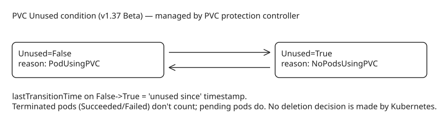

# Kubernetes v1.37 — PVC Last-Used Tracking (`Unused` Condition, Beta)

PersistentVolumeClaims tend to outlive the workloads that created them: when an app is deleted or migrated, its PVC remains behind, consuming storage and increasing cloud costs. Kubernetes **v1.37** graduates the `PersistentVolumeClaimUnusedSinceTime` feature gate from Alpha (v1.36, disabled by default) to **Beta — enabled by default**, so every cluster gets native "when was this volume last used?" data with no custom tooling or cross-referencing of pods and PVCs.

## How it works

The existing **PVC protection controller** in `kube-controller-manager` (which already watches pods to enforce storage object-in-use protection) now also manages a new **`Unused` condition** on each PVC's `.status.conditions`:

| Scenario | Condition status | Reason |
| --- | --- | --- |
| No non-terminal pods reference the PVC | `Unused=True` | `NoPodsUsingPVC` |
| At least one running or pending pod references it | `Unused=False` | `PodUsingPVC` |

Example condition:

```json
{
  "lastProbeTime": null,
  "lastTransitionTime": "2026-09-14T12:03:11Z",
  "message": "No pods are currently referencing this PVC",
  "reason": "NoPodsUsingPVC",
  "status": "True",
  "type": "Unused"
}
```

## Semantics worth knowing

- **Terminated pods don't count**: a pod in phase `Succeeded` or `Failed` does not keep the PVC marked as in use. Batch jobs with `restartPolicy: Never` won't prevent `Unused=True` after they finish.
- **Pending pods do count**: even an unschedulable pod (e.g. impossible node selector) counts — intent to use is enough.
- **Multiple pods**: the condition only flips back to `True` after the *last* non-terminal referencing pod is removed or terminates.
- **"Unused since" for free**: like every Kubernetes condition, it carries `lastTransitionTime`. When the condition transitions `False → True`, that timestamp records exactly when the PVC became idle — no need for Kubernetes to track which pod used it last.
- **Timestamp accuracy caveat**: the value reflects when the *controller observed* no pods using the PVC, not the exact unmount moment at the infrastructure level. Reported idle time may run slightly short of the true figure but should never overstate it.
- **Missing condition** means the feature was recently enabled and no transition has been observed yet (or the PVC hasn't gone through a usage cycle) — absence is not "in use".
- **Disabling the gate** stops updates, but already-set conditions remain stored in etcd and become stale; they are not stripped.
- The condition is purely informational: no other Kubernetes component reads it, so existing workflows that don't explicitly check it are unaffected.

## Finding idle PVCs (the jq query)

List all PVCs unused for more than 30 days across namespaces:

```shell
kubectl get pvc -A -o json | jq -r '
  .items[]
  | select(.status.conditions[]? | select(.type=="Unused" and .status=="True"))
  | select(
      (.status.conditions[] | select(.type=="Unused") | .lastTransitionTime) as $t
      | (now - ($t | fromdateiso8601)) > (30 * 86400)
    )
  | "\(.metadata.namespace)/\(.metadata.name) unused since \(.status.conditions[] | select(.type=="Unused") | .lastTransitionTime)"'
```

Kubernetes deliberately makes **no deletion decision** — cleanup policy is left entirely to the admin (or a controller you write on top of this signal).

## Operational details

- **Metric**: `pvc_protection_controller_unused_condition_syncs_total{result=success|error}` from kube-controller-manager; monitor the error rate as an SLO for the feature.
- **Scale validation** (KEP-5541): on a single-node cluster with 1000 PVCs and 100 pods (each mounting 10 PVCs), all `Unused=False` conditions appeared within ~49 seconds (~21 PVCs/s) with only +3 MB KCM memory during the reconciliation burst.
- **SLO target**: 9% of condition transitions should reflect within 60 s of the triggering pod event; on very large clusters, update delay can make `lastTransitionTime` slightly inaccurate (shorter than reality, never longer).
- **Design choice**: a dedicated status field (`UnusedSince *metav1.Time`) was considered and rejected in favor of a condition — conditions are Kubernetes-idiomatic, reuse existing PVC condition infrastructure, and give tooling standardized fields.

## Status tracking (Nov 2026) & one API-shape gotcha

- KEP-5541 is still **open at stage/beta** — no GA milestone is committed yet (assignee Roman Bednar, sig-storage). The alpha code PR ([k/k #137862](https://github.com/kubernetes/kubernetes/pull/137862)) carried the v1.35 milestone; beta promotion is [k/k #139620](https://github.com/kubernetes/kubernetes/pull/139620) for v1.37. The official docs page confirms: *Beta since v1.37, enabled by default*.
- **Gotcha — it's a condition, not a field**: despite the gate name `PersistentVolumeClaimUnusedSinceTime`, there is **no `status.unusedSince` scalar**. All data lives in `status.conditions[type=Unused]`. Code or policies written against `status.unusedSince` silently match nothing — gate names stick early and describe intent, not final API shape.

## Lifecycle & references

Alpha v1.36 → Beta (enabled by default) v1.37 → GA planned for a future release depending on feedback/adoption.



## Practical takeaways

1. On v1.37+ clusters the condition appears automatically — wire your FinOps/cleanup tooling to `status.conditions[type=Unused]` instead of hand-rolled pod↔PVC cross-referencing.
2. Use `lastTransitionTime` as the idle-age input for GC policies (e.g. alert at 30 days, delete at 90), but remember it can understate true idle time on very large clusters.
3. Absence of the condition is not a signal — only act on explicit `True`.

## References

- **KEP-5541 tracking issue**: https://github.com/kubernetes/enhancements/issues/5541
- [Kubernetes docs: Persistent Volumes — Unused condition](https://kubernetes.io/docs/concepts/storage/persistent-volumes/)
- [Kubernetes Blog: v1.37 PVC last-used tracking (Beta)](https://kubernetes.io/blog/2026-09-21/kubernetes-v1-37-pvc-last-used-time/)
- [KEP-5541: Report Last Used Time On a PVC](https://www.kubernetes.dev/resources/keps/5541/)
- [PR #139620: Promote PersistentVolumeClaimUnusedSinceTime to Beta](https://github.com/kubernetes/kubernetes/pull/139620)
- [Kubernetes v1.37 release notes (Garhwal)](https://kubernetes.io/blog/2026-08-26/kubernetes-v1-37-release/)
