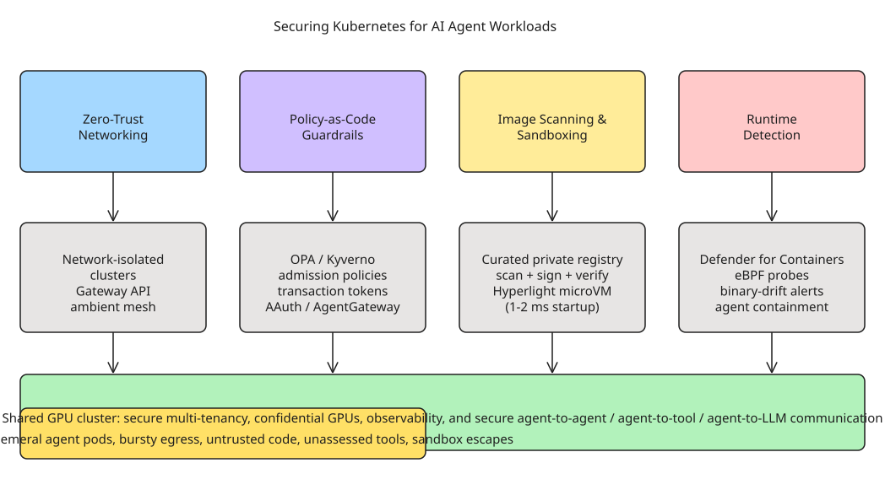

# Securing Kubernetes for AI Agent Workloads: A Four-Control-Plane Model

Securing Kubernetes has always spanned access control, image vulnerabilities, secrets, and networking — but **AI workloads expand the attack surface** with new behaviors, traffic patterns, and risks. Two years ago a cluster ran microservices (persistent apps, predictable CPU). Now it runs **agents**: dynamic, ephemeral processes on GPU nodes generating bursty, unpredictable traffic that frequently needs egress — and standard **Kubernetes NetworkPolicy lacks the granularity and visibility to handle it**.

Agents copy or generate untrusted code, discover and invoke tools you haven't assessed (or whitelisted), spin up sub-agents/skills/MCP clients, and chain unexpected calls to unfamiliar APIs. On top of that, the infrastructure now includes **scarce, expensive GPUs** that are almost certainly **shared** with other users. Tackling this requires an architecture that enforces security across **four control planes**, starting with the network. The full defense-in-depth picture (network → policy → supply-chain → runtime, over a shared-GPU substrate) is captured in the companion diagram below.

:::

## 1. Zero-trust networking (bootstrap → agent hops)

Even on a managed service like **Azure Kubernetes Service (AKS)**, standard clusters have **unrestricted outbound access by default**. AKS is moving to a more secure default: **network-isolated clusters** bootstrap with **no outbound dependencies on the public internet** unless you explicitly enable them.

- **No-egress bootstrap**: you can use **private endpoints** to pull all images from a private Azure Container Registry, so the platform is designed so there's no unexpected data exfiltration.
- **Private Link** (improved network acceleration) connects to Azure Key Vault or ships metrics/logs to Azure Monitor, keeping telemetry and secrets off the public network — suitable for fully air-gapped environments.
- **Gateway API** adoption plus **Azure Kubernetes Application Network** (preview) simplifies **ambient service mesh** (managed Istio) for a consistent way to control/monitor east-west and north-south traffic.

Key idea (Toddy Mladenov): *"Network routes you establish on the cluster control where agents can go to get tools, get packages, or get knowledge."* If the cluster can't see public registries and APIs, agents have fewer opportunities for unwanted behavior.

## 2. Policy-as-code for guardrails and governance

You can't predict every AI behavior, but you can **enforce declarative policies** governing agent-to-agent, agent-to-tool, and agent-to-LLM communication:

- **Admission policies/engines** such as **OPA** and **Kyverno** handle the granularity of *which agent, in which transaction, using which identity, is allowed to deploy which workload, call which tool, which data sources count as sensitive, and when to involve a human*.
- **Transactional (not one-time) authorization**: agent chains call agent-to-tool-to-agent, so authorization must be done *in the context of the transaction*, stitching the whole agent/sub-agent/tool interaction.
- **Transaction tokens** (IETF draft) and **AAuth** cover the whole lifecycle — not just the cluster but the workloads and their communication. The **AgentGateway** project (Istio as control plane) provides a routing layer for connections that stay open while agents generate bursty, multi-request traffic. **kontxt** is an open-source implementation of the IETF Agentic Authorization (OAuth + transaction tokens) for zero-trust agent-to-agent communication with declarative authorization over the entire identity chain.

## 3. Image scanning and provenance validation

Policies should cover which registries agents can pull images/libraries/tools from, how new tools are approved, and which APIs/data sources are sensitive. *"If you don't restrict the perimeter, agents can decide to go pull a tool from any registry they find convenient."*

- **Restrict to a single approved, curated registry within the VNet**, then apply continuous scanning for vulnerabilities, missing patches, outdated dependencies, malware, and exposed secrets. Public-registry images can be **quarantined, scanned, signed, verified, and (if needed) updated** before reaching production. Azure Container Registry supports RBAC and can **lock its artifact cache to another ACR registry** as upstream.
- **Lifecycle metadata** (machine-readable provenance + vulnerability reports) enables automated patching and admission-controller blocking of unsuitable images.
- **Sandboxes**: **Cloud Hypervisor** improves **Kata containers** performance, but spinning up a sandbox per Python script doesn't scale to thousands of agents. The **Hyperlight** runtime executes single-purpose apps in **hardware-isolated VMs** with a minimal memory footprint and **1–2 ms startup latency** — cheap enough to make a sandbox environment mandatory and treat all agent code as untrusted by default.

## 4. Runtime anomaly detection tuned for agentic behavior

Even with policy guardrails, agents behave unexpectedly. AKS integrates **Microsoft Defender for Containers** for runtime protection using **eBPF and other low-level probes**, raising alerts for **binary drift** (agents running code not in the original container), suspicious network access, and process behavior.

The catch: network/file-system monitoring covers *known* traffic patterns for long-lived workloads, but ephemeral agent workloads spin up pods dynamically. Anomaly detection must work at a higher level — it's not just misbehaving pods, but **agents repeatedly creating short-lived pods that immediately attempt sandbox escapes or brute-force databases**. Shutting down one pod doesn't help if the next shows the same behavior; **the agent itself needs to be contained**.

## 5. Protection in production: GPU multi-tenancy

Balancing isolation and utilization on scarce, expensive GPUs is complex. If you don't know how to **securely partition a GPU** into multiple instances, the direct high-speed connections between GPU nodes can degrade performance for other workloads or even leak data. **Confidential GPUs** (for running the most sensitive data) are still a **preview feature** for Kata and require you to handle key management.

Moving from proof-of-concept to production requires dealing with **observability, high-performance sandboxes, secure GPU multi-tenancy, and securing agent-to-agent communication**.

## Broader landscape (cross-referenced)

The four-plane model is echoed across the ecosystem:

- **Sandboxing runtimes**: **gVisor** (user-space kernel, fastest, software boundary), **Kata Containers** (per-pod guest kernel), and **Firecracker** (~50k LoC Rust, &lt;125 ms boot, &lt;5 MiB overhead, ~150 microVMs/sec/host) are the three isolation options; upstream **kubernetes-sigs/agent-sandbox** (late 2025) adds `Sandbox`/`SandboxTemplate`/`SandboxClaim`/`SandboxWarmPool` CRDs with warm pools to hide the ~1 s pod-start overhead.
- **Enforcement + detection products**: **Tigera Lynx** (agent discovery/identity/authorization + eBPF auto-discovery + Cedar default-deny policies + Istio ambient mesh), **ARMO** (GKE `Agent Sandbox` CRD + managed gVisor + eBPF behavioral baselines), and **Mitos** (microVM-in-pod "husk" design, in-pod egress filter blocking `169.254.169.254`).
- **A concrete, high-value rule** for any agent namespace: **block egress to `169.254.169.254`** (the cloud metadata server) — the classic hop from sandbox escape to stolen IAM credentials.

The unifying insight: a new inference/agent stack brings new security challenges and new controls, and the work of hardening the platform for agents "pays dividends" for traditional workloads too — a single cluster can host multi-tenant apps where *all* follow strong security practices because the platform enforces them.

## Key takeaways

1. **Agents change the threat model**: ephemeral, bursty, untrusted — standard NetworkPolicy and signature-based runtime detection are insufficient.
2. **Secure all four planes**: network (network-isolated, no-egress default), policy (OPA/Kyverno + transaction tokens), supply chain (curated registry + scan/sign + fast microVM sandboxes), and runtime (eBPF + agent-level containment).
3. **Contain the agent, not just the pod**: repeated short-lived sandbox-escape attempts signal the *agent* is the unit of containment.
4. **GPU multi-tenancy is a first-class security concern**: secure partitioning and confidential GPUs, plus blocking the cloud metadata endpoint, are non-negotiable in production.

## References

- [How to secure Kubernetes in the age of AI workloads (Mary Branscombe, The New Stack)](https://thenewstack.io/securing-kubernetes-ai-agents/)
- [Azure network-isolated clusters](https://learn.microsoft.com/en-us/azure/aks/concepts-network-isolated)
- [Azure Kubernetes Application Network](https://learn.microsoft.com/en-us/azure/application-network/)
- [AgentGateway (Istio control plane for agents)](https://github.com/agentgateway/agentgateway)
- [kontxt — open-source IETF Agentic Authorization (OAuth + transaction tokens)](https://github.com/aramase/kontxt)
- [Hyperlight — VM-based security for functions at scale](https://opensource.microsoft.com/blog/2024-11-07/introducing-hyperlight-virtual-machine-based-security-for-functions-at-scale/)
- [Confidential GPUs on AKS (H100 onboarding)](https://github.com/Azure/az-cgpu-onboarding/blob/main/docs/Confidential-GPU-H100-AKS-Onboarding.md)
- [Tigera Lynx — AI agent security for Kubernetes](https://www.tigera.io/tigera-products/lynx/)
- [ARMO — AI agent security framework on GKE](https://www.armosec.io/blog/implement-ai-agent-security-framework-gke/)
- [Mitos — secure AI sandboxes on Kubernetes](https://mitos.run/blog/ai-sandboxes-on-kubernetes)
