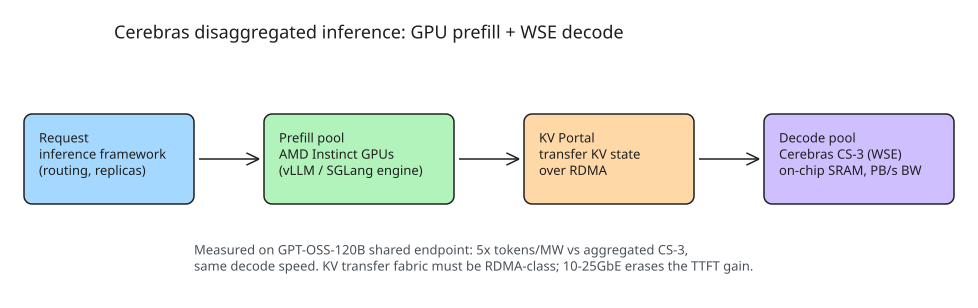

# Cerebras Disaggregated Inference: GPU Prefill + Wafer-Scale Decode for 5x Tokens per Megawatt

## Overview
On 17 Nov 2026 Cerebras announced a production **disaggregated inference** deployment: GPUs handle prompt processing (prefill) and Cerebras Wafer Scale Engines handle response generation (decode). In a production deployment on the Cerebras Inference Cloud (shared GPT-OSS-120B endpoint, measured 14 Nov), pairing AMD Instinct GPUs for prefill with CS-3 systems for decode delivered **5x the throughput per megawatt** of a CS-3-only (aggregated) configuration, with no loss in token generation speed. The economic driver is stark: Goldman Sachs research cited in the post projects AI inference demand growing **24x by 2030** while datacenter capacity grows only **2.2x** — so tokens-per-megawatt is the binding constraint for interactive/agentic workloads (Muse, Copilot, Codex).

## Why split prefill from decode
An inference request has two stages with opposite hardware profiles:
- **Prefill** processes the whole prompt and produces intermediate model state (KV cache). It is compute-bound and batch-friendly — good fit for GPUs.
- **Decode** is autoregressive: one token at a time, each step re-reading model weights from memory. It is memory-bandwidth-bound, so SRAM-centric chips win — Cerebras claims tens of GB of on-chip SRAM and tens of PB/s of bandwidth on a single wafer, **350x the SRAM capacity and 5,400x the memory bandwidth of a typical GB300 GPU**. More layers + more concurrent requests fit on-chip, which is what enables ultrafast decode.

Other split axes exist (draft–target, attention–FFN), but prefill–decode separation is the one that optimizes for highly interactive generation: each pool is sized and hardware-matched independently. This is the same architecture research popularized by DistServe (goodput-optimized PD disaggregation) and now productized in stacks like llm-d and vLLM's disaggregated serving — with the twist that the decode pool is a wafer-scale system instead of GPUs.

## Production results
- Baseline: aggregated CS-3-only serving of GPT-OSS-120B.
- Disaggregated: AMD Instinct GPUs prefill, CS-3 decode.
- Outcome: **5x throughput/MW at identical decode speed** — more revenue-capable tokens from the same power budget. Cerebras plans to roll this out across hundreds of MW in its cloud and partner datacenters by end of 2027.

## Partner deployment architecture
Partners deploy co-located prefill accelerators + Cerebras systems on a unified network, either via:
1. **End-to-end disaggregated software stack** (fastest time-to-market):
   - Disaggregated inference framework — routes requests between prefill and decode pools, manages replica capacity and health.
   - Prefill engine built on open-source engines (vLLM or SGLang).
   - Cerebras decode engine.
   - **KV Portal** — Cerebras software that transfers intermediate model state (KV caches) between prefill and decode engines **over RDMA**.
2. **Decode-only SDK** (maximum control): bring your own framework and prefill engine; you get the Cerebras decode engine + KV Portal, plus dev aids (mock Cerebras decode replica, reference integration with an open-source disaggregated framework).

Early-access partners: Amazon Web Services, Fireworks AI, Gimlet Labs, General Compute.

## Diagram: disaggregated request flow

## Relevance to Our Domain
PD disaggregation is becoming the default serving architecture; this announcement validates the hardware-heterogeneous variant (GPU prefill / non-GPU decode) in production, and adds two concrete design points for our own stacks: (1) KV transfer needs RDMA-class fabric (matching DistServe findings that 10–25GbE transfers erase the TTFT benefit), and (2) the "bring your own prefill, buy decode-only SDK" split mirrors how vLLM/llm-d separate router, prefill engine, and KV transfer. See also [[explanation-callo-invalidated-kv-speculative-decoding]] (reusing invalidated KV under PD disaggregation) and [[reference-kvcompass-prefix-cache-discovery]].

## References
- Cerebras announcement: [Cerebras Launches Disaggregated Inference](https://www.cerebras.ai/blog/cerebras-launches-disaggregated-inference)
- Prior art (prefill/decode split): [DistServe (LLMServe GitHub)](https://github.com/LLMServe/DistServe)
- Open-source PD disaggregation: [llm-d disaggregated serving](https://llm-d.ai/docs/dev/architecture/disaggregation/pd-disaggregation)
