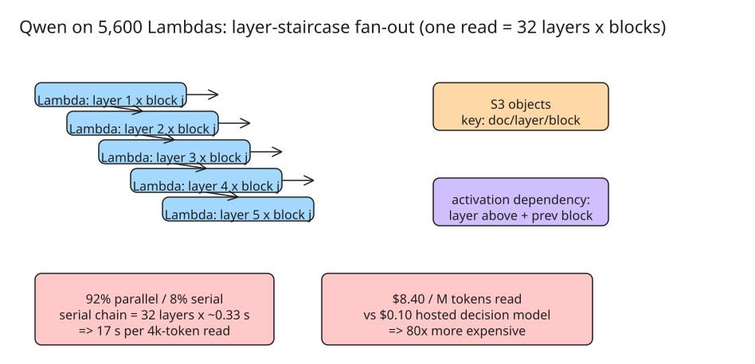

# Splitting a 9.3 GB Transformer Across 5,600 AWS Lambdas: Why CPU Fan-Out Inference Loses 80x

A hands-on negative result: can AWS Lambda — brilliant for massively parallel CPU fan-out (ffmpeg, video rendering à la Remotion) — serve LLM inference without GPUs? The answer is *yes, mechanically; no, economically*. The build succeeds at splitting one model call into **5,600 Lambda invocations**, and then costs **$8.40 per million tokens read versus $0.10 for a hosted decision model — more than 80x more expensive**. The value of the post is the concrete architecture and the arithmetic of why it fails.



## The setup

- **Model**: H2O-Lightning (a Qwen3.5-4B fine-tune), 9.3 GB — chosen because a *decision model* (read a document, pick one option, single forward pass) is the most parallel-friendly workload: no autoregressive decode loop.
- **Constraint**: Lambda's 3 GB memory limit. The model does not fit — but it has **32 layers of ~225 MB each, and one layer fits**. So the unit of parallelism becomes *one Lambda job per (layer, token-block)*.

## The architecture: a staircase 32 layers deep

Each Lambda is a simple idempotent API — read inputs from S3, do the math, write one object back:

```python
x       = load(f"{doc}/{layer - 1}/{block}")   # activations from the layer above
memory  = load(f"{doc}/{layer}/{block - 1}")   # my layer, previous block

y, memory = model.layers[layer](x, memory)

s3.put_object(
    Key=f"{doc}/{layer}/{block}",
    Body=pack(y, memory),
)
```

Dependencies: each job waits on **the layer above for the same block** and **its own previous block**. Each layer starts about a third of a second after the layer above — a staircase 32 layers deep. One read of a ~4,000-token document = 32 layers × token blocks ≈ **5,673 Lambda jobs**.

The honest parallelism accounting: **92% of the work parallelizes, 8% is serial** — and the serial chain (32 dependent layers) dominates wall-clock time. Result: **17 seconds to read ~4k tokens**.

## The bill: where the 80x comes from

| | This build (5,600 Lambdas) | Hosted decision model (Gemini Decision 1) |
|---|---|---|
| Cost per M tokens read | **$8.40** | $0.10 |
| Read of 4,000 tokens | 17 s / 3.4 ¢ | — / 0.04 ¢ |

Three takeaways the author draws out:

1. **Model engineering is easy in 2026** — an application developer could poke at layers and the transformers API directly; open models behave "just another API" with good devex.
2. **You need a GPU** — one layer over a few thousand tokens is a big matrix multiply, which is exactly what GPUs are built for and what Lambda CPU cores are not.
3. **Freedom ain't free** — CPU still costs dollars; there is no serverless arbitrage hiding in LLM inference.

## Design lessons for serverless inference

- **Granularity ≠ parallelism**: 5,600 invocations look impressive, but Amdahl's serial 8% (the 32-layer dependency chain, ~0.33 s/layer) sets a ~17 s floor no amount of fan-out removes.
- **S3 as the activation bus** adds per-hop read/write latency and cost on top of the compute — each edge in the staircase is an S3 round-trip.
- Per-layer splitting only *works* when weights fit per invocation (225 MB ≪ 3 GB); it fails economically when the math per invocation is a dense matmul on CPUs.
- Compare with GPU-backed serverless approaches that attack the same cold-start/cost problem properly (see See also).

## See also

- `explanation-trnrt-nki-megakernels-trainium.md` — the *right* way to do serverless-flavoured serving on AWS: fused kernels on accelerators.
- `how-to-fast-serverless-llm-cold-starts-cairn.md` — serverless LLM cold starts via shared/prewarmed startup work.
- `explanation-modelless-multi-tier-serverless-llm-inference.md` — multi-tier serverless LLM inference design.

## References

- [Serving Qwen via 5,600 Lambdas for fun and 80x negative profit — Noah Lindner](https://noahbuilt.it/writing/qwen-on-5600-lambdas)
- [H2O-Lightning-4B on Hugging Face](https://huggingface.co/h2oai/h2o-lightning-4b)
