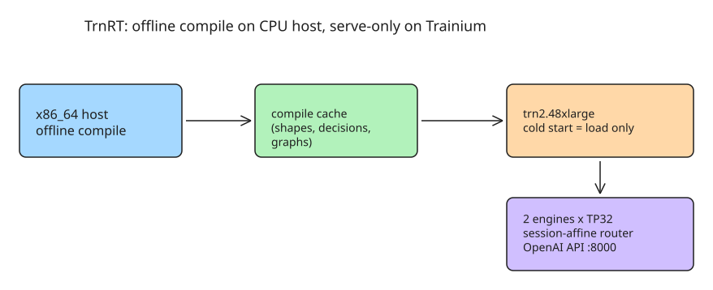

# TrnRT: NKI Megakernels Bring Open-Source LLM Serving to AWS Trainium2

## Overview
TrnRT (Apache-2.0, by RunAnywhere, ~1.6k stars) is the first serious **open LLM inference engine for AWS Trainium2**. It serves an OpenAI-compatible API from a single `trn2.48xlarge` instance (16 chips, 96 GiB HBM each, Neuron SDK 2.32 / neuronx-cc 2.27, Python 3.13). The flagship result, measured on [SemiAnalysis AgentX](https://github.com/SemiAnalysisAI/agentx-harness) (replays of real coding-agent sessions, 32 concurrent agents, 1M-token context): **3.57M tokens/min at decode batch 12**, a 24 ms batch-8 decode step, and **$0.040 per million tokens at spot pricing** ($0.167 on a capacity block). The first supported model is **GLM-5.3-Flash** (320B MoE, 18B active params, FP8, 1M-token context).

This matters because Trainium has lacked an open serving stack comparable to vLLM/SGLang on NVIDIA. TrnRT shows that hand-written [Neuron Kernel Interface (NKI)](https://awsdocs-neuron.readthedocs-hosted.com/en/latest/general/nki/index.html) kernels — one megakernel per layer half — close much of that gap on non-NVIDIA silicon.

## Why megakernels on Trainium
Decode is dominated by many small kernels launched per step; on Trainium the NeuronCore scheduler makes kernel-launch and inter-kernel data movement expensive. TrnRT fuses each decode step into roughly **one kernel per layer half**, covering:
- **KDA attention** (Kimi Delta Attention variant)
- the **fused DSA layer** (deepseek-style sparse attention: top-2,048 of the KV pages)
- **mHC** (manifold-constrained hyper-connections)
- the **MoE FFN**

This is the same megakernel trend seen in Llama.cpp's `llama-batched-bench` megakernel experiments and the NKI Library's experimental "Transformer TKG megakernel" shipped in Neuron SDK 2.29 — TrnRT is the first production-scope engine built entirely around it for Trainium.

## Architecture decisions
- **Two engines per box**: each engine is tensor-parallel over 32 logical NeuronCores, behind a **session-affine router** (`extra_body={"session_id": ...}` keeps a conversation on one engine's prefix cache).
- **Prefix cache across tiers**: a radix tree over **FP8 KV pages**, plus a **host-memory tier** for evicted pages and state checkpoints — device memory stays hot for active sessions.
- **1M-token context via bounded state**: sparse attention (top-2,048) plus linear attention keeps attention state fixed-size instead of growing with context.
- **Offline compile**: every computation graph is built on a plain x86_64 CPU host (no NeuronCore needed); the serving box loads precompiled artifacts and "compiles nothing by default". This decouples the hours-long compilation pipeline from the expensive accelerator.

## Workflow (from the quickstart)
```shell
# 1. Build the image (Neuron SDK 2.32, Python 3.13)
git clone https://github.com/RunanywhereAI/trnrt.git && cd trnrt
docker build -f docker/Dockerfile \
  --build-arg TRNRT_VERSION=$(python3 -c 'import trnrt; print(trnrt.__version__)') \
  --build-arg TRNRT_REVISION=$(git rev-parse HEAD) -t trnrt .

# 2. Build the compile cache (any x86_64 host, takes hours)
trnrt compile shapes     zai-org/GLM-5.3-Flash --revision $REV --out $OUT
trnrt compile decisions  --model zai-org/GLM-5.3-Flash --revision $REV --out $OUT
trnrt compile capture    --out $OUT -- --model $OUT/shapes
trnrt compile compile    --out $OUT --work-root $OUT/work
trnrt compile strip      --out $OUT

# 3. Serve on the trn2.48xlarge
docker run --rm --privileged --network host --ipc=host \
  -v /data/trnrt/cache:/cache -v /data/trnrt/nki:/var/tmp/nki-intermediate-cache \
  -v /models/GLM-5.3-Flash:/model -e NEURON_LIBTORCH_CACHE_ROOT=/cache \
  trnrt serve --model /model --port 8000
```
Calling it is a stock OpenAI client against `http://localhost:8000/v1`, including streaming, tool calls and reasoning output.

## Benchmark table (AgentX, one trn2.48xlarge, 1M context, 32 agents)
| Decode batch | Tokens/min | Decode tok/s per user (p50) | First token, cached (p50) | $/M tokens (spot) |
| --- | --- | --- | --- | --- |
| 4 | 2.36M | 46.6 | 76.73 s | $0.061 |
| 8 | 3.02M | 29.4 | 28.82 s | $0.047 |
| 12 (default) | 3.57M | 22.3 | 6.53 s | $0.040 |

Spot price $8.60/h (us-east-2, 3 Nov 2026); on a capacity block ($35.76/h) batch 12 costs $0.167/M tokens. Verification status is unusually rigorous for a young project: graph equivalence EQUAL on all 32 ranks across all 157 default-config graphs, and byte-identical outputs on 384/384 requests versus the benchmarked build.

## Diagram: offline-compile to serving pipeline



## When this matters
- **Cost-driven inference**: at $0.040/M tokens (spot) TrnRT pricing undercuts most managed open-model APIs for agentic workloads, if you can operate a trn2.48xlarge.
- **Non-NVIDIA strategy**: the offline-compile split is the pattern to copy on any accelerator with a slow compiler — cache artifacts like build outputs, keep the accelerator on the serving path only.
- **Caveats**: single model supported today (GLM-5.3-Flash), single instance type, benchmark measured on an earlier build, and cached first-token latency (6.5–77 s p50) shows prompt processing, not decode, is the current latency wall — consistent with [Cerebras-style prefill/decode disaggregation](explanation-cerebras-disaggregated-inference-wafer-decode.md) being the longer-term fix.

## References
- [TrnRT repository](https://github.com/RunanywhereAI/trnrt)
- [Build blog post: Serving GLM-5.3-Flash on one Trainium2 box with NKI layer megakernels](https://runanywhere.ai/blog/glm-5-3-flash-trainium2-nki-megakernels)
- [AWS Neuron docs — NKI](https://awsdocs-neuron.readthedocs-hosted.com/en/latest/general/nki/index.html)
- [Neuron SDK 2.29 release notes (NKI out of beta, TKG megakernel)](https://aws.amazon.com/about-aws/whats-new/2026/04/announcing-neuron-2-29/)
- [SemiAnalysis AgentX harness](https://github.com/SemiAnalysisAI/agentx-harness)
