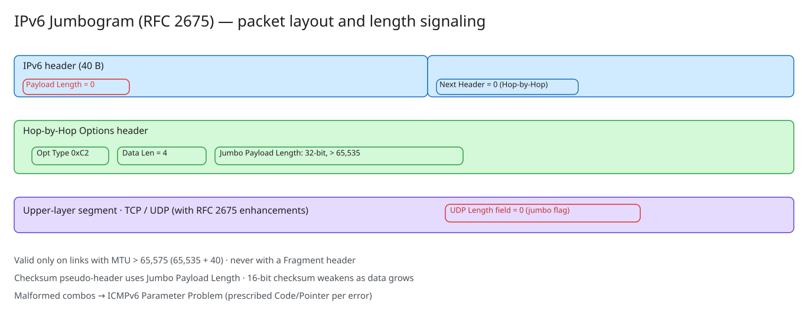

# IPv6 Jumbograms (RFC 2675): Escaping the 65,535-Byte Payload Limit

The IPv6 header carries a **16-bit Payload Length field**, capping any IPv6 packet at 65,535 bytes of payload. RFC 2675 (Standards Track, August 1999; Borman, Deering, Hinden — obsoletes RFC 2147) defines the **Jumbo Payload option**, a hop-by-hop option with a 32-bit length field that raises the ceiling to **4,294,967,295 bytes** — but only where it can possibly work: links with a **link MTU greater than 65,575 octets** (65,535 + the 40-byte IPv6 header). Nodes that never attach to such links need not implement or even understand jumbograms.



## The option format

Carried in the **Hop-by-Hop Options header**, immediately after the IPv6 header (4n + 2 alignment):

```text
 IPv6 header            Hop-by-Hop Options header
+-----------------+    +---------+---------+---------------------+
| Payload Length  |    | Opt Type| Data Len| Jumbo Payload Length|
|     = 0x0000    |    |  0xC2   |   0x04  |    32-bit unsigned  |
+-----------------+    +---------+---------+---------------------+
```

- **Option Type `0xC2`**, Opt Data Len `4`.
- **Jumbo Payload Length**: length excluding the IPv6 header but *including* the Hop-by-Hop header and any other extension headers; must be **> 65,535**.
- In every jumbogram, the IPv6 header's own Payload Length field **must be zero** — the zero + Next-Header=Hop-by-Hop combination is the trigger for a jumbo-aware node to read the real length from the option.
- **Must not be used with a Fragment header.**
- Upper-layer checksum pseudo-headers that use the IPv6 Payload Length must instead use the Jumbo Payload Length.

Nodes must validate a specific error matrix (Payload Length 0 without the option; option present with Payload Length ≠ 0; Jumbo Length &lt; 65,536; option + Fragment header) and report violations via **ICMPv6 Parameter Problem** with prescribed Code/Pointer values. Non-jumbo-aware nodes hitting an erroneously delivered jumbogram respond per the generic hop-by-hop option rules — which is exactly why the MTU rule exists: on configurable-MTU links you must not set MTU > 65,575 unless all attached nodes understand the option.

## TCP and UDP enhancements

The option alone is not enough — both transports have their own 16-bit constraints:

- **UDP** has a 16-bit Length field. Jumbogram rule: when UDP header + data exceeds 65,535 bytes, **set the Length field to zero** (previously an illegal value, since minimum UDP length is 8) and let the receiver derive the true length from the IPv6 payload length.
- **TCP** has no length field, but the **MSS option** and the **Urgent Pointer** are both 16-bit. The RFC specifies the corresponding TCP changes (building on the window-scale approach of RFC 1323, *TCP Extensions for High Performance*) so these fields are interpreted correctly for jumbo segments.

An explicit caveat in the RFC: the **16-bit TCP/UDP checksum becomes less accurate as the checksummed data grows** — application designers carrying 4 GB datagrams should not rely on it as a strong integrity check.

## Why you have (almost) never heard of them

Jumbograms are a **link-local-scale tool**, not an internet-wide mechanism: Path MTU Discovery (RFC 1981) across heterogeneous networks caps you at the smallest link MTU, so a 65,575+ byte packet only survives inside controlled high-MTU domains (dedicated datacenter backbones, HPC fabrics). Host stacks historically implemented RFC 2675 selectively — Linux support, where present, was opt-in and largely unmaintained — and no mainstream network path advertises such MTUs. The RFC's own framing is honest about this: the option "need not be implemented or understood" by ordinary nodes. The lasting value of reading it today is conceptual: it is a clean case study in how a fixed-width field (16 bits) in a base header becomes a protocol ceiling, and how extension options + "magic zero" signaling (Payload Length = 0, UDP Length = 0) retrofit around it without breaking the original parser contract.

## Related

- [[explanation-icmp-ping-limitations-availability]] — same family: what link/ICMP behavior does and does not prove about reachability
- [[explanation-isis-vs-ospf-design-tradeoffs]] — under the high-MTU domains where jumbograms are even theoretically viable

## References

- [RFC 2675: IPv6 Jumbograms — RFC Editor](https://www.rfc-editor.org/info/rfc2675/) — the normative text (option format, error matrix, TCP/UDP changes)
- [RFC 2675 on the IETF Datatracker](https://datatracker.ietf.org/doc/html/rfc2675) — status and related drafts (merges RFC 1883's option spec and RFC 2147's transport changes)
