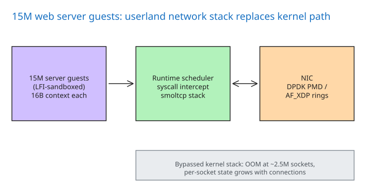

# Running 15M Web Servers on One VM: smoltcp, DPDK and AF_XDP Userland Networking

A systems experiment: fit **15 million tiny web servers** (one per ~half the world's population) on a single VM with 10 GB RAM and 1 CPU core. Every bottleneck hit — ports, memory, kernel network stack — is solved by moving control into userland.

## The minimal web server and its limits

Stripped to the essential syscalls (`listen`, `accept`, `recv`, `send`, `close`), a ~15-line C server doing `HTTP/1.0 200 OK` reaches ~65k RPS. Scaling *instances* hits three walls:

1. **Port exhaustion** — a listening server is identified by the tuple `(protocol, IP, port)`. Ports are `u16` (65 535 max); the ephemeral range `net.ipv4.ip_local_port_range = 32768 60999` is even smaller; UDP+TCP on the same port doubles the count to ~128k. The 65k ceiling is a TCP-standard constraint — widening ports in the kernel wouldn't help normal clients.
2. **Address space** — the fix is **AnyIP**: listen on a whole subnet. On IPv6, one command gives an entire `/64`:
   ```bash
   sudo ip -6 route add local 2001:db8:1234:5678::/64 dev lo
   ```
   Each guest shifts a base IP by its index (`htonl(first_ip + i)`) — 18 quintillion addresses.
3. **Process memory** — one server process costs ~1.5 MB → 15M processes need ~20 TB RAM.

## Custom runtime: 16 bytes per guest

The answer (as with running millions of V8 guests in one process) is a **userland scheduler** with **LFI** ([Lightweight Fork-based Isolation](https://www.scs.stanford.edu/~zyedidia/docs/papers/lfi.pdf), a sandboxing technique) for memory isolation. LFI replaces every syscall with a call into the host handler, so I/O is implemented entirely by the runtime — a "micro OS" that switches the CPU between guests.

The suspendable loop `accept → recv → send → close` has only two state variables (`server`, `client` fds), so the minimum saved context is:

```c
struct Context {
    pc: u64,        // instruction address to return to
    fd_server: i32, // server file descriptor
    fd_client: i32, // client file descriptor
};
```

16 bytes × 15M guests ≈ **220 MB** (8 bytes feasible with bit packing). With idle TCP connections costing ~0 bytes and ~5 KB per active connection (1M active assumed ≈ 5 GB), the RAM budget closes on paper.

## Replacing the kernel network stack

The kernel stack OOMs at ~**2.5M** servers and RPS *drops* as more servers run — per-socket kernel state dominates. The concrete culprit: the bare `socket()` syscall allocates **~3,300 bytes per socket** whether it is active, listening, or idle — just 10M idle listening sockets OOM a 10 GB VM. The AnyIP path is also effectively **IPv6-only economics**: VPS providers hand out a whole `/64` free (18 quintillion addresses), while an equivalent 15M-address IPv4 subnet would cost ~$250M. Replacing the stack with a userland one changes the economics:

- **smoltcp** (Rust TCP/IP stack): implement its `phy::Device` trait (3 methods) for full control, or use `rust-dpdk-net` (DPDK) / `xsk-rs` (AF_XDP) crates.
- **DPDK**: full userspace drivers, polling mode drivers, zero kernel involvement per packet — best in the benchmark.
- **AF_XDP**: kernel-side eBPF-based fast packet path to userland rings — just behind DPDK.

Measured: with smoltcp + DPDK, idle server costs **620 bytes** and an active connection ~1 KB — the experiment reached **16M servers**.

The final flow: runtime loads 15M guests → scheduler executes them one by one → guest syscalls are intercepted and served by the smoltcp stack and its DPDK/AF_XDP adapters → scheduler polls the stack for incoming data, wakes the owning guest, processes, switches.



## Key takeaways

- Kernel per-connection overhead, not raw CPU, is what caps massive-fanout servers; moving the stack to userland gives you direct control over bytes-per-connection.
- `(protocol, IP, port)` tuple + AnyIP subnets remove the port-count ceiling without hardware changes.
- A specialized runtime can amortize guest state to tens of bytes when the workload's suspendable state is tiny — the same trick behind million-tenant edge runtimes.
- Caveat from the author: a POSIX-compatible runtime reimplementing all syscalls is the hard part; this is a proof of concept.

## References

- [15 million web servers on one VM — smoltcp, DPDK, AF_XDP (kapteko)](https://kapteko.com/15-million-webservers/)
- [Same series: Running 10 million Codex CLIs on one server — LFI processes (kapteko)](https://kapteko.com/running-10-million-codex-clis-on-one-server-lfi-processes)
- [Same series: Userland Linux scheduler in Rust (kapteko)](https://kapteko.com/userland-linux-scheduler-in-rust)
- [LFI: Lightweight Fork-based Isolation paper (Stanford SCS)](https://www.scs.stanford.edu/~zyedidia/docs/papers/lfi.pdf)
- [Understanding Delays in AF_XDP-based Applications (arXiv 2402.10513 — latency pitfalls of AF_XDP socket parameters/system config vs kernel stack and DPDK)](https://arxiv.org/abs/2402.10513)
- [PoC source: AI10M/ten-million-webservers](https://github.com/artemyarulin/AI10M/tree/main/poc/ten-million-webservers)
- [AF_XDP kernel documentation](https://docs.kernel.org/networking/af_xdp.html)
- [DPDK documentation](https://doc.dpdk.org/guides/index.html)
- [smoltcp Device trait](https://docs.rs/smoltcp/latest/smoltcp/phy/trait.Device.html)
