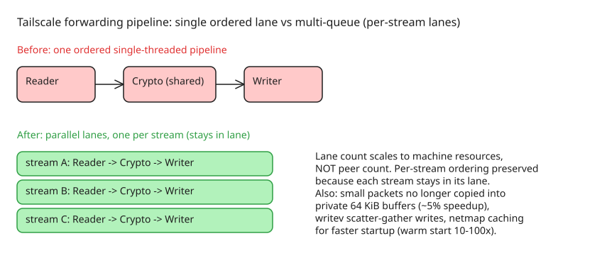

# Making Tailscale Faster — Buffer Reuse, Multi-Queue Pipelines, writev and Netmap Caching

Tailscale (2026-09-22) detailed a batch of data-plane performance work: buffer-reuse for small packets, multi-queue processing for subnet routers/app connectors/exit nodes, `writev` throughput gains, and netmap caching for faster startup. Context from their prior roadmap: Linux TCP throughput improvements → wireguard-go surpassing 10 Gb/s on bare metal → segmentation offloads giving >4× UDP throughput → Peer Relays for tricky conditions. This round targets the *forwarding* nodes (subnet routers, app connectors, exit nodes) and startup latency.

## 1. Less memory overhead for small packets (Linux/Android)

Most network packets are tiny (~1 KiB), but Linux's most efficient throughput tools — e.g. **GRO** (Generic Receive Offload) — require the receiver to be ready to accept **64 KiB at once**. wireguard-go only offers one 64 KiB buffer size, so a 1 KiB packet was copied into its own full 64 KiB buffer *every time* ("container shipping: ports and ships are built for one container shape, however full it happens to be").

The fix: on Linux/Android Tailscale now **leaves packets where they landed** — it identifies each packet's start/end inside the single large read instead of copying into a fresh buffer. Small packets stay small in memory, many share one allocation, and copies drop. Result: roughly **5% speed-up** in many network configurations by itself.

Complementary change: **shortened packet queues** between pipeline stages. The queues exist to absorb bursts; testing showed most depth went unused, while shorter queues meant less waiting time and less memory overhead — the freed capacity was passed on to subnet routers and app connectors.

## 2. Multi-queue for subnet routers, app connectors, exit nodes (H2 2026)

Until recently these node types processed packets from multiple independent streams in **one ordered, single-threaded pipeline** — a single lane shared across many connections, because a receiving application must never see its own packets out of order.

The new design: several parallel lanes instead of one, **scaled to the machine's resources rather than the number of peers**. Each stream gets a lane and *stays there* (preserving per-stream ordering), while lanes run in parallel so work spreads across CPU cores. Effects: higher aggregate capacity, lower delay between receiving and forwarding; hardware already present gets used more efficiently. App connectors and exit nodes — many users with short-lived connections — get the most noticeable boost.

## 3. Throughput gains with `writev` (Linux/Android)

Using Linux's [`writev`](https://linux.die.net/man/2/writev), Tailscale passes **multiple pieces of packet data to the kernel in one operation** instead of copying and combining them first. The "v" is vector: separate data fragments are described without being moved — fewer copies, fewer write syscalls, higher throughput. Partially implemented spring 2026; remaining gains land after v1.104.

## 4. Faster startup with netmap caching (all platforms)

A machine normally starts by contacting the control plane (~100 ms on a good network), authenticating, and fetching its **netmap** — the description of reachable devices and how to reach them. On bad airplane Wi-Fi or aggressively filtered hotel networks that step can be slow or impossible, so the device can't reach other tailnet devices at all.

Netmap caching: each device stores a copy of the netmap **on disk**. At startup it uses the cached copy to establish direct peer connections until it reaches the control plane for fresh info (connections are negotiated directly between devices; Tailscale sees no traffic, as usual). Observed effect: tailnets with poor control-plane reachability start sending through the data plane on a "warm" cache **one to two orders of magnitude faster** than from cold.

Limitations:
- Requires the device to have connected to the tailnet at least once (to fetch an initial netmap).
- Requires persistent disk; disk writes are minimized but large tailnets can make cache updates expensive, and slow/wear-sensitive storage (SD cards) may prefer it off.

## Release schedule

| Change | Availability |
|---|---|
| Memory reduction via buffer changes (Linux/Android) | v1.104 client |
| Multi-queue for subnet routers/app connectors | release after v1.104 |
| `writev` throughput gains (Linux/Android) | partially done spring 2026; remainder after v1.104 |
| Netmap caching | feature flag now; default in v1.104; mobile clients after v1.104 |

## Open problem: performance tooling

Tailscale is exploring a Tailscale-aware monitoring/testing toolkit, motivated by four gaps in general-purpose tooling: **distribution tax** (point-to-point tools need installation on every endpoint), **rigid workflows** (easy to run the wrong test and chase a phantom problem), **protocol support** (QUIC/HTTP3 often missing), and **Tailscale-awareness** (can't tell DERP vs direct paths, whether a peer relay would help, or how the path changes over time).

## Diagram: single-lane vs multi-queue packet pipeline

## References

- [We're making Tailscale faster — Tailscale blog](https://tailscale.com/blog/making-tailscale-faster)
- [Tailscale Peer Relays (beta)](https://tailscale.com/blog/peer-relays-beta)
- [Linux writev man page](https://linux.die.net/man/2/writev)
