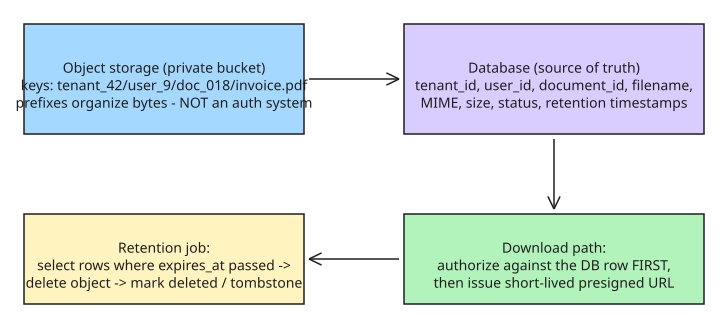

# Multi-Tenant Document Storage: Private Bucket Prefixes Plus Database Metadata

The dependable storage pattern for a multi-tenant SaaS that accepts PDFs, DOCX files, and invoices: **one private bucket**, **tenant/user-based key prefixes**, and **a database row for every document**. Object storage holds the bytes and nothing more; retention and deletion decisions live in code you can query.

## The boundary that makes it work



## Why prefixes are not an authorization system

- Start with **one private bucket per environment**, not one bucket per customer. A key carries the isolation context (`acme_42/user_9/doc_018/invoice.pdf`).
- The prefix is useful for *listing* a tenant's objects; your API must still **check the database row** before signing a download or accepting a delete request. Never expose a public URL as a substitute for that check.
- Do not put searchable fields in object metadata: object listing supports prefix filtering, not metadata queries — a metadata-only design turns every support request into a scan.

## The database contract

The row is the source of truth for `tenant_id`, `user_id`, `document_id`, original filename, MIME type, byte size, status, and retention timestamps. In the bucket store only the object key plus a checksum or size you can verify.

Retention becomes boring (in the good way):

- Scheduled job selects rows whose `expires_at` has passed → deletes the object → marks the row deleted (or keeps a tombstone for audit).
- User deletion selects by `tenant_id` + `user_id` without guessing which filenames belong to them.
- Keep the order and retry policy explicit — a failed byte deletion must not silently look like a successful compliance action. Model "requested deletion" separately from "bytes confirmed deleted" so retries are safe and support gets a truthful answer.
- If the process dies after the object write but before the row insert, a **reconciliation job** lists the tenant prefix and quarantines unreferenced keys.

## Minimal upload path (SDK-free)

The article demonstrates the pattern against a plain REST object API — useful because any HTTP-capable worker can share the same calls (same shape works with S3/R2 SDKs):

```javascript
const base = "https://api.example.com/v1";
const key = "tenant_42/user_9/doc_018/invoice.pdf";

// PUT with an Idempotency-Key so a retry never double-writes
await fetch(`${base}/storage/object/put/${bucket}/${encodeURIComponent(key)}`, {
  method: "PUT",
  headers: {
    Authorization: `Bearer ${apiKey}`,
    "Content-Type": "application/pdf",
    "Idempotency-Key": "doc_018-upload-v1"
  },
  body: bytes
});
```

Production hardening the author calls out: stream the file (don't buffer bytes), exponential retry with a cap on `429`/`Retry-After`, validate MIME before choosing the suffix, store the intended retention date **before** the first byte is sent, and record the provider request ID.

## Operational limits to know before you commit

| Concern | Reality |
|---|---|
| Lifecycle rules | One-day minimum granularity — hour-level expiry needs an application job |
| Multipart fragments | Not always auto-cleaned; budget a cleanup job |
| Conditional writes | No `If-Match` on plain REST APIs — coordinate compare-and-swap via queue/DB transaction |
| Browser-direct upload | Needs provider CORS controls; otherwise upload through your service |
| Immutability/WORM, versioning, cross-region replication | Specialist features (S3-class) — not every minimal provider has them |

## Provider-fit framing (controls, not price leaderboards)

- **Amazon S3** — mature lifecycle, versioning, object lock; more IAM/policy surface to operate.
- **Cloudflare R2** — S3-compatible, egress-friendly; verify which S3 features your retention policy needs.
- **Supabase Storage** — convenient when Postgres auth/metadata already live there.
- Minimal REST providers — one Bearer key, no SDK; fine for a small/mid document bucket, weak on CORS/versioning/WORM.

Model the workload with three numbers before choosing: **new bytes, reads, deletion events** — then add the engineering hours spent maintaining the integration. A different per-GB rate is irrelevant if it forces a second control plane.

## At scale

Move large files to multipart upload, queue deletions, emit an audit event per state transition — and **keep the same key grammar and database contract**; changing those late creates a migration project per tenant. Let the database own the state machine; the object API is the side effect.

## References

- [Private Bucket Prefixes and Database Metadata for Multi-Tenant SaaS Documents — DEV.to](https://dev.to/leiferiksson8493/private-bucket-prefixes-and-database-metadata-for-multi-tenant-saas-documents-ocf) (original article; note it carries a vendor slant — the storage-boundary pattern itself is vendor-neutral)
- [Amazon S3 versioning user guide](https://docs.aws.amazon.com/AmazonS3/latest/userguide/Versioning.html)
- [Cloudflare R2 docs](https://developers.cloudflare.com/r2/)
- [Supabase Storage guide](https://supabase.com/docs/guides/storage)
