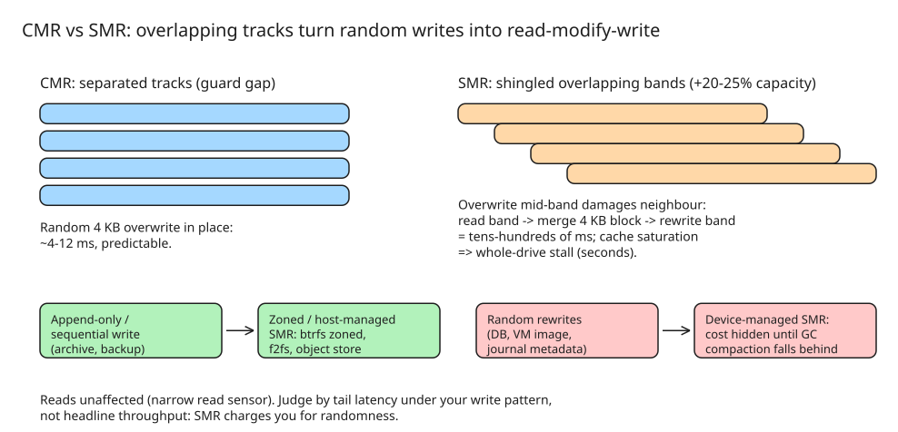

# SMR vs CMR Hard Drives: Shingled Tracks, Read-Modify-Write Stalls, and Zoned Storage

The one mechanical fact behind every SMR/CMR difference: **shingled magnetic recording overlaps tracks like roof shingles**, reclaiming the guard gap between them. You gain ~20–25% more capacity on the same platter — but you can no longer overwrite a single track in place without damaging its neighbour, so random updates become read-modify-write cycles. SMR is not a slower disk; **it is a disk that charges you for randomness**.

## Why the physics forces the trade-off

- The write pole is physically **wider than the read sensor**. CMR spaces tracks far enough apart that the wide write field lands only on the intended track — the empty gap is wasted space but guarantees any track can be rewritten in isolation (the abstraction all software has assumed: LBA → physical location, overwrite in place).
- SMR removes the gap. Tracks are written in overlapping bands, sequentially from the "bottom" of a band to the "top", because writing a new track partially covers the previous one.
- **Reads are unaffected**: the read sensor is narrow and can pick out individual tracks even when they overlap. The problem is exclusively with writes — updating data mid-band means reading the whole affected region, merging your change, and rewriting it all back.

## The arithmetic

| Workload | CMR | Device-managed SMR |
|---|---|---|
| Random 4 KB write | ~4–12 ms (seek + rotation at 7200 RPM) | Tens to hundreds of ms if the band cache is cold (read band → merge → rewrite) |
| Sustained random writes | Stable | Cache saturates → drive **pauses host writes entirely** for internal housekeeping; multi-second stalls |
| Large sequential write | Full interface rate | Full interface rate (250–280 MB/s), and higher areal density means more MB/s under the head |
| Capacity, same 3.5" platform | 18–20 TB (9–10 platters) | 22–26 TB; key ingredient of 30+ TB nearline drives |

Averages lie here: an SMR drive's headline throughput can look fine while its **tail latency is catastrophic**. Judge by tail latency under your actual write pattern, at matched capacity and interface.

## Device-managed vs host-managed vs host-aware

- **Device-managed SMR (DM-SMR)**: firmware + a cache area hide the band structure; the host sees a normal block device. The drive reshuffles data in the background — but *hiding the cost is not eliminating it*. When background compaction can't keep up, the stall reappears, and monitoring often can't see it coming because the drive reports itself as an ordinary SCSI/ATA disk.
- **Host-managed SMR (HM-SMR)**: exposes the band structure via the **Zoned Block Device** interface; the OS/app must write sequentially within zones and reset them explicitly. Plugging one into software that assumes random writes simply **fails** — the drive rejects out-of-order writes rather than quietly fixing them. Requires zoned-aware software: `btrfs` in zoned mode, `f2fs` with zoned block support, or append-only applications (object stores, log-structured systems).
- **Host-aware**: intermediate — the drive manages bands but hints zones to the host.

## Where the "archives good, databases bad" model breaks

Filesystems are not naturally sequential: a journaling filesystem constantly writes small scattered metadata updates, and those land in shingled bands **even when the bulk data stream is perfectly sequential**. This is exactly why first-generation SMR drives + ext4 produced multi-minute stalls during large copies. There is also a workload gradient on identical hardware: the same drive as a once-a-month cold archive behaves beautifully; as a build-server scratch space with constant small rewrites, it behaves terribly.

## Decision guidance

- **Home user**: write-once/grow-mostly use (Time Machine, media library) → SMR is free terabytes/dollar. VM images, databases, torrent clients that rewrite small pieces of large files → expect seconds-long freezes; buy CMR.
- **Datacentre operator**: SMR cold tier cuts $/TB meaningfully at petabyte scale *if* the workload is append-mostly and the stack is zoned-aware (object storage engines, backup targets fit; general-purpose database volumes don't). Common pattern: keep both tiers — shingled for write-once cold storage, conventional for random writes.
- **The transferable lesson**: SMR is one instance of an interface that hides its costs. CMR charges a uniform, predictable price for the overwrite abstraction; device-managed SMR keeps the clean abstraction but has a variable-cost operation that surfaces only under certain access patterns. The same pattern recurs in flash translation layers (GC stalls) and eventually-consistent cloud object stores.

## References

- **SMR vs CMR Hard Drives: The Capacity Trick That Costs You Latency** (DEV.to): [https://dev.to/gxqwb_ai/smr-vs-cmr-hard-drives-the-capacity-trick-that-costs-you-latency-2ipn](https://dev.to/gxqwb_ai/smr-vs-cmr-hard-drives-the-capacity-trick-that-costs-you-latency-2ipn)
- **Linux Zoned Block Device documentation**: [https://zonedsd.com/](https://zonedsd.com/)
- **btrfs zoned mode**: [https://btrfs.readthedocs.io/en/latest/Zoned-mode.html](https://btrfs.readthedocs.io/en/latest/Zoned-mode.html)
