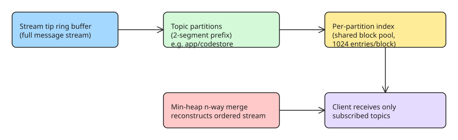

# Jane Street Aria — Scaling a Critical Message Bus with Topic-Partition Indexing and Adaptive Subtree Splitting

Aria is Jane Street's internal messaging framework and hosted system that processes multiple terabytes of data per day. Clients subscribe to get a live stream of messages; topics form a hierarchical namespace like a file system (e.g. `app/codestore/commits`), and clients can subscribe to an individual topic or an entire subtree (globstar-style). This note explains the two re-architectures that let Aria scale as client count grew: **topic-partition indexing** for cheap tip recovery, and **adaptive subtree splitting** for fast initial recovery.

## The problem: filtering was overloading servers

When Aria delivers messages to a client over TCP it keeps the recent stream — the **stream tip** — in an in-memory ring buffer. A lagging client requests recent messages from this buffer to catch up (**tip recovery**). The original implementation filtered the *entire* stream down to the subscribed topics with a simple linear pass: algorithmically inefficient but CPU-cache-friendly, so it was "decently fast" at first.

As more clients did tip recovery simultaneously, servers hit 100% CPU and clients started "falling off the tip." Adding servers was only a stopgap — the filtering work itself had to be rethought.

## Solution 1: index per topic partition, not per topic

A naive fix is one index per topic, but Aria instances can hold **almost a million topics**, so that is untenable. Instead each **topic partition** gets an index. A topic partition groups all topics sharing the same two-segment prefix (a segment being one slash-separated part): `app/codestore/commits` and `app/codestore/features` both live under the `app/codestore` partition.

Each partition holds an index of its messages' locations in the stream. When a client requests messages, Aria performs an **n-way merge of the indexes using a min-heap**, reconstructing the ordered message stream for just those partitions — no full linear scan.

### The heap was the bottleneck (and AI made it cheap to fix)

Profiling showed the min-heap dominated cost. Rather than pick one implementation by intuition, an agent spun up **five different heap implementations** and profiled them overnight; `fast_heap_unboxed` gave a **2x improvement** in indexed recovery. The new logic was validated with expect tests, exercised in Antithesis (fuzzing/concurrency testing), and reviewed by a swarm of agents.

### Storing indexes without wasting memory: a shared block pool

A per-index ring buffer would not work — ring buffers are not dynamically resizable, so each would have to be sized for the worst case. Index size is inversely proportional to message size (smaller messages → more fit in the tip store → larger index). With 32-byte minimum messages, a single partition's index could reach **2 GB**, and holding that per partition would waste too much memory.

The fix: a **shared pool of blocks, each holding 1024 entries**. An index points to a block and inserts values into it; once all messages in a block have left the ring buffer, the block is popped off and reused by another index. Indexes thus grow and shrink with their partition's live message count.

## Solution 2: adaptive subtree splitting for initial recovery

A second problem was **initial recovery** — clients that reboot request *all* messages since the start of the week (millions to billions of messages). In one incident a recovery that normally took under 2.5 s took over **13 minutes**, because Aria read and filtered ~10x more data than it needed to send.

Aria persists messages in chronological segments per topic partition, then splits them into **subtree stores** (each holding messages for one topic subtree). The original heuristic picked the store from the first three topic segments — effectively giving each direct child of a partition its own store. That broke when one topic had far more messages than siblings: reading the small topic meant filtering out all of the large sibling's messages, and users were forced to design topics around Aria's internal splitting behavior.

The replacement combines a **greedy clustering algorithm with binary search**: topics with many messages get their own subtree store, while smaller topics are folded into shared stores. In one example tree, a 2.72 GB topic previously sat in the same store as 10 MB and 28.5 MB topics; after adaptive splitting it gets its own store while the small topics bundle together.

## Verification strategy

Because dropping or reordering a message is catastrophic, the team layered multiple testing strategies:
- **Expect tests** for algorithm properties (large topics get their own store; small siblings share stores).
- A **property-based test** inserting random messages on random topics, then reading out random pieces of the topic tree to confirm ordering and content — extended to randomize the splitting itself, proving message content is invariant under how the tree is split.
- Multiple **Antithesis** runs to confirm nothing else in Aria broke.

## Results

The tip-indexing code shipped to production; staging showed **~30% less CPU utilization** in real-world scenarios and significantly lower overall client latency. Servers without indexing still exhibited multi-second tail latencies that the new-code servers did not. Adaptive splitting was deployed to staging at time of writing, with production rollout pending.

## Why this matters for your own streaming systems

The transferable lessons:
1. **Index by a coarser grouping than the finest unit.** Per-topic indexes explode in cardinality; per-partition (prefix-grouped) indexes stay bounded and still enable cheap filtered reads via an n-way merge.
2. **Amortize index memory with a shared block pool** so structures scale to worst-case message sizes without pre-allocating 2 GB per structure.
3. **Make storage layout adaptive, not heuristic.** Let the system decide store boundaries from actual data volume (greedy clustering + binary search) instead of forcing users to shape their namespace around internal design.
4. **Cheap experimentation beats intuition for hot-path choices** — profile several candidate implementations rather than betting on one.

## References

- [Jane Street — Scaling and benchmarking a critical message bus using a new indexing strategy](https://blog.janestreet.com/scaling-and-benchmarking-a-critical-message-bus/) (original source)
- [Aria: state-machine replication and why you should care](https://signalsandthreads.com/state-machine-replication-and-why-you-should-care/) (background on Aria's hosted-system design)
- Related KB note: [[PicoMQ: Durable Streams over HTTP on Object Storage]] — a contrasting "durable log on object storage" approach to the same streaming problem.
