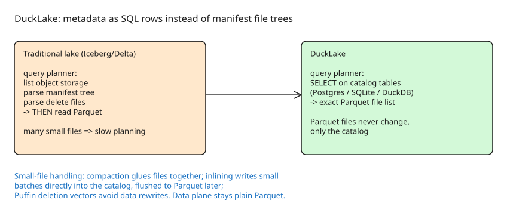

# DuckLake: Treating Lakehouse Metadata as a Relational Database Problem

DuckLake is an open-source table/lakehouse format from DuckLabs (the DuckDB company, MIT-licensed under the independent DuckDB Foundation). Its core inversion: instead of scattering **manifest files across object storage** (Iceberg/Delta/Hudi style), DuckLake stores **all table metadata inside a standard SQL database catalog** — PostgreSQL, SQLite, or DuckDB itself. Data stays plain Parquet; only the catalog changes.

> "You're going to issue queries somewhere. The server is going to answer these questions back, and you know exactly which Parquet files you have to read. So the Parquet files don't change. Just the catalog." — Pedro Holanda, principal engineer at DuckLabs

DuckLake 1.1 launched in October 2026 alongside **DuckDB 2.0.0 LTS**, pairing new features with 200+ bug fixes; it runs natively inside DuckDB.

## Why: the metadata-file tax of traditional lakes

Traditional table formats answer "which Parquet files do I read?" by traversing trees of JSON/avro manifest files in object storage. With many concurrent streams inserting, you accumulate so many files that planning a query requires reading a pile of metadata *and then* a pile of Parquet — slow queries and frustrated developers. DuckLake recasts that whole problem as one SQL databases have solved for decades: indexed lookups over catalog tables instead of file-tree traversal.

## How it reduces file count

- **Compaction ("glue files into one")**: many small Parquet files can be merged into one, cutting request counts — also possible across multiple snapshots.
- **Inlining and flushing** solve the small-files problem in streaming ingestion: small batches are written directly *into the catalog* as table rows ("you get your actual data representation as a table in a catalog"), then **flushed** to Parquet when they accumulate. (In early versions inlining was limited to DuckDB-hosted catalogs, not Postgres.)
- **Deletion vectors via Puffin files** handle deletes/updates without rewriting data files.

## Why DuckDB + Parquet fit so well

Parquet and DuckDB's native storage are both **columnar and organized in row groups**, so the conversion step between engine and lake format is minimal — part of why DuckLake is fast without massive server clusters. Decades of RDBMS engineering (transactions, indexing, schema management) get reused for the catalog: any tool that speaks SQL can inspect or maintain lake state.



## Mental model vs Iceberg/Delta

| Concern | Iceberg / Delta | DuckLake |
| --- | --- | --- |
| Metadata location | Manifest/file trees in object storage | Rows in a SQL database (Postgres, SQLite, DuckDB) |
| Query planning | Traverse + parse manifest files | `SELECT` against catalog tables |
| Small-file handling | External compaction jobs | Compaction + inlining/flushing in-format |
| Operations | Catalog service or REST catalog | An ordinary database you already know how to run |
| Data files | Parquet (+ others) | Parquet |

Trade-off to keep in mind: the design pushes consistency and concurrency onto the catalog database — catalog DB availability and scaling become part of the data plane's operational story, in exchange for drastically simpler operations.

## Choosing the catalog database (official guidance, ducklake.select docs)

| Workload | Catalog choice | Concurrency model |
| --- | --- | --- |
| Local warehousing, single client | DuckDB file (`ducklake:metadata.ducklake`) | **One process at a time** unless every process attaches `READ_ONLY`; many connections within that process are fine |
| Local warehousing, multiple local clients | SQLite (`ducklake:sqlite:metadata.sqlite`) | Single writer, but DuckLake **retries lock conflicts**, effectively hiding it |
| Multi-user lakehouse, remote clients | PostgreSQL (`ducklake:postgres:dbname=… host=…`) | Ordinary Postgres concurrency; requires PG 12+ and the `postgres` extension |
| Serve a DuckDB catalog to many clients | Quack protocol (`quack:localhost`, default port **9494**) | Token-based secret; server-side `ducklake_commit` when the server has ducklake loaded |
| MySQL | ⚠️ Officially **not recommended** | Known issues with the DuckDB MySQL connector; MySQL 8+ if forced |

Minimal attach (DuckDB catalog):

```sql
INSTALL ducklake;
ATTACH 'ducklake:metadata.ducklake' AS my_ducklake;
USE my_ducklake;
```

Postgres catalog — note the explicit `DATA_PATH`, since the catalog DB holds only metadata:

```sql
INSTALL ducklake; INSTALL postgres;
ATTACH 'ducklake:postgres:dbname=ducklake_catalog host=localhost' AS my_ducklake
    (DATA_PATH 'data_files/');
```

Operational gotchas from the docs: use the `sqlite:` prefix (or `META_TYPE 'sqlite'`) rather than relying on unprefixed-file auto-detection; with Quack, `DATA_PATH` is stored *as written* — a relative path resolves against each client's working directory, so use absolute paths or object-storage URLs; Quack `set_option` changes are not undone by `ROLLBACK`.

## Related in this KB

- How to Handle the Small Files Problem in Distributed Storage
- Explanation: Evolution from Warehouses to Lakehouse
- [Explanation: DuckDB 2.0 — Async I/O, Recursive CTEs, Variant](../../programming/databases/explanation-duckdb-2-0-async-io-recursive-ctes-variant.md)

## References

- Original article: [DuckLake 1.1 solves the absurd complexity of data lakes at AI scale](https://thenewstack.io/ducklake-sql-lakehouse-metadata/) (The New Stack podcast, Jennifer Riggins w/ Pedro Holanda)
- [DuckDB 2.0.0 LTS announcement](https://duckdb.org/2026-10-21/announcing-duckdb-200)
- [MotherDuck: DuckDB ecosystem newsletter — DuckLake stores all metadata in a database catalog](https://motherduck.com/blog/duckdb-ecosystem-newsletter-april-2026/)
- [Talk Python #562 — DuckLake: The Lakehouse That's Just SQL and Parquet](https://talkpython.fm/episodes/show/562/ducklake-the-lakehouse-thats-just-sql-and-parquet)
- [DuckLake docs: Choosing a Catalog Database (official guidance verified 2026-11-16)](https://ducklake.select/docs/stable/duckdb/usage/choosing_a_catalog_database)
- [DuckLake specification](https://ducklake.select/docs/stable/) · [duckdb/ducklake on GitHub](https://github.com/duckdb/ducklake)
