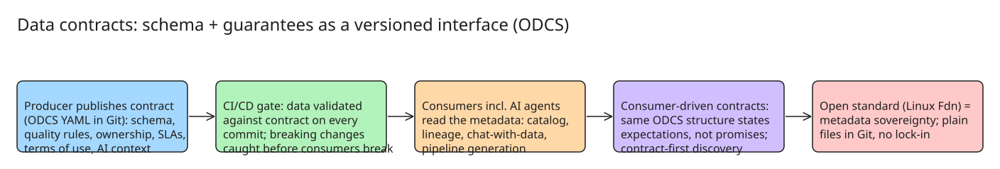

# Data Contracts as Versioned Interfaces: ODCS Structure, CI/CD Enforcement, and Why AI Agents Change the Incentive

A **data contract** is a machine-readable, verifiable, versioned description of a dataset and the promises made about it — the interface description layer between data producers and consumers. The thesis of the Thoughtworks/Bitol authors' 2026-11-18 article on martinfowler.com: **data contracts will become for data what OpenAPI is for REST APIs**, and the arrival of AI agents as metadata consumers is what finally makes writing them properly worthwhile.

## The six defining properties

1. **Machine-readable** — structured YAML, not wiki prose; tools and agents parse and act on it directly.
2. **Verifiable** — promises are assertions ("less than 1% empty names"), evaluable and pass/fail.
3. **Versioned** — SemVer; consumers can distinguish harmless from breaking change.
4. **Provider-driven** — published one-sidedly by whoever produces and knows the data; ownership of the interface sits where the knowledge sits.
5. **Consumer-oriented** — written for the consumer's decision: schema, semantics, quality, terms of use.
6. **Source of truth for metadata** — catalogs, marketplaces, docs and agents all draw from it instead of maintaining divergent copies.

## ODCS: the de facto standard

The **Open Data Contract Standard (ODCS)** — part of the Bitol project, a Linux Foundation graduate, spec on GitHub with 1000+ stars, JSON-schema validated — is the YAML format. ODCS 3.2 sections, with the load-bearing details:

| Section | What it pins down |
| --- | --- |
| Fundamentals | `apiVersion`, `id`, `name`, `version`, `status` (draft → phasing-in → active → deprecated → retired) |
| `schema` | Columns/fields with `logicalType`, `physicalType`, `primaryKey`, `required`, examples, classifications (`pii:true`); same structure covers Kafka topics, files, API payloads |
| `quality` rules | SQL assertions with thresholds (`mustBeLessThan: 0.01`), library checks (`invalidValues` mustBe 0), row-count bounds — machine-checkable by design |
| `team` / `support` | Named owner with role, reachable support channel — responsibility, not just metadata |
| `description` / terms of use | purpose, usage, limitations, links to policies (GDPR, licensing) |
| `slaProperties` | Measurable runtime promises: `freshness: 24 hours` checked against `customers.last_updated_at`, `retention: 5 years` |
| `servers` | Where data physically lives (Snowflake, Kafka, S3, Postgres…) — connection details without credentials |
| `roles` | Named IAM roles and access kinds; who holds them is decided per access request |
| `context` (new in 3.2) | **AI context**: `instructions` (system prompt for the dataset — "premiums are in cents"), `constraints` (what agents must not do), `verifiedStatements` (question→validated-query pairs so agents reuse correct answers instead of guessing) |
| `price` / `customProperties` / `authoritativeDefinitions` | Chargeback, vendor extension, and links to external definitions (e.g. an OpenAPI spec) |

## Contracts in context

- **Ontologies**: point columns at shared concepts via `authoritativeDefinitions` with an IRI (RDF/OWL, or the Apache Ossie incubating ontology standard). Kills metadata duplication (define `Customer.id` once) and gives semantic join safety across contracts.
- **Data products**: the **Open Data Product Standard (ODPS)** describes a product whose input/output *ports* reference ODCS contracts — the architectural quantum with contract-described interfaces. Contracts at output ports remain the central artifact.
- **Marketplaces**: the contract is the product-details page; an **access agreement** (contract + stated purpose + consumer, time-bound, approved by the provider — a Bitol OAAS RFC is in flight) is the "buy" click. Published test results act as the reviews: "freshness met 29 of the last 30 days."

## Working with contracts: the operational core

- **Git is their natural habitat** — contracts live next to pipeline code and CI config (`customers.odps.yaml` at root, `datacontracts/*.odcs.yaml` in a subfolder). Naming: `<dataset>_<tech>_v<N>.odcs.yaml`; major version in the filename, ID stable across majors so v1/v2 coexist during phased rollouts.
- **Data-first vs contract-first**: existing datasets can be put under contract (Data Contract CLI converts SQL DDL / JSON Schema / Avro into a first draft, then enrich); greenfield use cases should negotiate the contract in a facilitated workshop before code. **After the first publish the direction flips: the contract is the source of truth and the data must follow it** — a column rename makes the contract *test* fail; it is a breaking change, not a regeneration.
- **Versioning discipline (SemVer)**: major = breaking (remove/rename column), minor = additive (new column), patch = prose fixes. For event streams this maps onto schema-registry compatibility modes — beware that *backward* compatibility permits field deletion, exactly what breaks consumers; anything the registry would reject becomes a major version on a new topic.
- **CI/CD enforcement** with the Data Contract CLI (1M+ downloads/month, Thoughtworks Radar *Trial*): `datacontract lint` (contract validity) → `datacontract breaking` (fail PRs shipping breaking changes under minor/patch) → `datacontract ci` (test data against contract pre-merge) → nightly `datacontract test --server prod` with alerts to owner and downstream consumers on breach. Also generates DDL, masking policies from `pii:true` tags, HTML docs, and quarantines violating data.

## Why agents change the economics

Agents **treat every value as truth** — a missing description becomes a confidently wrong pipeline. Prose fields that humans skim and authors skip now have machine-speed consequences, so the neglected half of the contract finally has teeth: ODCS 3.2 added the AI `context` block for exactly this. Contract-first also enables two capabilities that were previously unreliable: **agent-generated pipelines** (contract + company skills plugin as the spec, contract tests as feedback loop) and trustworthy **chat-with-your-data** (contracts via MCP make data discoverable, semantics make joins correct, terms of use make permissions explicit).

**Consumer-driven contracts** close the loop: a consumer writes an ODCS contract in the same structure where schema statements are *expectations* instead of promises — enabling contract-first discovery ("I need this data, find who can provide it") and documenting actual vs granted usage.

## Costs and adoption advice

Contracts are not free — they cost writing time and require owners to keep promises; an agent acts on a stale contract as confidently as a correct one. Adopt selectively: contract the **team-to-team interfaces** (ideally as data-product output ports), start where it hurts (broken pipelines, quality incidents) or at brand-new use cases, and treat it as a cultural shift toward accountable ownership — explicitness often reveals *missing* ownership that must be fixed organizationally first. Platform templates, consumer workshops on needed SLAs, visible reliability scores, and a named alert owner reduce the perceived friction.

And the sovereignty argument: metadata is strategically central but tiny, so vendors give metadata tools away to capture the format. The lock-in test — *can you export all contracts as plain files into Git and rebuild your catalog elsewhere from them alone?* — is why ODCS being vendor-neutral at the Linux Foundation matters: whoever controls the metadata format controls agent access to your data.

## Related

- [[../../data-engineering/lakehouse/explanation-lakegres-vector-search-open-table-formats]] — same "open table formats + open standards, no lock-in" thesis applied to vector search.
- [[../../ai-machine-learning/rag/howto-hybrid-search-bm25-rrf]] — the retrieval layer "chat with your data" depends on; contracts supply the semantics retrieval alone cannot.

## References

- [Data Contracts — martinfowler.com (Dr Ingo Fox, Daniel Eberhardt, Stefan Negele, published 2026-11-18)](https://martinfowler.com/articles/data-contracts.html)
- [Open Data Contract Standard (Bitol / Linux Foundation)](https://github.com/bitol-io/open-data-contract-standard)
- [Data Contract CLI](https://cli.datacontract.com/)
- [Open Data Product Standard](https://github.com/bitol-io/open-data-product-standard)
- [Making Your Data Ready for Agentic AI — martinfowler.com](https://martinfowler.com/articles/making-data-ready-for-agentic-ai.html)
- [Data Mesh Principles — martinfowler.com](https://martinfowler.com/articles/data-mesh-principles.html)
