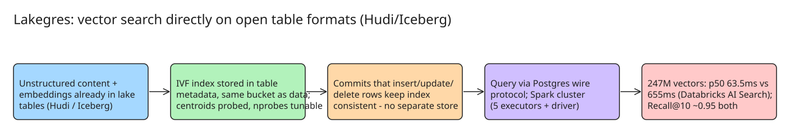

# Lakegres: IVF Vector Search Inside Hudi/Iceberg Table Metadata, Queried over the Postgres Wire Protocol

Unstructured content and its embeddings already sit in lake tables, yet serving vector search traditionally means syncing them into a **separate index store** (a dedicated vector DB or a managed serving endpoint) and living with the drift, duplication and second system of record. **Lakegres** (Onehouse) removes the round-trip: it stores an **IVF vector index inside the table's own metadata, in the same bucket as the data files**, keeps it consistent through ordinary table commits, and answers similarity queries **over the Postgres wire protocol** — so any Postgres client or agent framework runs `ORDER BY embedding <-> ?` against lake data directly.

## The architectural bet: the index is table state, not a side system

- **Index-in-metadata.** The vector index lives with the Hudi/Iceberg table metadata in the same object-store bucket. Commits that insert, update or delete rows **also update the index** — there is no separate index pipeline to sync, and no stale second copy. The index is "maintained with table writes and leaves the data files unchanged".
- **IVF, tunable recall/latency.** Lakegres uses **Inverted File (IVF)** indexing: the query vector is compared against cluster **centroids** first, then only the nearest clusters are probed. `nprobes` is the main latency/recall tradeoff knob (the benchmark used `nprobes=128`; index variant `ivf_rabitq_mdt`).
- **Open, experimentable index.** Because the index is metadata, you can rebuild it with different settings against the same data without rewriting data files. The Hudi implementation is being **upstreamed to Apache Hudi**, and XTable support is in release-candidate testing so other engines can integrate.
- **Postgres wire protocol.** Queries arrive as ordinary SQL — the endpoint serves agent frameworks and BI tools identically; it also already queries Lance and Vortex files while keeping the open table format.
- **Elastic build compute.** Index construction runs on a configurable **Spark cluster** (the benchmark: five `m8gd.4xlarge` executors + one `r8gd.4xlarge` driver) — scale the cluster to build faster, unlike serverless endpoints with fixed sizing.

## Benchmark: 247M vectors vs Databricks AI Search

Same corpus on both sides: **247,154,006 passages, 1,024-dim Cohere Embed v3 vectors, ~1 TB on S3**; 200 queries, top-10 nearest neighbours, run one at a time. Lakegres (5 Spark executors + driver) vs **Databricks AI Search storage-optimized tier** (6 storage-optimized units, one replica — the closest comparable for lake-native serving at this scale):

| Metric (warm) | Lakegres | Databricks AI Search |
| --- | --- | --- |
| p50 | **63.5 ms** | 655 ms |
| p90 | 67.9 ms | 876 ms |
| p99 | 75.3 ms | 1,209 ms |
| Recall@10 | 0.95 | 0.952 |
| Index build | faster; elastic (scale cluster) | ~3 h 10 min |

Roughly a **10× warm-latency advantage at equal recall**, with one caveat the authors state plainly: the numbers mix Databricks' **server-side** latency measurements with **client-side psql timings** for Lakegres, hardware on the Databricks side is not visible, and this is a latency comparison, not a TCO comparison. ~20–25 ms of each Lakegres query is Spark planning/task-scheduling overhead *outside* the index — headroom, but also evidence the design is a query-engine integration, not a purpose-built serving path yet.

## Why it matters for the agent/RAG stack

The agent-data story (cf. ODCS data contracts making data trustworthy for agents) presumes agents can *reach* the data with the tools they already have. Lakegres's bet extends the same open-format logic to retrieval: embeddings generated once into lake tables stay the single source of truth, and search becomes a SQL verb on the Postgres protocol rather than a bespoke vector-DB integration per framework — no dual-bookkeeping when rows change, and index rebuilds are cheap metadata operations. The comparison table's own history is the argument against standalone vector DBs: every dedicated system in it reports different datasets, dimensions and concurrency, which is exactly the fragmentation open formats aim to end.

Watch-outs: published latency mixes measurement methods (server vs client side); IVF recall depends on `nprobes` tuning per corpus; the implementation is early (Hudi upstreaming and XTable RC still in flight).

## Related

- [[../../ai-machine-learning/rag/howto-hybrid-search-bm25-rrf]] — the retrieval-fusion layer that pairs with a lake-native vector index.
- [[../data-contracts/explanation-data-contracts-odcs]] — same thesis (open formats in place, no lock-in) applied to data metadata instead of indexes.

## References

- [Lakegres: Vector search on open table formats — Onehouse blog](https://www.onehouse.ai/blog/lakegres-vector-search-on-open-table-formats)
- [Apache Hudi asynchronous indexing](https://www.onehouse.ai/blog/asynchronous-indexing-using-hudi)
- [Databricks AI Search documentation](https://docs.databricks.com/aws/en/ai-search/ai-search)
