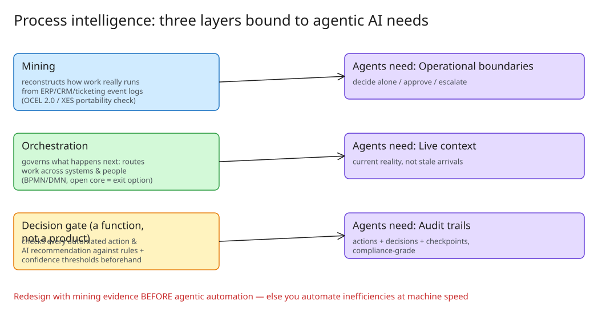

# Process Intelligence in 2026: Mining, Orchestration, and the Decision Gate for Agentic AI

Process intelligence is commonly mistaken for one thing — a process-mining tool for analysts. Treated properly it is **three cooperating layers**, and it is becoming the layer that decides how reliably an enterprise runs, governs, and automates operations — which is why it turns out to be the missing substrate for trustworthy agentic AI.

## The three parts

1. **Mining** reads the event logs ERP, CRM, and ticketing systems already produce and reconstructs how work *actually* runs, not how the BPM diagram says it should. It surfaces bottlenecks, rework loops, and the variants that quietly bypass controls — which is where the cost hides.
2. **Orchestration** governs what happens next: routing work across systems and people and enforcing the rules.
3. **The decision gate** checks every automated action and AI recommendation against business rules, confidence thresholds, and constraints *before* it has consequences. It is a **function, not a product category** — it can live inside an orchestration engine as native DMN, run as a real-time context engine fed by event streaming, or sit in a third-party rules engine.

Each part alone fails: mining without orchestration sees problems but cannot fix them; orchestration without mining automates a process nobody has verified; neither without a decision gate can bound what an AI agent is allowed to do.

## Why agentic AI raises the stakes

Agentic AI doesn't change why the discipline matters; it raises how much it matters and how fast a mistake spreads. An agent with downstream consequences needs three things from the process layer:

- **Operational boundaries** — what it may decide alone, what needs human approval, what must always escalate.
- **Live context** — current operational reality, not data that was stale on arrival.
- **Audit trails** — every action, model decision, and human checkpoint, documented in a way compliance can stand behind. The decision gate is the mechanism that delivers this: what passes proceeds; what doesn't is escalated or rejected *with a documented reason*.

The commonly skipped step: **introducing agentic AI is not embedding AI into an existing process**. A process built for human execution is rarely the right foundation for an autonomous one — redesign using mining evidence first, or you automate your inefficiencies at machine speed.

## Buying is two decisions (sometimes three), not one quadrant

The market converges from both sides: miners adding execution (Celonis's Context Model, Ikigai Labs acquisition), orchestrators adding analytics and agent control, platform vendors buying miners outright (Salesforce folding Apromore into Agentforce). Enterprises typically pick **one mining vendor plus one or more orchestration vendors** — a split result (agnostic miner + platform-native orchestrator, or the reverse) is normal and often correct. "Agnostic" means different things per band:

- **In orchestration**: where the process logic lives and who owns it. BPMN keeps the model readable across tools, but engines are rarely drop-in compatible — the model travels more easily than the deployment. Real portability = owning business logic in standard code on an engine you can self-host, with an open or source-available core.
- **In mining**: data-source and commercial independence — connecting to SAP, Salesforce, and ServiceNow at once while being licensed and governed independently from all of them.

## Four decisions that keep your options open

More important than the logo on the contract, because they determine how **reversible** the choice is:

1. **Open standards** — BPMN and DMN for orchestration; **OCEL 2.0** and XES for mining; MCP and A2A for agent connectivity. The lock-in check on the mining side is **OCEL export**, not the "object-centric process mining" label: many vendors deliver OCPM on a proprietary internal model.
2. **Open source** — distinct from open standards. A vendor can support every standard and still be closed underneath; an open core is what makes leaving practical (host it, inspect it, fork it).
3. **Data sovereignty** — SaaS-only platforms force operational data out of your environment; alternatives run on-prem or analyze where the data lives. Trade and digital-sovereignty tensions have made this a board-level question even outside regulated industries.
4. **Consolidation risk** — acquisitions bring price hikes, roadmap shifts, forced migrations, and lost cross-vendor neutrality (Apromore → Salesforce). A mega-vendor suite removes acquisition risk and replaces it with lock-in across all three layers at once.

The architectural convergence that matters is not commercial: process intelligence, event-driven integration, and trusted agentic AI must work as **one system** without carrying one logo — best-of-breed plus open standards keeps capability, pricing leverage, and exit options intact.

## Related

- [[explanation-lakegres-vector-search-open-table-formats]] — same open-formats-vs-managed-copies thesis, applied to vector indexes in the lake
- [[explanation-data-contracts-odcs]] — explicit interface contracts as the trust mechanism; the decision gate is the runtime counterpart of a contract check

## References

- [Process Intelligence Landscape 2026: Mining, Orchestration, and the Agentic AI Shift — DZone (Kai Wähner)](https://dzone.com/articles/process-intelligence-landscape) — original analysis; independent analyst piece (author disclosed roles at Talend/TIBCO/Confluent and Kestra)
- [Full vendor-by-vendor landscape (free PDF)](https://www.kai-waehner.de/landscapes/process-intelligence-landscape-2026/) — zones, OCEL export checks, six narrowing questions
