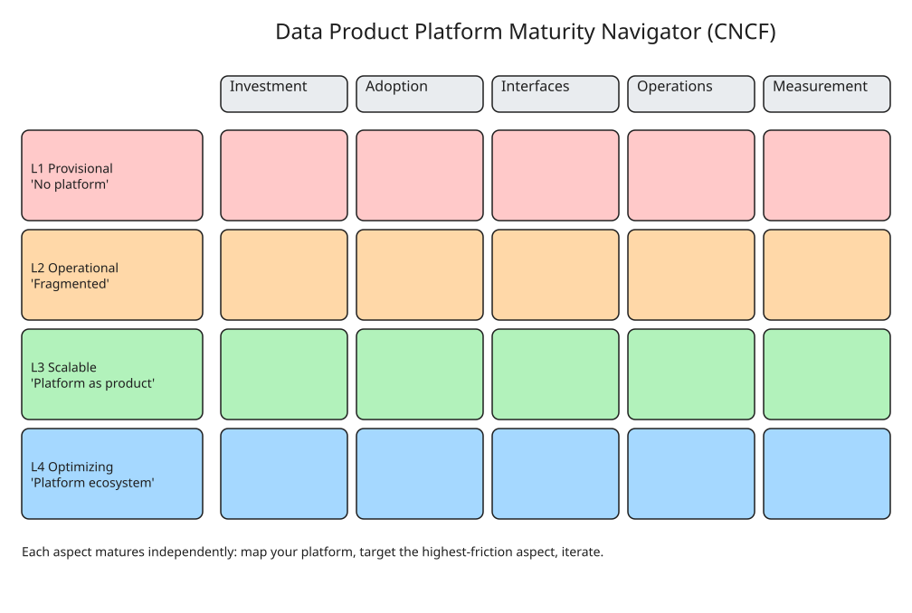

# The Data Product Platform Navigator: CNCF Maturity Model for Data Mesh Platforms

One of the core principles of data mesh is the **self-service data platform**:
domain teams must be able to build, deploy and manage their own data products
without friction. In practice organizations hit a **platform gap** — the
underlying technologies (compute, storage, ingestion, catalogs, query engines,
quality tools) lack first-class abstractions for *data contracts* and *data
products*, so no single technology composes into a complete data product and
adoption stalls.

Tom De Wolf (martinfowler.com, Nov 2026) proposes using the **CNCF Platform
Engineering Maturity Model** (from CNCF TAG App Delivery) as a navigator to
assess where a data-mesh platform stands and what to invest in next.

## The model: 4 levels × 5 aspects

Maturity levels (each aspect progresses through them **independently**):

1. **Provisional** — ad-hoc "no-platform" platform. Developers request
   components through personal networks; every data product is stitched
   together manually; deep technology fragmentation and shadow IT.
2. **Operational** — centralized, standardized, but still fragmented. Requests
   flow through ticketing systems (Jira) or IaC scripts (`createS3Bucket`,
   `createSparkJob`, …) per component; developers still glue everything
   together themselves → "Frankenstein" data products, escape to shadow IT.
   Terraform-style automation removes ticket queues but not the composition
   burden.
3. **Scalable** — *platform as a product*. A dedicated platform team ships a
   **Data Product Developer Portal** + **Data Mesh Platform Backend**: the
   developer declares the data product (input/output ports, transformation
   setup, data contracts) and the backend provisions *and wires* Git, CI,
   storage, catalog, jobs automatically. Cognitive load drops; architectural
   uniformity enables automated governance (policy checks, audit logging,
   access control, data-quality verification injected by the platform).
4. **Optimizing** — *platform as an ecosystem*. Capabilities integrate into
   local IDEs/CLIs, domain and specialist teams contribute platform
   capabilities, and measurement/feedback loops drive continuous optimization.

The five aspects assessed at each level:

| Aspect | Question it answers |
|---|---|
| **Investment** | How staffing and funds are allocated to the platform |
| **Adoption** | How and why users discover and use the platform |
| **Interfaces** | How users interact with and consume capabilities |
| **Operations** | How capabilities are planned, prioritized, developed, maintained |
| **Measurement** | How feedback is gathered and incorporated |

## How to use it (3 steps)

1. **Know your current state** — map each aspect onto the level grid (e.g.
   Investment at Level 2 with a dedicated team, but Operations and Measurement
   still ad-hoc at Level 1).
2. **Focus on the highest-friction aspect** — pick one aspect to advance
   (e.g. invest in a platform *product* team and collect user pain-point
   insights).
3. **Iterate** — apply improvements, re-map, balance people/process aspects
   (Investment, Adoption) against technology aspects (Interfaces,
   Operations); avoid over-investing in one column while others lag.

Key nuance: the organization does **not** move through the model as a whole —
each aspect moves on its own timeline. Data mesh success realistically
requires at least the **Scalable** level for Interfaces/Operations, because
below that the cognitive load pushes domain teams to self-provisioned shadow
platforms and the mesh cannot scale.

## Why this matters

- It gives platform teams a shared vocabulary to **articulate progress and
  justify funding** to stakeholders.
- The maturity grid turns "our data mesh isn't scaling" into a diagnosable
  map: which aspect is lagging, and what the next *small* investment step is.
- Practical starting move: bring the grid into your next platform/architecture
  review, locate your capabilities, and target the single aspect causing the
  most friction for domain teams.

## Related notes

- `howto-choose-data-mesh-platform-architecture.md` — picking a concrete
  stack (AWS/GCP/Databricks/Kafka) once the platform abstraction exists.
- `../Data-Mesh-Foundations/` — data mesh principles the platform must serve.

## References

- **The Data Product Platform Navigator — Tom De Wolf, martinfowler.com**: [https://martinfowler.com/articles/data-product-platform-nav.html](https://martinfowler.com/articles/data-product-platform-nav.html)
- **CNCF Platform Engineering Maturity Model (TAG App Delivery)**: [https://tag-app-delivery.cncf.io/whitepapers/platform-eng-maturity-model/](https://tag-app-delivery.cncf.io/whitepapers/platform-eng-maturity-model/)
- **CNCF announcement post (Bangser & Gavant)**: [https://www.cncf.io/blog/2023/11/20/announcing-the-platform-engineering-maturity-model/](https://www.cncf.io/blog/2023/11/20/announcing-the-platform-engineering-maturity-model/)
- **Talk recording (Data Mesh Live 2026)**: [https://www.youtube.com/watch?v=fOjWN1jU9R0](https://www.youtube.com/watch?v=fOjWN1jU9R0)
