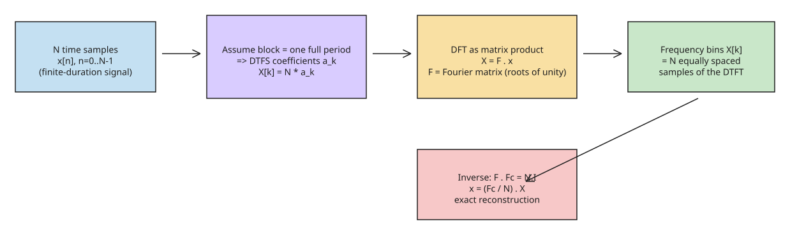

# The Discrete Fourier Transform: From DTFS Insight to Fourier Matrix and Spectral Leakage

Eli Bendersky's notes build the DFT from the ground up for *computable* digital signal processing — signals that are both discrete **and finite in duration**. The key pedagogical move: the DFT is not an arbitrary formula but the Discrete-Time Fourier *Series* (DTFS) applied to the assumption that the N available samples represent one full period of a periodic signal.

## The core construction

Given N samples `x[n]`, `n ∈ {0..N-1}`, two routes exist to frequency analysis:

1. **DTFT route**: treat the signal as infinite with zeros outside the window and compute `X(w) = Σ x[n]·e^{-iwn}`. Problem: `X(w)` is *continuous* in `w` — impossible to store or compute exhaustively on a computer.
2. **DTFS route (the DFT)**: assume the N samples are one period of a periodic signal. The DTFS coefficients reconstruct the discrete periodic signal *precisely*. With the convention `X[k] = N·a_k`:

```
X[k] = Σ_{n=0}^{N-1} x[n] · e^{-i·k·(2π/N)·n}
```

The two views are intimately related: **the DFT is exactly N equally spaced samples of the DTFT**:

```
X_DFT[k] = X_DTFT(2πk/N)
```

## Computable form (NumPy)

```python
def dft(x):
    """Return X[k] = sum_n x[n] exp(-2 pi i k n / N)."""
    N = len(x)
    n = np.arange(N)
    X = np.empty(N, dtype=complex)
    for k in range(N):
        weights = np.exp(-2j * np.pi * k * n / N)
        X[k] = np.sum(x * weights)
    return X
```

Numpy's vectorization computes the whole weights array per frequency bin `k` at once.

## The Fourier Matrix and roots of unity

The deeper linear-algebra story: powers of the N-th roots of unity form an **orthogonal basis of C^N**. With `ω = e^{-i2π/N}`, the DFT is a matrix-vector product `X = F·x` where F is the DFT matrix:

```python
def dft_matrix(N):
    """Construct F[k, n] = W_N**(k*n), where W_N = exp(-2 pi i / N)."""
    root = np.exp(-2j * np.pi / N)
    indices = np.arange(N)
    exponents = np.outer(indices, indices)
    return root**exponents

def dft_via_matrix(x):
    return dft_matrix(len(x)) @ x
```

## Inverse DFT via matrix algebra

Multiplying F by its element-wise conjugate F_c gives `N·I` (the geometric-series property of roots of unity), so `F·F_c = N·I` and the inverse transform is `F_c/N`:

```
x[n] = (1/N) · Σ_{k=0}^{N-1} X[k] · e^{+i·k·(2π/N)·n}
```

Two more practical properties:

- **Normalization convention** (shared with NumPy): no factor on the forward transform, `1/N` on the inverse.
- **Conjugate symmetry**: for real-valued signals, bins above the Nyquist index (bin N/2) are negative frequencies — magnitudes mirror the positive half, phases invert.

## Spectral leakage

When the sampled block is *not* a whole number of cycles, naive periodic extension creates a discontinuity at each period boundary. The true frequencies no longer align with DFT bins, and their energy **spreads across multiple bins** — spectral leakage.

Key nuance: reconstruction is unaffected (IDFT still recovers the exact N samples), but *frequency analysis* is skewed — the DFT reports frequencies that never existed in the underlying signal, only to account for the discontinuity. Standard mitigation: apply **window functions** that taper the signal toward zero at the block edges.



## Related notes

- `data-science/simulation-bootstrapping/` — other computational-math foundations.
- Pair with the FFT: the DFT formula above is O(N²); the FFT computes the identical result in O(N log N) by exploiting periodicity of the roots of unity.

## References

- **Eli Bendersky — Notes on the discrete Fourier transform (DFT)**: https://eli.thegreenplace.net/2026/notes-on-the-discrete-fourier-transform-dft/
- **Previous post in the series (DTFS/DTFT)**: https://eli.thegreenplace.net/2026/notes-on-discrete-time-fourier-series-and-transform/
- **Complex roots of unity post**: https://eli.thegreenplace.net/2026/notes-on-the-complex-roots-of-unity
- **Spectral leakage (Wikipedia)**: https://en.wikipedia.org/wiki/Spectral_leakage
