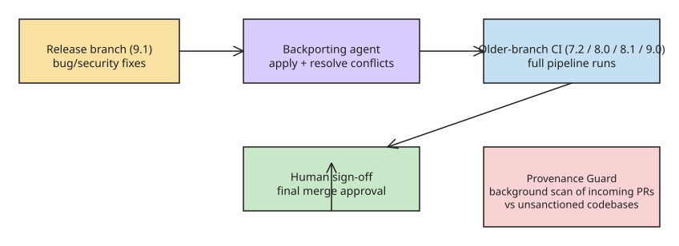

# How Project Valkey Uses AI Agents for Bug Backporting and Code Provenance Scanning

**TL;DR:** Ahead of Valkey 9.1 (the Linux Foundation's Redis alternative), maintainers replaced manual cherry-picking of bug fixes across support branches (7.2, 8.0, 8.1, 9.0, 9.1) with a **backporting agent** that applies fixes, runs the CI pipelines of older versions, and resolves merge conflicts. A second agent, **Provenance Guard**, scans incoming PRs to catch code copied from unsanctioned codebases. Humans keep final sign-off; the project reports saving several hours of testing time per engineer per week.

## Why backporting is hard at Valkey's scale

Valkey is a "hot" part of data ecosystems — always-on caching, message queues, and data structures inside production applications — so users hesitate to jump major versions. The project therefore maintains **five support branches simultaneously** (7.2, 8.0, 8.1, 9.0, 9.1). Keeping older branches secure means cherry-picking each fix from the release branch and re-validating it against older-version CI — hours of manual work per maintainer, made worse because the branches diverge over time.

## The backporting agent

The agent's loop per fix:

1. Pick up the fix from the release branch.
2. Apply it to the target older branch.
3. Run the target branch's CI pipelines.
4. Handle merge conflicts autonomously.
5. Proactively identify **test fixes** that also need backporting.

## Provenance Guard

The second agent runs automatically in the background, scanning incoming PRs to verify that no code was inadvertently taken from unsanctioned codebases and applied to Valkey. Design notes from the maintainers:

- It is a **preliminary and auxiliary check in addition to human-driven review** — explicitly not a last line of defense.
- It offloads one highly deterministic security check to a "second set of eyes," reducing review cognitive load.
- It has already caught unintentional code copying in the project.

## Human-in-the-loop boundaries

Maintainers keep the final sign-off before merging — the agents prepare and validate, humans approve. Reported impact: **several hours of testing time saved per engineer per week**, redirected to core engineering. The same framing applies to the broader maintainership question: agents take the routine (backports, provenance scans, verification), humans take judgment calls — and newer engineers are advised to learn to audit these "bot coworkers" rather than compete with them on routine tasks.

## Transferable pattern

The Valkey setup is a useful template for any project maintaining multiple long-lived branches:

1. **Identify the deterministic maintenance work** (cherry-picks + CI validation) that scales badly with branch count.
2. **Give the agent the full loop** — apply, test on the target branch, handle conflicts, and flag *related* fixes (test updates) it discovers along the way.
3. **Keep a human gate at merge time**, and treat the agent's output as a validated draft.
4. **Add a provenance layer** for code-integrity scanning that runs continuously, not per-release.

## Context: the Valkey 9.1 release these agents served

The agent workflow debuted around the **Valkey 9.1 release cycle (shipped 19
May 2026)**. Beyond the AI maintainer agents, 9.1 is relevant because the same
release cycle the agents were built for also delivered:

- **Up to 10% lower per-key memory usage** on common workloads, no tuning
  required — a direct cloud-cost lever for platform teams.
- **Valkey Search 1.2** (separately governed module): full-text search,
  numeric filtering, tag lookup, and vector similarity in one query path —
  pitched at retiring a separate search/vector stack. Maintainer Madelyn
  Olson (AWS Principal Engineer): "The world has mostly moved past
  purpose-built vector databases… you put it in the tools you're already
  familiar with" (cf. pgvector, OpenSearch).
- Core-engine hardening for multi-tenant deployments: **database-level ACLs,
  automated TLS certificate reloading, and a cluster-wide `CLUSTERSCAN`**
  command, plus an admin console for visual cluster inspection.
- Olson's framing of the agent strategy: AI handles the **well-bounded**
  parts of the maintainer workflow (backports, provenance scans, crash-
  triggering fuzz-style scans) while **explicitly not substituting for
  community judgment** on direction.

## References

- [Backporting bug fixes is dead, Project Valkey now sends in the bots (The New Stack — Adrian Bridgwater)](https://thenewstack.io/valkey-ai-backporting-agents/)
- [Valkey 9.1 release notes (valkey.io)](https://valkey.io/blog/valkey-9-1-delivers-improvements-in-security-performance-and-more/)
- [Valkey 9.1 trims memory 10% and pulls search into the core (The New Stack)](https://thenewstack.io/valkey-91-cuts-memory/)
- [Valkey 9.1 ships with hybrid search, AI maintainer agents and a leaner engine (diginomica)](https://diginomica.com/valkey-91-ships-hybrid-search-ai-maintainer-agents-engine)
- [valkey-ci-agent — backport validation and CI follow-up (GitHub)](https://github.com/valkey-io/valkey-ci-agent/pull/93)
