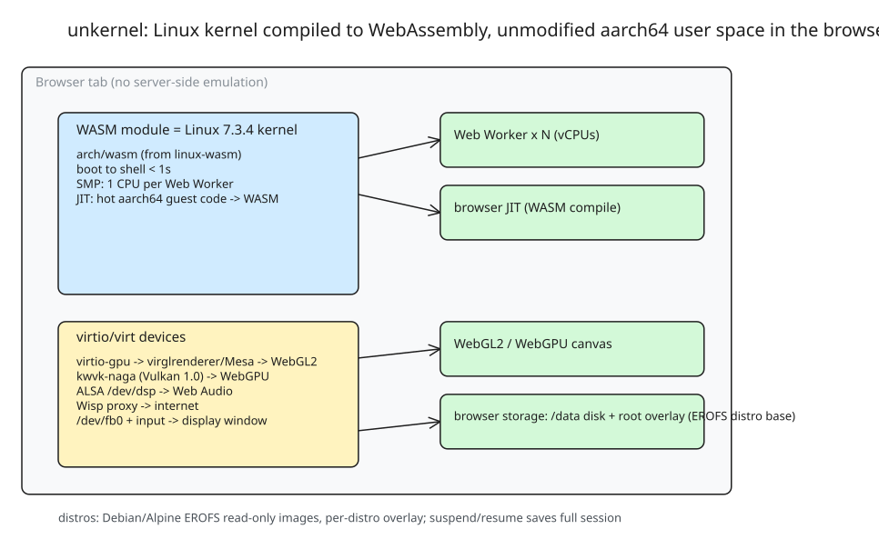

# unkernel: A Real Linux Kernel Compiled to WebAssembly, Running in a Browser Tab

The question: what does it actually take to run the **Linux kernel itself** — not a
container, not an emulator of hypothetical hardware, but Linux 7.3.4+ compiled to a
WebAssembly module — inside a browser tab, booting to a shell in under a second?

**unkernel** ([github.com/pithings/unkernel](https://github.com/pithings/unkernel),
by Pooya Parsa / pi0, sponsored by Vercel's OSS program; ~2.4k stars) compiles the
kernel to WASM and runs **unmodified aarch64 user space** on top of it. The kernel
is a real Linux with an `arch/wasm` port (based on Joel Severin's
[linux-wasm](https://github.com/joelseverin/linux-wasm)), built with Zig +
Emscripten, and shipped as an npm package (`unkernel` auto-selects the Node or
browser entry; `unkernel/node` / `unkernel/web` pin one).

## How the pieces map onto browser primitives

| Kernel/guest need | Browser primitive used |
|---|---|
| Kernel execution | WASM module (the compiled Linux) |
| SMP (multi-CPU) | one **Web Worker** per vCPU (6 suggested) |
| Guest code speed | **JIT compiler: hot aarch64 guest code → WebAssembly**, so the browser engine's JIT does the final compile |
| GPU (GL) | guest **Mesa/virglrenderer** on browser **WebGL2** via virtio-gpu (`/dev/dri`, virgl) |
| GPU (Vulkan) | guest **Vulkan 1.0 → WebGPU** through `kwvk-naga.wasm` (naga translator) |
| Storage | read-only **EROFS** distro images (Debian 13.7 / Alpine) + per-distro overlay; a persistent **data disk** (`/data`, 4–64 GiB) kept in browser storage — grows on reboot, never shrinks |
| Networking | **Wisp proxy** to the internet (configurable servers, or off) |
| Audio | ALSA `/dev/dsp` → browser audio |
| Display | `/dev/fb0` + input devices → canvas window; guest Wayland via `wland`, terminal via `wterm` |
| Session persistence | **suspend/resume**: the running system is saved to browser storage when the tab hides/closes and resumes where it left off |

Guest web servers (`python3 -m http.server 8000`) get surfaced as preview windows
or tabs by the host page — the guest's ports are proxied into the same tab.

## Why this is architecturally interesting

1. **It is not an emulator and not a VM.** QEMU-style emulation interprets guest
   instructions; unkernel *is* the kernel — the WASM module executes kernel code
   directly, and only the aarch64 user-space binaries go through the guest-code JIT
   path (guest code → WASM → browser engine machine code). This mirrors the trick
   seen in browser emulators (e.g. the 3DS-in-browser WASM dynarmic pipeline) but
   applied to the kernel side of the stack.
2. **Devices become host-API adapters.** Every virtio device is a thin shim onto a
   web platform API: virtio-gpu onto WebGL2 (virgl), Vulkan onto WebGPU (kwvk/naga),
   block onto browser storage, net onto a Wisp proxy. The kernel needs no real
   hardware drivers, only `arch/wasm` plumbing.
3. **The browser becomes the hypervisor.** CPU count = worker count, memory = typed
   arrays (64 MiB–4 GiB), persistence = browser storage, snapshots = serialize the
   whole system. Sub-second boot makes disposable per-tab Linux instances practical.
4. **Packaging is the second half of the product.** The npm package bundles the
   GPL-2.0 kernel + Alpine static busybox base (`MIT AND GPL-2.0-only`), the
   `virgl.wasm` and `kwvk-naga.wasm` guest renderers, and downloads EROFS distro
   images that keep their own licenses; `licenses.md` ships the third-party notices.

## Practical constraints to know

- Storage lives **in this browser** — clear site data and the data disk is gone
  (Export/Import and Reset exist in Settings → Storage).
- Disk only grows on reboot; capped by browser storage quota.
- JIT is opt-in ("hot guest code to WebAssembly"); without it guest code runs slower.
- Network is proxied (Wisp), not raw — the guest has internet, not arbitrary L2.
- SMP boots a distinct kernel path: each CPU pinned to a Web Worker.

## Try it

`unkernel.dev` boots Debian to a shell instantly; Settings expose CPUs, memory,
distro (Debian/Alpine/base shell), data disk, network, display/GPU toggles, and
suspend policy. Embed via the npm package (browser or Node entry points).

## References

- Live demo: [unkernel.dev](https://unkernel.dev)
- Source: [pithings/unkernel on GitHub](https://github.com/pithings/unkernel) (GPL-2.0 kernel, MIT SDK)
- Upstream port: [joelseverin/linux-wasm](https://github.com/joelseverin/linux-wasm)
- Related KB note: [Running a 3DS Emulator in the Browser: WASM Recompilation and WebGL Bottlenecks](explanation-wasm-3ds-emulator-browser-webgl-bottlenecks.md)
