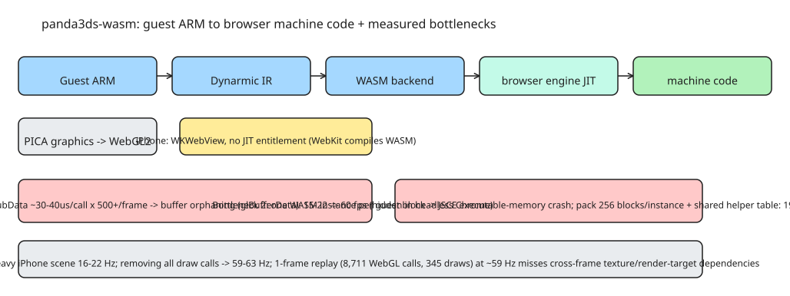

# Running a 3DS Emulator in the Browser: WASM Recompilation, WebGL2 Uploads, and iOS Engine Bottlenecks

The question: could a Nintendo 3DS emulator run on an iPhone at a useful speed? Without JIT entitlement for the app, the route taken (in the **panda3ds-wasm** port of Panda3DS, built over two days with heavy AI assistance) is to **recompile guest ARM code to WebAssembly at runtime** and let the browser engine compile that. PICA graphics render through **WebGL2**; on iPhone this runs inside **WKWebView**, where WebKit performs the WebAssembly compilation — the app itself never needs JIT.

**Pipeline:** `Guest ARM → Dynarmic IR → WebAssembly → machine code (browser engine)`. A new backend translates Dynarmic's intermediate representation into WebAssembly. Everything runs locally — no streaming, no server-side emulation; users open their own game dumps.

## What works today

- **Chrome on Apple Silicon Mac**: Super Mario 3D Land and Mario Kart 7 at **60 fps** emulation speed in tested scenes. Sound, keyboard input, on-screen controls work.
- **iPhone**: menus and light scenes at ~**55–63 fps**; the heavy World 1-1 scene only **16–22 fps**.
- Compatibility varies; new shader compiles cause noticeable pauses; some games do not get past startup; full save states not implemented (game-save persistence is).

## Surprise #1: headless testing hid a graphics bottleneck

One scene was bottlenecked by **graphics buffer uploads**. In a visible Chrome window on ANGLE/Metal, the existing streaming-buffer path using `glBufferSubData` took **~30–40 µs per call** — at **>500 calls per frame** that is a substantial part of the frame budget.

Switching to **buffer orphaning with `glBufferData`** reduced the upload cost: in one measured scene, emulation speed went from **15–22 → 60 fps**.

The awkward part: **headless Chrome did not expose the same bottleneck**. Practical lesson: automated runs help, but performance must be measured with the game **actually visible**.

## Surprise #2: too many small WebAssembly instances

Initially each compiled guest block had its **own WebAssembly instance**. That worked at small scale, but in **Safari on Mac** performance deteriorated as live instances grew into the **tens of thousands**. Worse: importing many helper functions **consumed executable memory in JavaScriptCore**, eventually crashing the page.

Fixes:

- **pack 256 compiled blocks into one instance**
- call helpers **indirectly through a shared table**, reducing per-module imports

In one heavy Safari-on-Mac scenario this brought performance from **~19 Hz → 44 Hz**. Caveats: these are project measurements, not a universal WASM optimization recipe — and on iPhone the same changes did **not** fix the main slowdown.

## The unresolved iPhone problem

The heavy scene runs 16–22 Hz on the phone. Removing **all draw calls** (while keeping uploads and the rest of the emulator) reaches **~59–63 Hz** — pointing at the drawing path, but not by itself distinguishing GPU execution, command submission, and synchronization.

To narrow it down, they recorded the WebGL calls for one frame and built a **standalone replay page**:

- recording contains **8,711 WebGL calls**, **345 draws** (343 `TRIANGLES` + 2 `TRIANGLE_STRIP`)
- the replay reproduces that single frame at **~59 Hz** on the same phone, even with **9 ms of artificial CPU work** added per frame
- adding a large WASM memory plus tens of thousands of live WASM instances does **not** reproduce the real emulator's slowdown

The recording repeats a single frame. In the live game, **texture contents change**, **render targets are sampled by later draws**, and **dependencies carry across frames** — the replay may be missing an important part of the workload. Open question: what needs to change in the replay to make it representative of the live emulator? The replay lives at `web/probe-glreplay.html` with the recording in `web/glframe.json`.

## Transferable takeaways

1. **Runtime WASM recompilation** sidesteps JIT restrictions in web contexts: the *browser engine* does the machine-code compilation.
2. **Upload path matters more than draw count**: orphaning (`glBufferData`) beat streaming (`glBufferSubData`) by an order of magnitude on ANGLE/Metal.
3. **Many small WASM instances are a real cost** (JSCE executable-memory pressure); batch blocks and share a helper import table.
4. **Headless and visible rendering differ** — benchmark with the workload actually displayed.
5. **Frame replay is not the live workload**: cross-frame texture/render-target dependencies break single-frame replay fidelity on iOS.

## References

- [Nintendo 3DS in a Browser (DEV.to source article)](https://dev.to/yury_gagarin_b26c9247af7c/nintendo-3ds-in-a-browser-two-days-of-ai-assisted-porting-then-the-hard-parts-3ai2)
- [panda3ds-wasm repository (GitHub)](https://github.com/gagarinyury/panda3ds-wasm)
- [Live browser demo](https://panda.profy.top/)
- [WebKit instances and batching notes](https://github.com/gagarinyury/panda3ds-wasm/blob/main/docs/webkit-instances-and-batching.md)
- [Graphics performance experiments](https://github.com/gagarinyury/panda3ds-wasm/blob/main/docs/performance-notes.md)
