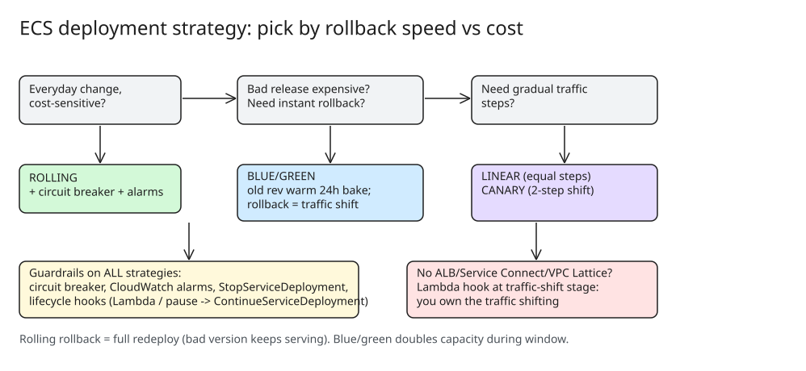

# Amazon ECS Built-In Deployment Strategies

Progressive delivery on Kubernetes usually means assembling a stack yourself (Argo Rollouts or Flagger: a controller you install and keep current, analysis wired to your metrics backend, a traffic provider for weighted canaries). ECS builds the same capabilities into the service itself, configured through a single service deployment configuration. Written by the AWS engineer who works on ECS deployment safety — vendor perspective, but concrete API/config detail throughout.

## Capability mapping vs Argo Rollouts / Flagger

| What you need | Argo Rollouts / Flagger (K8s) | Built into ECS |
| --- | --- | --- |
| Deployment strategies | Rolling via Deployment; blue/green + canary from an installed controller | Rolling, blue/green, linear, canary — set in deployment configuration |
| Traffic shifting | Replica-count weighting; ingress/mesh/Gateway API for precise % | ALB, NLB, ECS Service Connect, VPC Lattice — or your own logic via lifecycle hooks |
| Health/metric analysis | Analysis templates vs Prometheus/Datadog/CloudWatch | Deployment circuit breaker + CloudWatch alarm monitoring |
| Automatic rollback | Controller aborts and shifts traffic back | Rollback on circuit breaker or alarm; manual stop via `StopServiceDeployment` API |
| Custom checks / approval gates | Webhooks, custom analysis, manual promotion | Lifecycle hooks (Lambda or pause target), resumed via `ContinueServiceDeployment` API |

## Why rolling is not always enough

Rolling replaces old tasks batch-by-batch; new tasks get traffic once they pass health checks. Tuning knobs: `minimumHealthyPercent` and `maximumPercent` (batch size and extra capacity). The gap is **rollback speed**: if a bug surfaces slowly (metric emission + alarm-processing delay), most or all tasks already run the bad version — and rolling rollback means *another rollout* (launch new tasks, pass health checks, replace bad ones), so availability is exposed while the bad version keeps serving.

Blue/green closes that window: the old revision stays running alongside the new one through a configurable **bake period (up to 24 h)**; production traffic routes to green, blue stays registered and ready. Rollback = a traffic shift, not a redeploy. Cost: double compute capacity during the deployment window.

- **Linear**: traffic moves in equal increments over n configured steps.
- **Canary**: two-step traffic migration (a canary share, then full shift) rather than n increments.
- Both use the same well-defined traffic-shift steps as blue/green to isolate traffic between versions.

## Detection and control mechanisms (all strategies)

1. **Deployment circuit breaker** — monitors task launch/health states during a deployment against a threshold; configurable counter algorithm (July 2026) lets you ignore intermittent launch/health failures and set your own failure threshold.
2. **CloudWatch alarms** — auto-rollback on alarm (e.g. 4xx/5xx spikes).
3. **`StopServiceDeployment` API** — pull the cord on an ongoing deployment.
4. **Service deployment lifecycle hooks** — Lambda or pause target types. Key stage: `POST_PRODUCTION_TRAFFIC_SHIFT`. If your monitoring lives outside CloudWatch (Datadog, Splunk, Grafana), implement a Lambda that polls your own alarm source; if you can't use Lambda, use an **EventBridge trigger with a pause target**, then call `ContinueServiceDeployment` when your condition succeeds.

Notable: all strategies work **without** a load balancer/Service Connect/VPC Lattice — ECS invokes a Lambda lifecycle hook at the production traffic-shift stage so you run your own traffic-shifting logic (that stage requires a Lambda target; pause hooks aren't allowed there). Lifecycle hooks on rolling deployments exist but at only two stages. All strategies are compatible with Service Connect and VPC Lattice.

## Strategy selection table

| Your situation | Reach for | Tradeoff |
| --- | --- | --- |
| Everyday changes, cost-sensitive services | **Rolling** + circuit breaker + alarms | Rollback is a redeploy; bad version serves until replaced |
| Bad release is expensive, need instant way back | **Blue/green** | Double compute during deploy window |
| Gradual exposure control | **Linear** (equal steps) or **canary** (two-step) | Same warm-capacity cost pattern as blue/green |
| Monitoring outside CloudWatch | Any strategy + **lifecycle hooks** at post-production traffic shift | Code you write and own |
| No load balancer / Service Connect / VPC Lattice | Any strategy + **Lambda lifecycle hook** at traffic-shift stage | You own traffic-shifting logic |

## References

- The New Stack: [How Amazon ECS handles blue/green, canary, and linear deployments](https://thenewstack.io/amazon-ecs-deployment-strategies/) (sponsored by AWS Marketplace — treat marketing framing accordingly; technical content is API-accurate)
- AWS docs: [ECS deployment lifecycle hooks guide](https://docs.aws.amazon.com/AmazonECS/latest/developerguide/deployment-lifecycle-hooks.html) · [Configurable circuit breaker settings](https://aws.amazon.com/about-aws/whats-new/2026/07/amazon-ecs-circuit-breaker-settings/)
- Related in KB: `developer-tools-practices/cicd-patterns/` ([CI/CD workflow design patterns](reference-cicd-workflow-design-patterns.md)), [[explanation-error-ownership-retry-storms]]
