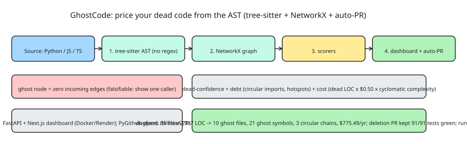

# GhostCode: Pricing Dead Code with AST Graphs, Confidence Scorers, and Auto-PRs

Dead code is usually treated as a vibe — "we should clean this up sometime." **GhostCode** turns it into a P&L line item: a dead-code analyzer that **reads your AST instead of guessing from text**, prices the dead lines, and opens deletion PRs for you. The author's first scan was of their own repo: **35 files, 2,317 lines** → **10 ghost files, 21 ghost symbols, three unknown circular-import chains**, total **$775.49 of annual maintenance burn**.

## The four layers

1. **Ingestion — tree-sitter.** Parse Python and JS/TS into **real ASTs** with [tree-sitter](https://tree-sitter.github.io/). No regex guessing, no string-matching for "import". If the parser can't see the symbol, it doesn't count. (Regex-based "unused code" tools lie the moment a dynamic import shows up.)
2. **Graph — NetworkX.** Everything becomes a graph: files, functions, classes, imports. A **"ghost node" is any node with zero incoming edges** — nothing calls it, nothing imports it, nothing references it. That's dead code *by construction, not by opinion*. Zero incoming edges is falsifiable: show me one caller, or it's dead.
3. **Scorers.** Three of them:
   - **Dead-code scorer** — how confident are we this is actually dead (deletion confidence).
   - **Debt scorer** — how tangled is the code that *is* alive (circular imports, complexity hotspots).
   - **Cost scorer** — **dead LOC × $0.50, scaled by cyclomatic complexity**. A simple dead utility is cheap; dead code wrapped in nested conditionals that future-you has to read is expensive. The $0.50 number is deliberately crude on purpose — a precise-but-wrong number is worse than a crude-but-directional one.
4. **Dashboard + auto-PR.** A **Next.js** dashboard over a **FastAPI** API (Docker, deployed on Render), and **PyGithub** opens the deletion PRs for you.

## Dogfooding results

Running it on the author's own repo (35 files / 2,317 lines): 10 ghost files, 21 ghost symbols, three circular-import chains nobody knew about. One "keeping in case I need it later" helper module had **zero incoming edges from day one** — it was never needed. Deleting it took one PR and **tests stayed green, 91/91**. The repo now has 10 fewer files.

## The pattern worth stealing

- **Start with tree-sitter, not regex.** AST visibility is the difference between "looks unused" and "provably unreferenced".
- **Zero incoming edges is the right definition** of dead: falsifiable and machine-checkable.
- **Price it crudely, early.** "$0.50/line scaled by complexity" turned "should we clean this up" into "this file costs $120 a year to keep" — a decision, not a feeling.
- **Run it in CI** so the graveyard doesn't grow back (the analyzer now runs in CI on the author's repo).
- **Auto-PR, not auto-delete.** Human review on the deletion PR keeps the blast radius small; 91/91 green tests after the deletion is the acceptance gate.

## References

- [I priced my own dead code and got a $775 bill (DEV.to source article)](https://dev.to/muhammad_abdullahshah_96/i-priced-my-own-dead-code-and-got-a-75-bill-162)
