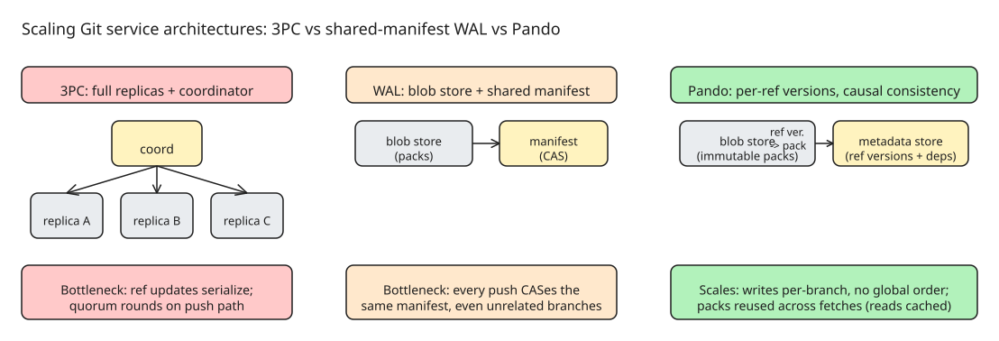

# Pando: How OpenAI Scaled Git for Agent-Era Monorepos with Causal Consistency and Packfile Reuse

OpenAI's monorepo buckled under Codex: one engineer now stages several concurrent changes, and each push fans out into several CI jobs fetching the same commit. Fetches and pushes slowed, merges failed, and reliability of the source-control path **fell below 90%**. Their answer was **Pando**, a new backend for Git repositories that kept the Git protocol and client untouched — median push latency dropped by nearly **5x**, and it now serves nearly **a petabyte of Git data per day**.

The interesting part is not the outcome but the trade-off: Pando scales by *relaxing two assumptions every conventional Git service treats as requirements*.

## The two goals

1. **Horizontally scalable writes** — concurrent pushes to many branches must not contend.
2. **Maximal read throughput** — clients download fast enough to saturate their network bandwidth.

Both while staying wire-compatible with `git` so engineers *and agents* adopt it without workflow changes.

## Background: what a Git service must coordinate

A repository is **objects** (blobs, trees, commits, tags — content-addressed, immutable, stored loose or delta-compressed in packfiles) plus **references** (refs: branches/tags pointing at commits). During a fetch, the client names wanted commits and "haves"; the server computes the reachable-object set, subtracts what the client has, and streams the remainder as a packfile. A push uploads a pack that may *depend on objects the server already has*, then asks the server to move refs.

Replicating that across servers means: a replica may only serve a new ref value once it can supply every object reachable from it, and the service must order competing ref updates (two pushes moving the same branch from the same old tip to different new commits). **Systems that impose a single global order on all writes make pushes to unrelated branches wait on one another** — the root bottleneck.

## The two conventional designs, and where they stall

**Three-phase commit (3PC).** Full repository replica on every server. A push's packfile is copied to all replicas in parallel; then a coordinator locks the ref on each replica, verifies the expected old tip, sends pre-commit, waits for a **majority ack**, then commits. Reads are locally consistent everywhere — but refs update **one at a time**, each push costs multiple coordinator round-trips, and quorum waiting puts replica disk performance and network latency *on the push path*.

**Write-ahead log (WAL).** Push uploads its packfile to blob storage in parallel, then publishes the ref update by **compare-and-swap on a shared manifest** in that blob store. CAS failures mean re-reading intervening entries and retrying. Writers parallelize on uploads, but *every* push — even to unrelated branches — contends on the same manifest; the CAS round-trip rate-limits the whole repository, and batching to amortize it adds queueing latency. Replicas also fall behind reading/indexing packs when writes outpace them.

## Pando's architecture: drop repository-wide consistency, reuse packfiles

Pando gives up exactly two assumptions:

**1. Causal consistency instead of repository-wide point-in-time state.**
A push stores the incoming packfile as an **immutable blob** in a horizontally scalable blob store. Each time a branch moves, Pando records a **ref version** — the new tip, the pack that supplied it, and the earlier ref versions that pack depends on — in a horizontally scalable **metadata store**. Fetching a ref replays the set of ref versions to the client, reconstructing the writer's state.

- Per-ref **serializability**: clients conflict only when pushing to the *same* ref simultaneously.
- Cross-branch reads are **not** point-in-time: during a clone negotiation, one client may observe `foo`@v1 / `bar`@v2 while another sees `foo`@v2 / `bar`@v1. In practice engineers and agents depend on the order of updates to a single reference, not a global ordering.

**2. Packfile reuse instead of per-client pack generation.**
Conventional servers generate a bespoke pack per fetch (subtracting that client's haves) — CPU- and I/O-bound at read scale. Pando **reuses the same packfiles across fetches**: a client may receive some objects it already has, but the server serves identical bytes to many clients with little computation, from caches. Side-branch pushes re-include the topic's earlier commits, so a client holding the advertised trunk tip can fetch any topic branch **in one pack**.

## Client-side changes being upstreamed

From OpenAI's public [fork of Git](https://github.com/openai/git):

- **Parallel pack download and indexing** of independent packs.
- **"Explicit haves"**: the server advertises a branch's current tip separately from the history a pushing client may leave out of its pack — so a client can use `git push --force-with-lease` to verify the feature branch hasn't moved while building its pack **against trunk alone**; anyone with trunk history can then fetch that branch from the same pack.
- **`packfile-uri` tracing** and byte counters for pack generation, to tell whether a slow fetch was spending its time *generating* packs or *transferring* them.

Several improvements are already upstream; the rest track in OpenAI's public patch tracker.

## How they validated it

A simulation of the three architectures: 1,000 clients each repeatedly pushing unique commits to distinct branches (10,000 pushes), measuring total wall-clock completion and **push-to-fetch latency** (round trip until an independent reader can check out the commit) across commodity-to-premium VM and blob-storage configurations. Pando's per-branch coordination wins as writer count grows; the 3PC and WAL designs serialize on coordinator rounds and manifest CAS respectively.

## Takeaways for anyone running a large monorepo

- Global ordering of ref updates is a *choice*, not a Git requirement — most workloads only need per-ref ordering.
- Per-client pack generation is the read-path killer; caching/reusing packs converts read scale into a blob-store/cdn problem.
- Agent-driven development multiplies every scaling pressure (branches, fetch fan-out, CI). Design for *many concurrent writers* before it hurts: OpenAI's reliability sat under 90% before they acted.
- Protocol compatibility is the adoption unlock: same `git` client, same workflows, swap only the backend.

## References

- Original post: [Scaling Git at OpenAI](https://openai.com/index/scaling-git-at-openai/) (OpenAI, 2026-11-02)
- TheNewStack coverage: [OpenAI built itself a new Git backend, too](https://thenewstack.io/openai-pando-git-backend/)
- OpenAI's Git fork: [openai/git on GitHub](https://github.com/openai/git)
- Related KB notes: [AST-based merge conflict prediction](explanation-ast-based-merge-conflict-prediction-tree-sitter.md), [Git & GitHub basics](../../../tutorials/developertoolspractices/gitworkflow/tutorial-git-github-basics.md)
