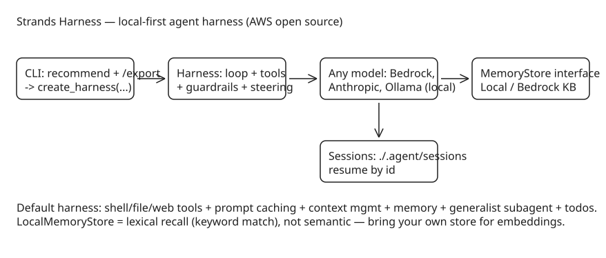

# AWS Strands Harness — A Local-First, Model-Agnostic Agent Harness (Open Source)

AWS open-sourced **Strands Harness** (repo `strands-agents/harness-sdk`, Apache 2.0): a fully assembled agent harness that runs locally by default with no AWS infrastructure dependency, while remaining model-agnostic across Bedrock, Anthropic, OpenAI, Google, and Ollama for local models. The New Stack's coverage highlights the claim of ~45% lower cost than Claude Code or Codex on comparable tasks — the interesting part architecturally is what "harness" means here: a pre-wired loop with tools, memory, sessions, context management, and delegation already enabled, rather than an SDK you assemble yourself.

## What ships in the box

A one-line call gets shell, file tools, and web access working out of the box. The default harness additionally enables:

- **Prompt caching** and **automatic context management**
- **Long-term memory** — `MemoryManager` is backend-agnostic (talks to stores only through a `MemoryStore` interface). Ships with `BedrockKnowledgeBaseStore` (embedding-based, requires AWS) and a new **`LocalMemoryStore`**: zero-infrastructure, persists to disk by default (`~/.strands/memory/notes.json`), lexical recall with recency tiebreak (keyword matching, not semantic — documented as such), ephemeral mode for tests via `persist: false`.
- **Persistent sessions** on by default: each conversation is persisted under `./.agent/sessions` with a generated id; choose the id yourself and a later run rehydrates the same conversation (`strands --session-id api-design`). Session storage ≠ long-term memory — one is per-conversation state, the other cross-session recall.
- A **`generalist` subagent** (delegation) and a **`todos` task tracker**, both enabled by default.
- A tuned system prompt: explore before changing things, confirm before anything irreversible, verify before calling a task done.

```typescript
import { Agent, MemoryManager } from '@strands-agents/sdk'
import { LocalMemoryStore } from '@strands-agents/sdk/vended-memory-stores/local'

const agent = new Agent({
  model, // "provider/name" — Bedrock default; Ollama for local
  memoryManager: new MemoryManager({
    stores: [new LocalMemoryStore({ name: 'notes' })],
    addToolConfig: true,
  }),
})
```

## The CLI as an on-ramp to the library

The interactive CLI is a fast path into code: it detects config in the current directory, recommends a model, built-in tools, Agent Skills, MCP servers, long-term memory, context management, and a tool-approval mode — accept or adjust each. `/export` then writes a Python or TypeScript project with your choices set directly on `create_harness(...)` / `createHarness(...)`, exporting a ready-to-import `agent`. The CLI persists sessions the same way as the library.

## How it relates to the Strands SDK

Strands Harness sits on top of the **Strands Agents** SDK (Python + TypeScript monorepo), which is model-driven: define a prompt and tools in code, let the model plan/chain/call-reflect. The SDK's production features — hooks that intercept every loop step, guardrails before tool execution, steering handlers for self-correction, MCP support, bidirectional streaming, structured output, OpenTelemetry tracing — carry through to the harness. AWS teams (Amazon Q Developer, AWS Glue, VPC Reachability Analyzer) already run Strands in production; deployment reference implementations cover Lambda, Fargate, and EC2, plus a return-of-control pattern where tools execute client-side while the loop runs server-side.

## Why it matters

1. **Local-first default** with Ollama support means you can evaluate harness behavior (tool selection, context management, memory) without an API key or cloud account — useful for comparing harnesses on identical local models.
2. **Sessions + memory as first-class, swappable stores**: the `MemoryStore` interface is the seam to bring your own backend (mem0-style external memory, vector DBs) without touching agent code.
3. **The `/export` pattern** — build interactively, then drop into code — is a useful on-ramp design worth copying for any agent tooling: it keeps the library as the source of truth while making exploration cheap.



## Practical takeaways

1. Try it with Ollama first (`model="ollama/..."`) to evaluate harness behavior without cloud spend; swap the provider string when you're ready for Bedrock/Anthropic.
2. Use `LocalMemoryStore` for prototyping and personal agents (hundreds–low thousands of entries); its lexical recall is explicitly not semantic search — production corpora need a different store behind the same interface.
3. Pick session ids deliberately (`--session-id api-design`) when you want resumable, named conversations; sessions are per-conversation state, distinct from long-term memory.

## References

- [The New Stack: AWS open-sources an AI agent it says is 45% cheaper than Claude Code and Codex](https://thenewstack.io/aws-strands-harness-agent/)
- [strands-agents/harness-sdk (GitHub)](https://github.com/strands-agents/harness-sdk)
- [Strands harness quickstart (official docs)](https://strandsagents.com/docs/user-guide/harness/quickstart/)
- [AWS Open Source Blog: Introducing Strands Agents](https://aws.amazon.com/blogs/opensource/introducing-strands-agents-an-open-source-ai-agents-sdk/)
