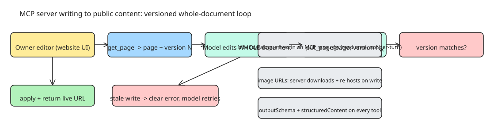

# Designing MCP Servers That Write to Public Content

Most MCP servers are read-heavy: they fetch data, run searches, query databases. The Keepp team (a link-in-bio / website builder) shipped an MCP server with a fundamentally different job — Claude and ChatGPT can build and edit **public, live web pages** that strangers will see. A user says "add my new class times and a booking button" in chat, and the assistant mutates a real page. Six lessons from running that in production:

## 1. Let the model write the whole document — but make stale writes fail

Their first instinct was a dozen small tools: `add_block`, `move_block`, `change_color`. **It failed**: models lost track of order, half-applied changes, and left pages inconsistent.

What worked: a single tool `put_page` that **replaces the entire page document**. The model calls `get_page`, edits what it got back, and sends the complete list of blocks. Anything left out is deleted — and the tool description says so plainly.

The hazard: the owner edits in the editor while the assistant is mid-change, and the assistant silently overwrites. The fix is **optimistic concurrency**:

- every `get_page` returns a `version`
- `put_page` requires the `version` it was given
- a write against a stale version **fails with a clear error** instead of silently winning

Optimistic concurrency turned out to be the single most important guard on the whole server.

## 2. Keep the schema out of every tool listing

A page has many block types, each with its own fields. Putting the full block catalogue into `put_page`'s input schema **bloats every tool listing the host sends to the model, on every turn**.

Fix: move the full block catalogue into an **MCP resource**. The tool description points at it, so the model reads it once when it needs it rather than carrying it in every request. Tool listings stay small; the model still has every field when it builds a page.

## 3. Never trust a URL the model gives you

Models like to paste image URLs straight into pages, from wherever they found them. That makes the public page depend on someone else's server — and some of those images vanish a day later.

Fix: **every image URL in a write is downloaded and stored on the server side as part of the write**. If one cannot be fetched, the whole write fails and names the offending block. The model is told exactly what went wrong and usually fixes it on the next try. The server owns every asset the model hands it.

## 4. Return structured results on every path

Hosts handle tool results differently: some show the model only the text content, some read `structuredContent`. Their rules:

- declare an `outputSchema` on **every** tool
- return structured content on **every** success path, with a readable sentence in the text as well
- a **test fails the build** if any tool is missing either

Same discipline for safety hints: each tool declares whether it is **read-only, destructive, or touches the outside world**, from one table in the codebase, so hosts can decide when to ask the user first.

## 5. OAuth for native clients needs loopback on any port

Remote MCP over OAuth worked first time in **browser** hosts. It broke for **native** clients like Claude Code, which sign in through a `localhost` callback on a **random port** — their redirect check wanted an exact match.

The fix is in the spec for native apps: **loopback redirect URIs are allowed on any port**. Once accepted, sign-in worked everywhere. **Client ID Metadata Documents** also meant no dynamic client registration was needed for the hosts they cared about.

## 6. Different hosts need different tool sets

Not every host wants every tool. Some app directories do not allow selling subscriptions inside the assistant. For those clients, **hide the plan tools entirely** rather than letting them fail. Filtering by client at **listing time** is cleaner than refusing at **call time**.

## The short version

If you are building an MCP server that writes to anything public:

1. give the model **whole documents with a version check** (optimistic concurrency)
2. keep **big schemas in resources**, not in tool listings
3. **own every asset** the model hands you (download and re-host on write)
4. return **structured results everywhere**, with output schemas enforced by tests

## References

- [What We Learned Letting Claude and ChatGPT Edit Live Websites Over MCP (DEV.to)](https://dev.to/thinslatelabs/what-we-learned-letting-claude-and-chatgpt-edit-live-websites-over-mcp-5b55)
- [Keepp developer docs (MCP server connection)](https://keepp.link/developers)
