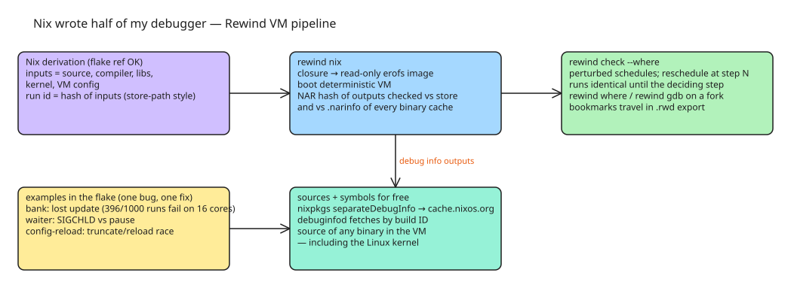

# Nix Wrote Half of My Debugger — Hermetic Inputs, debuginfod Sources, and Rewind's Schedule Perturbation

A debugger needs the exact program inputs, debug symbols, every source file, and a way for another person to obtain all of it on their machine. **A Nix derivation is exactly that** — so the hard part of a deterministic debugger is already done by Nix. The author's tool, **Rewind VM**, is a deterministic VM where every run of a Nix build is a pure function of its inputs, *including the thread schedule*; the article shows how Nix supplies the inputs, the sources, and the symbols, and how Rewind uses them to find race conditions.

## The bug being hunted: a classic lost update

Two tellers depositing into one account:

```c
static void deposit(int teller, long amount)
{
  long seen = balance;
  char line[64];
  int n = snprintf(line, sizeof line,
                   "teller %d: %ld + %ld\n",
                   teller, seen, amount);

  if (write(1, line, n) != n)
    return;
  balance = seen + amount;
}
```

On a 16-core laptop `bank` lost money in 396 of 1,000 runs; pinned to one core with `taskset`, none of 1,000 did — one core rarely switches threads mid-deposit. A deterministic VM with a single CPU passes the *first* run too, which is why Rewind **perturbs the schedule**: `rewind check` re-runs the build under many perturbed schedules, each asking the guest kernel to reschedule at different steps, and narrows the first failure to one step:

```
$ rewind check --where github:fzakaria/rewindvm#bank
...
step 3237 decides it: a reschedule there makes the run fail

passing: run 12feb5f832205a72, schedule 0
failing: run c2f1cfac0c288f3e, schedule 1 over steps 3237..3238
the two are the same run until step 3237

where the threads were:
        3237   139/140   deposit (bank.c:24), on the CPU at the deciding step
        3250   139/141   deposit (bank.c:24), at the first event that differs
```

The two runs are identical until step 3237, where only the failing one gets a reschedule. The check takes 11 s on a laptop.

## Free thing one: the inputs

`rewind nix` takes a derivation (a flake reference works) and Nix already knows its inputs: source, compiler, libraries, kernel, VM config. `rewind nix` realises the closure, packs it into a read-only erofs image, and boots the VM on it.

- The run's id is a hash of its inputs (like a store path). `rewind show` prints the command that makes it again:

```
$ rewind show 12feb5f8
rewind nix /nix/store/cr8rl40rjb9cmmcd9sxn9mpdrhvp53jj-bank-0.1.0.drv --epoch 1791331200 --clock branches --name bank-0.1.0  # 12feb5f832205a72
```

- After a successful build, the guest reports each output's **NAR hash**, and `rewind nix` checks it against the host's copy *and* against every binary cache Nix substitutes from (fetching only the `.narinfo`):

```
$ rewind nix github:fzakaria/rewindvm#bank
...
/nix/store/27a4q7w90jzp4wg5kaaajvb64zll6yqg-bank-0.1.0 dbf0df3de84b7a84  matches your store
```

This validates that the in-VM build matches the local build and that the run is reproducible by Nix's own machinery.

## Free thing two: every symbol and every source

`rewind where <run> <step>` shows the source at the playhead plus the stack frames:

```
$ rewind where c2f1cfac 3250
process 139 (bank), thread 141, at step 3250
#4 deposit (bank.c:24)
      22  int n = snprintf(line, sizeof line, "teller %d: %ld + %ld\n",
                           teller, seen, amount);
>     24  if (write(1, line, n) != n)
called from #5 teller (bank.c:34)
called from #6 start_thread (pthread_create.c:454)
```

Why this is free: nixpkgs builds packages with `separateDebugInfo`, and the debug info is cached on cache.nixos.org as a `debug` output. The tool leverages **debuginfod** to fetch debug info *and sources by build ID* — so it can show the source of any binary in the VM, including the Linux kernel.

## gdb on a fork of any step

`rewind gdb` opens gdb on a **fork of the run at the playhead** with every thread of the process: breakpoints, watchpoints, memory, registers, variables. Bookmarks (`b`) attach notes to steps; they travel inside the run's `.rwd` export, so the person you hand the run to sees your notes on the timeline.

## Examples in the flake (one bug, one fix each)

- `philosophers`: a deadlock.
- `bank`: the lost update above.
- `waiter`: a SIGCHLD arriving between a flag check and `pause`, so the parent sleeps until the 10 s `make check` timeout kills it.
- `config-reload`: one process rewrites a config file in place while another rereads it — on many cores it fails nearly every time; on one CPU only some schedules land the reader between truncate and last write:

```
$ rewind check github:fzakaria/rewindvm#waiter
```

## The takeaway

Most of a debugger's hard work — exact inputs, reproducible runs, symbols, sources, portability to another machine — is already done by Nix. Start from something hermetic like a Nix derivation and you get a deterministic debugger mostly for free:

```
$ nix run github:fzakaria/rewindvm -- check github:fzakaria/rewindvm#bank
```

## Diagram



## References

- [Nix wrote half of my debugger — Farid Zakaria](https://fzakaria.com/2026/10/07/nix-wrote-half-of-my-debugger)
- [Rewind VM — the preceding post on the deterministic VM itself](https://fzakaria.com/2026/10/03/rewind-vm-a-flaky-build-you-only-catch-once)
- [debuginfod — fetching debug info and sources by build ID](https://fedoraproject.org/wiki/Debuginfod)
