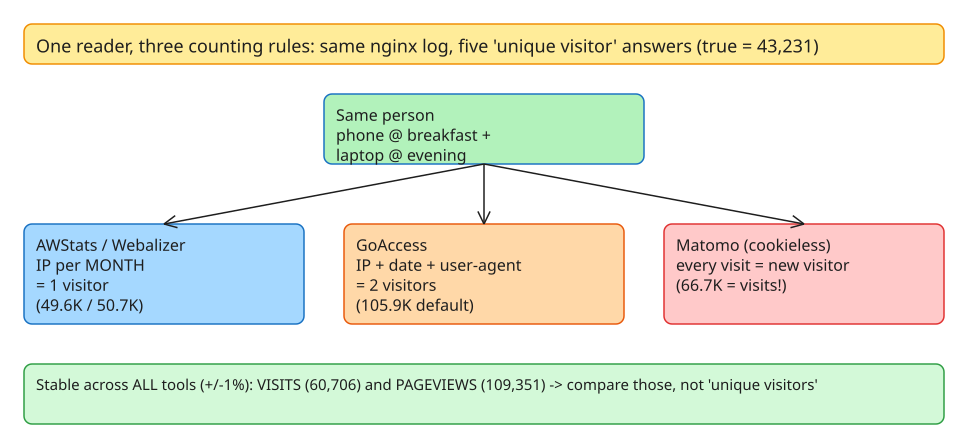

# Why Five nginx Log Analyzers Report Five Different Unique-Visitor Counts

## The experiment

The author **synthesized a month of nginx access log** so ground truth was known in advance:
**43,231 real people, 60,706 visits, 109,351 pageviews, 502,103 lines, 118,216 bot requests**.
The same file was then run through five self-hosted analyzers. Unique-visitor output:

| Tool | Unique visitors reported | True = 43,231 |
|---|---|---|
| AWStats | 49,616 | +15% |
| Webalizer (Stone Steps branch) | 50,707 | +17% |
| Matomo (log importer) | 66,674 | +54% |
| GoAccess `--ignore-crawlers` | 67,863 | +57% |
| GoAccess, default | 105,885 | **+145%** |

None is close; GoAccess in default mode more than doubles reality.

## Root cause: three different definitions of "visitor"

The tools do not measure the same quantity — "unique visitor" is a **policy choice, not a
measurement**:

- **AWStats / Webalizer:** one visitor per IP address **per month** (aggressive collapsing —
  everyone behind a NAT or DHCP lease merges).
- **GoAccess:** visitor = **IP + date + user agent** (one person on phone + laptop = 2 visitors;
  a browser update creates a third).
- **Matomo on cookieless log import:** every **visit is a new visitor** — it reported 66,675
  visits and 66,674 visitors, i.e. visitor ≈ visit by construction.

Bot filtering is not the explanation: after removing bots, the spread was still 49,576–60,209.

## What does hold up: visits and pageviews

Every tool landed **within 1% of the true visit count (60,706)**, and pageviews were either exact
or 1.4% high. Practical rule:

- **Compare tools, and trend month-over-month, using visits and pageviews — never unique
  visitors from access logs.**
- If someone asks for a headcount from nginx logs: it cannot be read from the log alone. Show
  visits instead.

## The scraper no bot list caught

One planted scraper claimed **Chrome 141** in its user agent and sent **7,285 requests**. **No bot
list in any of the five tools flagged it** — it inflated pageviews by **6.7%**. User-agent
blocklists only know what someone already reported; any fresh disguise passes. Expect bot
filtering to be recall-limited against novel agents.

## Relative speed on the 502K-line file

| Tool | Runtime |
|---|---|
| Webalizer | 3.4 s |
| lnav | 4.5 s |
| GoAccess | 6.1 s |
| AWStats | 19.5 s |
| Matomo | **265 s** |

For quick answers from a log, anything but Matomo's importer; four tools finish under 20 s.

## Decision guidance

| Need | Tool |
|---|---|
| Fast interactive log exploration | lnav |
| Quick static report, fastest | Webalizer (Stone Steps) |
| Real-time terminal dashboard | GoAccess (treat its visitor count as IP+date+UA, not people) |
| Historical per-IP-per-month view | AWStats |
| Full analytics platform from logs | Matomo (know visitor = visit without cookies; 44x slower) |

## References

- [Five log analyzers, one nginx log, five visitor counts — DEV.to](https://dev.to/markosavran/five-log-analyzers-one-nginx-log-five-visitor-counts-2lp6)
- [Full comparison with commands and versions — opensource-analytics.com](https://opensource-analytics.com/access-log-analyzers-compared/)
