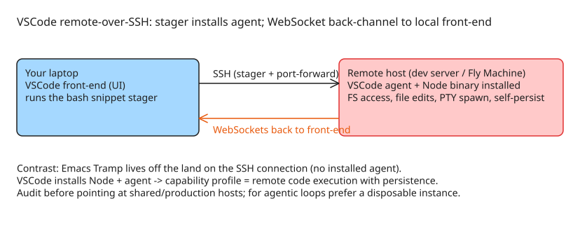

# VSCode's SSH Remote Agent Architecture — Why It Behaves Like a Persistent Remote Shell

Fly.io (Thomas Ptacek) dissected how VSCode's "remote editing over SSH" actually works, motivated by wanting to integrate Fly Machines into the VSCode remote-editing flow — especially for LLM agent loops that need a clean-slate Linux instance they can't damage. The finding: unlike Emacs' Tramp, which "lives off the land" on the remote connection, **VSCode mounts a full-scale invasion** of the remote host.

## How VSCode's SSH remote mode works (observed architecture)

1. **Bash snippet stager**: the local client runs a Bash snippet over the SSH session that *downloads an agent* — including a **binary installation of Node** — onto the remote machine.
2. The agent runs over **port-forwarded SSH**.
3. It establishes a **WebSockets connection back to your running VSCode front-end**.

The protocol on that WebSocket connection can:

- Wander around the filesystem
- Edit arbitrary files
- Launch its own shell PTY processes
- **Persist itself**

In security terms, Ptacek notes there's a name for tools with exactly this capability profile (a remote code execution foothold with persistence) — "I won't say it out loud, because that's not fair to VSCode." His stated concern: letting people VSCode-remote-edit dev servers is already nervous-making; doing it during an incident on production would be apocalyptic.

## Contrast: Emacs Tramp

Emacs hosts **Tramp**, the spiritual forebear of remote editing systems — a blob of Elisp that hooks into *any* interactive environment (usually SSH) where it can run Bourne shell commands, and extends Emacs to that environment. Tramp lives off the land on the existing connection; VSCode instead installs its own agent stack. The author's expectation ("take Tramp, simplify it, swap Elisp for TypeScript") is exactly what did *not* happen.

## Why this matters for agentic workflows

The motivating use case: LLM agents close a loop (generate code → run → read errors → iterate), and that iteration should happen on a **clean-slate Linux instance that spins up instantly and can't screw you over** — not your dev laptop, because "LLMs have boundary issues" and will happily iterate on system configuration. Understanding what VSCode's remote mode installs is prerequisite to trusting it as the transport for such loops; Fly's conclusion was they don't need VSCode's agent at all to get a custom connection to a Fly Machine working in VSCode — but documenting the mechanism is the point of the post.

## Practical takeaways

- **Audit what your editor installs**: VSCode remote mode drops a Node binary + agent on the target; inventory it before pointing it at shared or production hosts.
- **The WebSocket back-channel is the trust boundary**: once the agent connects, its protocol capabilities (arbitrary file edit, PTY spawn, self-persistence) define the blast radius of any compromise of either endpoint.
- **Tramp-style "live off the land" remains the lower-footprint pattern** for remote editing when you don't need a full IDE server on the target.

## Diagram: VSCode SSH remote agent data path

## References

- [VSCode's SSH Agent Is Bananas — Fly.io blog (Thomas Ptacek)](https://fly.io/blog/vscode-ssh-wtf/)
- [Emacs Tramp](https://www.gnu.org/software/tramp/)
- [Suspected VSCode server node source](https://github.com/microsoft/vscode/tree/c9e7e1b72f80b12ffc00e06153afcfedba9ec31f/src/vs/server/node)
