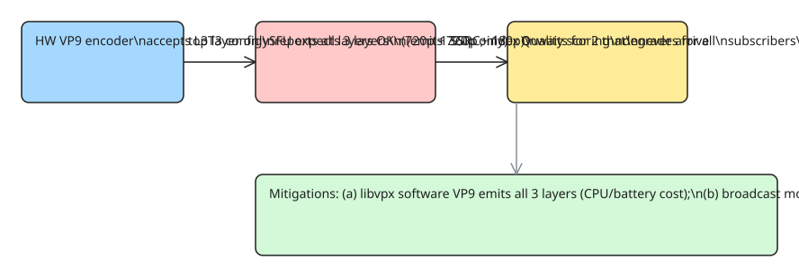

# Android Hardware VP9 Accepts Spatial SVC, Then Silently Drops the Layers — a WebRTC Video Quality Debugging Journey

Spatial SVC (Scalable Video Coding) lets a single encoder emit one stream with **spatial layers** (different resolutions) and **temporal layers** (different frame rates). An SFU then forwards the subset each subscriber's bandwidth supports — one encoder instead of the three (or more) that simulcast requires. The pitch is excellent. The reality on Android: the hardware VP9 encoder *accepts* the spatial SVC configuration, reports success, and then **only emits the topmost layer** — silently.

This is the full debugging journey (from a Getstream production case): the symptom, two false leads, the root cause, the verification, and the production mitigation.

## The setup: L1T3 vs L3T3

The stream uses VP9 with:

- **Spatial layers**: 180p / 360p / 720p (3 layers)
- **Temporal layers**: 7.5 / 15 / 30 fps (3 layers)

| Mode | Configuration | When |
|---|---|---|
| **L1T3** | 1 spatial layer, 3 temporal layers | Only the broadcaster watches — lowest cost, full frame-rate ladder |
| **L3T3_KEY** | 3 spatial layers, key-only temporal scaling | A second viewer joins — the SFU now needs resolution variants to match each viewer's bandwidth |

The switch from L1T3 to L3T3_KEY is the trigger for everything below.

## The symptom

Quality scores dropped when the second viewer joined. In L1T3 (broadcaster only) the stream rated fine. The moment L3T3_KEY kicked in, quality metrics tanked — a strong hint that something in the *spatial* dimension was broken, not the temporal one.

## False lead 1: encoder thrashing

First hypothesis: the hardware encoder couldn't change resolution or buffer type while running, so the stack **tore down and re-initialized the encoder every ~200ms** whenever the target resolution changed. The quality scaler then oscillated between 720p and 540p, and the flapping looked like "bad quality."

Fix: set the **degradation preference** (libWebRTC's `kEncodeDegradationPreference` — prefer dropping frame rate over resolution) so the encoder never re-initializes mid-stream. Quality stabilized… but the stream still scored low. The thrashing was real, but it was a *separate* bug.

## False lead 2: phantom bitrate

Next: the SFU's per-subscriber bitrate accounting looked wrong. Digging into libWebRTC, `SendStatisticsProxy` maps **SSRC → simulcast index** to attribute sent bitrate to the right "stream." But spatial SVC carries **one SSRC** for all layers, so the index is always 0, and the target bitrate computation reads `GetSpatialLayerSum(0)` — which is ~**71 kbps** — while the encoder was actually sending **~1.4 Mbps**.

```cpp
// The phantom: one SSRC, so the lookup always hits layer 0
// and the "expected" bitrate is the 180p layer's, not the
// actual top-layer send rate.
int index = ssrc_to_simulcast_index[ssrc];  // always 0 for SVC
float expected = GetSpatialLayerSum(index);  // ~71 kbps, vs 1.4 Mbps real
```

The numbers proved the encoder *was* sending high-bitrate video — so the low quality score wasn't a send-side bitrate problem.

## The root cause

**Android's hardware VP9 encoder produces only the topmost requested layer.** It accepts the full L3 spatial SVC configuration (capability check passes, `VideoEncoder` reports all layers), but the actual output stream contains only the highest layer — the 180p and 360p spatial layers never appear on the wire.

The SFU, told to forward 3 spatial layers, waits for 2 that never arrive; its quality scoring degrades accordingly. The encoder isn't failing — it's *lying* about its layer output, with no error and no capability flag to check.

Verification:

- Reproduced on **Samsung and Pixel** devices, spanning **both Qualcomm and Tensor** SoCs — this is platform behavior, not a single chip vendor's.
- **Software VP9 (libvpx) produces all three spatial layers correctly** — same configuration, correct output. The cost: CPU and battery, which is exactly why the hardware path exists.
- **No API exists to detect spatial SVC support up front.** Android 17's `getSupportedLayeringSchemas()` returns only *temporal* schemas (`webrtc.svc.l1tN`) — it says nothing about spatial layering, so you cannot branch on "is spatial SVC real on this device" before committing to the mode.



## Production data and mitigations

- **HW VP9 streams consistently rated low** across the fleet — the platform behavior is deterministic, not flaky.
- **Mitigation A — software encoder**: libvpx VP9 produces all three spatial layers correctly for the same configuration. Acceptable for low-concurrency use; the CPU and battery cost is the reason the hardware path exists in the first place.
- **Mitigation B — "broadcast mode" (in development at Getstream)**: the publisher sends a **single HW stream at the top resolution** (which the hardware encoder does correctly), and the **SFU transcodes the quality ladder server-side**. Opt-in for broadcast-style use cases (many viewers, one publisher) where server-side transcoding is affordable and client-side SVC is not.

## Lessons for anyone shipping SVC on Android

1. **Capability reports are lies until verified on the wire.** The encoder reported full spatial SVC; the actual layer output only shows up in a packet capture. Verify with an actual capture, not the API.
2. **One SSRC breaks simulcast-oriented accounting.** Anything in libWebRTC that maps SSRC → simulcast index silently collapses to index 0 under spatial SVC — bitrate targets, bandwidth allocation, and quality scoring all read the wrong number.
3. **No pre-flight check exists.** Android 17's layering schema API is temporal-only; there is no way to ask "will this device emit spatial layers?" before committing to L3T3.
4. **Server-side transcoding is the fallback that makes hardware encoders safe** — when the client can't be trusted to produce the ladder, the SFU builds it.

## References

- [Android Hardware VP9 Accepts Spatial SVC, Then Drops the Layers (DEV.to, Getstream, original source)](https://dev.to/getstreamhq/android-hardware-vp9-accepts-spatial-svc-then-drops-the-layers-17gd)
- Related KB note: [[Scaling Real-Time APIs to 100k+ Concurrent Connections with WebSockets, SSE, and Redis Pub/Sub]] (the SFU/fan-out side of real-time media delivery)
