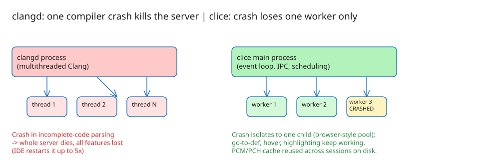

# clice: Rethinking the C++ Language Server with Modern C++ and a Process Pool

**[clice](https://github.com/clice-io/clice)** hit its first stable release (v1.0) after ~4 months of nightly-driven alpha testing and 1,000 commits. Like clangd and ccls it is built on LLVM/Clang, but it was redesigned from the ground up to fix architectural problems those servers have carried for years — and it doubles as a production-scale demonstration that modern C++ (C++20 modules, `import std`, coroutines, static reflection via concepts) is usable at hundreds of thousands of lines.

## The central architectural bet: process pool over threads

clangd runs multithreaded Clang inside one process. C++ is complex enough that the compiler **crashes or leaks memory on corner cases** — especially on *incomplete* code mid-edit, which almost nobody stress-tests (downstream users test compilers on complete code; half-written code falls back on best-effort heuristics). In clangd, one compiler crash takes down the whole server and every editor feature (the demo in the post shows clangd 23.1.0 dying 5 times on completion in one file until the extension stops restarting it).

clice compiles in an **isolated child-process pool modeled after modern web browsers**: losing one worker costs you nothing but a per-file warning; go-to-definition, highlighting, hover, and completion keep working. The process boundary also gives clean memory management and **compilation priority scheduling**, cutting wasted resource use.

## Feature-level differences vs clangd

| Area | clangd | clice |
|---|---|---|
| Crash isolation | Whole server dies | One worker dies |
| C++20 named modules | Very limited, no cache | Full support: scans deps from `compile_commands.json`, lazily builds modules on demand regardless of build system/compiler; **PCH/PCM cached on disk across sessions** |
| Non-self-contained files | Errors | "Compilation context": auto-detects the context (a source file's compile command, or a header's inclusion site); switch contexts (fast.cpp vs precise.cpp) and inactive regions/types update; build configurations (debug/release) groupable |
| Templates | Needs concrete instantiation | **DFS pseudo-instantiator** resolves dependent names without full instantiation; templates treated as duck-typed interfaces — Go to Implementation on a dependent call lists what each instantiation actually calls; Find References / Call Hierarchy work the same way |

## Modern C++ as the implementation language

- **C++20 coroutines throughout**, on a custom libuv-based structured-concurrency async library (kotatsu) — event loop on the main thread coordinating multiple processes (IPC) and threads.
- **C++20 named modules + C++23 `import std`**, fully self-hosting: `clice modularize` auto-generates module wrappers for third-party libraries; clice serves its own codebase.
- **Static reflection** on templates + concepts for all serialization (TOML, JSON, bincode, blob, CLI args) with Rust-macro-like declarative annotations, zero boilerplate.
- **Data-oriented design**: almost no virtual functions (except Clang-required callback interfaces); heavy `std::format`, `std::expected`, `std::ranges`/`std::views` usage, deliberately avoiding C++98/11-era APIs.
- **Hermetic Bazel build** with the unified [xclang](https://github.com/clice-io/xclang) toolchain for cross-compilation; binaries built with **PGO + LTO**; artifacts depend only on system libraries.

## Getting started

Install the **clice** extension from the VS Code Marketplace (server for your platform is bundled — no separate download); VS Code forks (Cursor, VSCodium, Windsurf) install it from Open VSX. Open a C++ project with a compilation database: by default clice searches the workspace root and immediate subdirectories (e.g. `build/`) for `compile_commands.json`; custom paths and other build systems are covered in its configuration docs.

## Why it matters

Two lessons generalize beyond C++ tooling:

1. **Crash isolation is a design requirement** for any tool that embeds a parser/compiler working on malformed input — treat the parser as untrusted, run it out-of-process.
2. The author credits AI coding agents (models like Opus 5.5 / Fable 5.2) with the project's completeness: writing a full LSP from scratch on Clang internals became feasible for a solo developer. The post doubles as a v1.0 retrospective — maintenance moves to incremental fixes going forward.

## References

- [clice v1.0 Released: Welcome to Modern C++ — ykiko's blog](https://ykiko.me/en/articles/2105384023094834022/) (original source)
- [clice-io/clice on GitHub](https://github.com/clice-io/clice)
- [clice VS Code extension](https://marketplace.visualstudio.com/items?itemName=clice-io.clice)
- [kotatsu (async/codec libraries)](https://github.com/clice-io/kotatsu)
- [Design and Implementation of a New C++ Language Server (2024, the original design post)](https://www.ykiko.me/en/articles/13394352064)

Related: [[howto-porting-concurrent-cpp-to-rust]]
