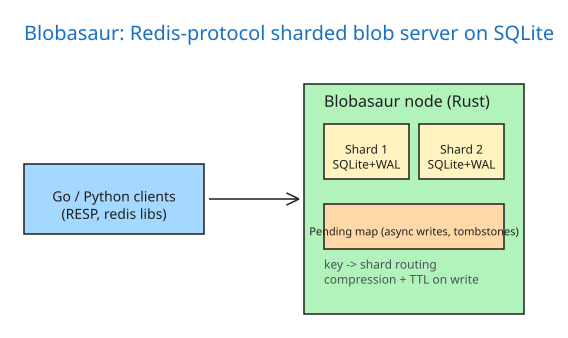

# Blobasaur: Distributed, High-Performance Blob Storage on SQLite

Zerodha replaced an aging SSDB cluster with **Blobasaur**, an open-source (AGPLv3, Rust) sharded blob server that speaks the **Redis protocol** and uses **SQLite** as the per-shard storage engine. It serves multi-KB to multi-MB JSON blobs at thousands of requests/second on commodity hardware with single-digit millisecond latency.

## Why they moved off SSDB

SSDB (a C++ disk-backed Redis-protocol store) served Kite (~20M users, custom trading layouts, widget workspaces) for years, but:

1. **Unmaintained** — written in C++, outside the team's stack, so forking was not viable.
2. **Not distributed** — single-node only; blob sizes had been capped at 1 MB because latency degraded on larger payloads.

Requirements for a replacement: Redis-protocol drop-in (`GET/SET/HGET/HSET/DEL/EXPIRE`), low latency across 2 KB–5 MB payloads, built-in compression (repetitive JSON), simple CRUD + per-key TTL, horizontal sharding, and **relaxed durability is acceptable** (losing the last few UI-preference writes after a crash is annoying, never financial).

## Alternatives evaluated

| Candidate | Why rejected |
|---|---|
| ScyllaDB | Suboptimal throughput for large blobs; tombstones from overwrites/TTL need careful tuning |
| PostgreSQL `BYTEA` | Severely suboptimal performance and disk-space efficiency |
| YugabyteDB | Blob support exists but is not a primary design goal; system too large |
| RocksDB | Right primitives, not architected for high-throughput multi-MB writes |
| Ceph | Operational complexity; never got to try it |
| SeaweedFS | Closest candidate, but append-before-compaction grows disk under overwrite-heavy workloads, blob IDs need a separate key mapping, no per-blob TTL |
| S3 / MinIO | High per-request latency for small blobs, write-heavy request costs (writes = 50% of traffic), coarse lifecycle TTLs |
| Raw filesystem | Must reinvent atomic writes, batching, TTL index, fd/inode management |

## Why SQLite

- For small blobs SQLite is up to **35% faster than raw filesystem I/O** ([sqlite.org claim](https://www.sqlite.org/fasterthanfs.html)). Raw files win above ~100 KiB — but blobs are compressed before writing and **99% of compressed values sit below 100 KiB**.
- Inherits ACID transactions, crash recovery, and tooling: any shard file can be inspected with the `sqlite3` CLI.
- **Rust over Go**: Go's SQLite driver needs CGo (complicates static builds, pins OS threads under high concurrency, GC pressure on multi-MB buffers). Rust with `sqlx`, `rusqlite`, and `tokio` calls SQLite's C API directly and ships a single static binary.

## Hard-won operational details

- **Space reclamation**: `PRAGMA auto_vacuum = INCREMENTAL` per shard plus a `blobasaur shard vacuum` subcommand (128 MB default); because shrinking a file in WAL mode requires a checkpoint, it runs `PRAGMA wal_checkpoint(TRUNCATE)` right after incremental vacuum.
- **Async writes vs. read-your-writes**: with `async_write`, writes return `OK` while still in a memory queue. Reads (`GET`, `HGET`, `EXISTS`, `TTL`) are routed through an in-memory **pending map** first, including explicit **tombstones** — otherwise a `DEL` followed by `GET` returned the old value from SQLite.
- **TTL cleanup contention**: p99 write spikes of 30–50 ms were traced to a background cleanup worker holding its own write connection and running one large `DELETE`. Fix: route cleanup batches through the shard's existing writer connection and bound each pass with `cleanup_chunk_size` (1,000 rows). Expired rows are filtered at read time, so chunked physical deletion is correctness-neutral.

## Production numbers

Three nodes (4 vCPU, 8 GB RAM). Over a full trading session (09:00–15:30): p99 ≈ **2 ms** on every node, p50 **250–550 µs**. By command: `HSET` p99 ~2 ms, `HGET` p99 ~1.4 ms, `HDEL` p99 mostly under 1 ms.

## Architecture at a glance

Clients speak RESP (Redis protocol) to the Blobasaur server; keys are partitioned across shards; each shard is one SQLite database file with WAL mode, compression on write, and a pending-write map in front of reads; a coordinator/consistent-hashing layer maps keys to shards on the cluster nodes.

## Key takeaways

- SQLite is a legitimate storage engine for a *server* workload when the working set per shard is file-sized and payloads are compressed below the ~100 KiB crossover.
- Redis-wire compatibility was the migration risk-killer: existing Go/Python services were untouched.
- Single-writer-per-file designs (SQLite) demand that *all* writers — including background maintenance — share one writer lane with bounded batches.

## References

- [Distributed, high-performance blob storage on SQLite — Zerodha Tech Blog](https://zerodha.tech/blog/high-performance-distributed-blob-storage/)
- [Blobasaur on GitHub (iamd3vil/blobasaur, AGPLv3)](https://github.com/iamd3vil/blobasaur)
- [SQLite: 35% Faster Than The Filesystem](https://www.sqlite.org/fasterthanfs.html)
