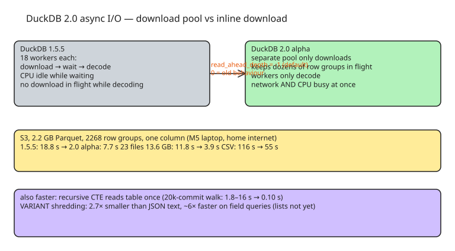

# DuckDB 2.0 — Why It Is Faster: Async I/O, Rewritten Recursive CTEs, and VARIANT Shredding

DuckDB 2.0 (alpha) is faster on remote data not because of a new executor, but because it **overlaps network waiting with CPU work** and stops re-reading tables for recursive queries. All benchmark numbers below are from a single M5 laptop over home internet to us-east-1, so treat them as relative, not absolute.

## Async I/O — network and CPU busy at the same time

Reading a 2.2 GB Parquet file from S3 (228M rows, 2268 row groups, one column ≈ 230 MB):

```sql
CREATE SECRET s3 (TYPE s3, PROVIDER credential_chain, REGION 'us-east-1');
SET enable_external_file_cache = false;  -- force every run to hit S3

SELECT VoteTypeId, count(*) AS n
FROM read_parquet('s3://us-prd-motherduck-open-datasets/stackoverflow/parquet/2023-05/votes.parquet')
GROUP BY ALL ORDER BY 1;
```

| Same query | 1.5.5 | 2.0 alpha |
| --- | --- | --- |
| 2.2 GB Parquet, one column | 18.8 s | 7.7 s |
| 23 files, 13.6 GB, one column | 11.8 s | 3.9 s |
| 1.7 GB plain CSV | 116 s | 55 s |
| 30 tiny (~1 MB) Parquet files | 3.7 s | 3.3 s |

In 1.5.5 each of the 18 workers does download → wait → decode in turn: while a worker waits, its CPU is idle, and no download is in flight while it decodes. In 2.0 a **separate pool of threads only downloads**, keeping dozens of row groups in flight in a buffer, while the 18 workers only decode. One knob controls it:

```sql
-- read_ahead_depth: how many row groups the download pool may fetch ahead.
-- default -1 = automatic (sized from thread count) → async I/O on by default
SET read_ahead_depth = 0;  -- restores 1.5.5 behaviour
```

Two caveats: tiny files barely improve because per-file round trips (footer, then data) dominate — reading ahead cannot remove them, and storing a lake as thousands of 1 MB files is bad practice either way. And the S3 numbers above are home-internet-bound; cloud compute will show more.

## Recursive CTEs — cost proportional to rows touched, not rounds × table size

The 2.0 recursive CTE engine reads the base table **once**, builds a lookup on the parent column once, and each round only looks up the rows it just found. In 1.5.5 every round re-read the whole table — eight levels meant eight full reads; thousands of levels meant thousands of full reads.

```sql
WITH RECURSIVE ancestors(id) AS (
    SELECT max(id) FROM commits            -- HEAD
    UNION
    SELECT p.parent_id FROM ancestors a JOIN commit_parents p ON p.commit_id = a.id
)
SELECT count(*) FROM ancestors;
```

On a generated 20,000-commit repo with a few merges, walking ancestry to the root: 1.5.5 took **1.8 s to 16 s** across runs; 2.0 alpha took **0.10 s every run** (the team claims up to 40x on graph reachability). Shallow hierarchies (org charts, ~8 levels) gain little; deep ones (git history, data lineage, bill of materials) turn "push this to a graph database" jobs into normal queries. Keep the hierarchy as one parent/child table with integer ids, and use `USING KEY` when the recursion carries a value like depth or cost.

## VARIANT — smaller and faster than JSON strings (shredding)

`VARIANT` is now a first-class type. When DuckDB writes a row group, it inspects the JSON and pulls fields that appear in most rows **with a consistent value kind** into their own real columns; rare or type-inconsistent fields stay in a binary remainder. On 5M events stored three ways:

| | JSON string | VARIANT 2.0 | VARIANT 1.5.5 | typed columns |
| --- | --- | --- | --- | --- |
| On disk | 224 MB | 85 MB | 81 MB | 45 MB |
| Filter on 2 sub-fields | 366 ms | 63 ms | 4.96 s | 52 ms |
| Sum grouped by country | 408 ms | 61 ms | 5.28 s | 51 ms |
| List contains | 357 ms | 1.96 s | 4.65 s | 67 ms |

Key points:

- VARIANT is **2.7× smaller** than the JSON string; `pragma_storage_info('ev')` shows sub-columns, with the event kind dictionary-encoded. `EXPLAIN` shows filters pushed into the scan.
- On shredded fields VARIANT is ~6× faster than parsing JSON text and within 20% of typed columns; vs 1.5.5's VARIANT (type without shredding) it is ~78× faster.
- The list query is the exception: casting a VARIANT list to `VARCHAR[]` costs ~2 s in this alpha — **field access is where shredding pays today; lists are not there yet**.
- A field that is `231` in one row and `"231ms"` in the next falls into the remainder. Keep value kinds consistent.
- Promote hot fields to real columns:

```sql
ALTER TABLE ev ADD COLUMN type VARCHAR;
UPDATE ev SET type = payload.type::VARCHAR;
```

## Quick hits from the release and commit log

- **Triggers with transition tables** — statement-level `OLD TABLE`/`NEW TABLE` make history logging a database-side concern:

```sql
CREATE TRIGGER price_history AFTER UPDATE ON prices
REFERENCING OLD TABLE AS before_rows NEW TABLE AS after_rows
FOR EACH STATEMENT
INSERT INTO price_history (id, old_price, new_price)
SELECT a.id, b.price, a.price FROM before_rows b JOIN after_rows a USING (id);
```

- **Nested schemas**: `CREATE SCHEMA finance.reports;`
- **DML inside CTEs** (atomic row-move pattern):

```sql
WITH moved AS MATERIALIZED (DELETE FROM staging RETURNING *)
INSERT INTO prod SELECT * FROM moved;
```

- `SET dialect_compatibility_mode = 'spark'` for migrating Spark SQL pipelines.
- `SET external_file_cache_spill = true`: cached remote file blocks evicted from memory spill to the temp dir instead of re-downloading — with a 300 MB memory limit, a second read of an 854 MB S3 Parquet file went from 23.9 s to 0.35 s.
- CLI gains: SQL formatter (`duckdb -format`, `.auto_format on`), queryable history (`.history`, `FROM shell_history()`), `.about`, `.manual <function>`.
- `read_json` now detects ISO-8601 timestamps with offset as `TIMESTAMPTZ` instead of silently dropping the offset.
- `CREATE SECRET s IN CONNECTION (...)` scopes a secret to one connection.
- **Quack**, the client-server protocol, reaches 1.0 with this release.

Install the alpha:

```bash
curl https://install.duckdb.org | DUCKDB_VERSION=alpha bash
~/.duckdb/cli/latest/duckdb -c "SELECT version()"
```

## TL;DR

- S3 reads are 2–3× faster with zero query changes; it is on by default (`read_ahead_depth = -1`), `0` restores old behaviour.
- Deep parent/child walks get the recursive-CTE boost; shallow ones do not.
- Model what you know: consistent fields as VARIANT (or real columns), keep the long tail in VARIANT, avoid list casts in hot queries.

## Diagram



## References

- [Why DuckDB 2.0 is faster — MotherDuck](https://motherduck.com/blog/why-duckdb-20-is-faster/)
- [DuckDB alpha install page](https://duckdb.org/install/preview)
