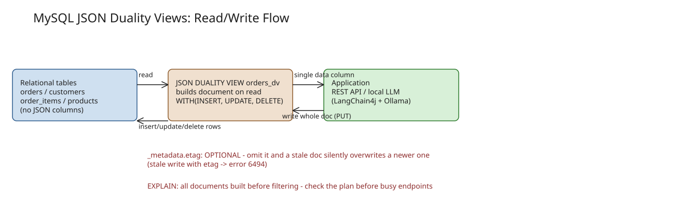

# MySQL JSON Duality Views: One Database, Two Models (MySQL 9.7)

A **JSON duality view** lets MySQL hand your application a complete JSON document — an order with its customer and
line items — while the data stays in normal relational tables. Reading the view builds the document from the rows
on demand; **writing a document back makes MySQL work out which rows to insert, update, or delete**. Nothing is
stored as JSON, so there is nothing to keep in sync.

- Duality views arrived in **MySQL 9.4**, but writes were **Enterprise-only**.
- **MySQL 9.7.0 brought writes to the free Community edition** — if you read an older post saying writes need
  Enterprise, it was right at the time and isn't anymore.
- Oracle Database has a similarly named feature; it's a different product and its behavior says nothing about
  MySQL's.

## The view definition

The example is a small shop: `customers` → `orders` → `order_items` → `products`, plain InnoDB tables with FKs and
CHECK constraints, no JSON columns anywhere. The order view expresses the same relationships in SQL:

```sql
CREATE OR REPLACE JSON DUALITY VIEW orders_dv AS
SELECT JSON_DUALITY_OBJECT(WITH(INSERT, UPDATE, DELETE)
  '_id': o.id,
  'status': o.status,
  'createdAt': o.created_at,
  'updatedAt': o.updated_at,
  'customer': (
    SELECT JSON_DUALITY_OBJECT(
      'id': c.id, 'name': c.name, 'email': c.email
    ) FROM customers c WHERE c.id = o.customer_id
  ),
  'items': (
    SELECT JSON_ARRAYAGG(JSON_DUALITY_OBJECT(WITH(INSERT, UPDATE, DELETE)
      'id': i.id, 'quantity': i.quantity, 'unitPrice': i.unit_price,
      'product': (
        SELECT JSON_DUALITY_OBJECT(
          'id': p.id, 'sku': p.sku, 'name': p.name
        ) FROM products p WHERE p.id = i.product_id
      )
    )) FROM order_items i WHERE i.order_id = o.id
  )
) FROM orders o;
```

Rules that bite (reproduced in the companion project's error log):

- `WITH(INSERT, UPDATE, DELETE)` makes an object's table updatable. Objects **without** annotations are
  read-only — the example deliberately leaves `customer` and `product` read-only so editing an order can't rename a
  customer or product shared by other orders.
- **Error 6455** (`Invalid JSON duality view definition: FROM clause must include exactly one table`): you cannot
  flatten a product's SKU into each line by joining `order_items` to `products` inside the `items` object — each
  object needs its own nested SELECT.
- **Error 6469** ("Primary key column of every table should be projected"): every table's primary key must be
  projected; the root key must be named `_id`.
- A view with a normal SELECT reads the single `data` column:
  `SELECT JSON_PRETTY(data) FROM orders_dv WHERE data->'$._id' = 1001;`

## Reading

The document comes back with a `_metadata.etag` — a fingerprint of the document MySQL uses to detect conflicting
writes. Sharp edge: **empty collections come back as `null`, not `[]`** — an order with no items gives
`"items": null`, a customer with no orders the same. If your API promises empty arrays, convert the nulls yourself.

From Java the repository method just returns the JSON string; a Spring Boot controller sends it as the response
body with `application/json` content type — Spring doesn't re-serialize it and no DTOs get built along the way.

## Writing: PUT semantics, never PATCH

```sql
UPDATE orders_dv SET data = ? WHERE data->'$._id' = ?
```

- **Writing through the view replaces the whole document.** Leave one item out of `items` and that line is deleted;
  leave out `items` entirely and every line is deleted. Think PUT, never PATCH.
- The etag is checked **before** a write is accepted: if the order changed after you read it, the stale write
  fails with **error 6494**. Two racing writers on the same document: one succeeds, the other gets 6494.
- **The etag is optional — and the author argues that's the wrong default.** Omit `_metadata` and MySQL accepted a
  stale document and *silently overwrote a newer cancellation*, with no error. A client can lose conflict
  detection by omitting one field. A sensible API should require it (428 without, 409 when stale).
- The etag covers exactly what the view projects: renaming a customer invalidates their orders' etags, but a change
  to an unprojected catalog price doesn't.
- `ON UPDATE CURRENT_TIMESTAMP` gotchas: a column with `ON UPDATE CURRENT_TIMESTAMP` only applies when you don't
  set the column yourself — the returned document carries the old `updatedAt`, so a trigger
  (`SET NEW.updated_at = CURRENT_TIMESTAMP(6)`) puts the database back in charge. General rule: if a column is in a
  writable document, assume clients will send it back, whether you meant them to or not.
- MySQL rejected broken JSON, unknown fields, a missing `status`, a changed `_id`, edits to read-only objects, and
  constraint/FK violations — and **rolls the whole document back** when any part fails (documented rollback
  behavior).
- `INSERT INTO orders_dv VALUES (?)` takes no column list.

## Performance: check the query plan

`EXPLAIN` on a lookup by ID showed MySQL **building every order document first, then filtering** to the requested
one. The plain join went straight to the row through its indexes. Removing the Java mapping loop made the
*application* look cheaper, but the database does work for orders the caller never asked for. The author had not
measured at scale and would not assume the lookup is fast — check the plan with realistic data before putting it on
a busy endpoint. Also rejected by the view definition: root WHERE filters, sorted nested items, computed fields,
and composite primary keys.

## Duality view vs JSON column

Copy order 1001's document into a JSON column, then rename the customer: the **view shows the new name, the copy
keeps the old one**. A JSON column checks that the JSON is valid, not that it refers to anything. Keeping the old
name is exactly what an invoice wants. Rule of thumb: data already in related tables that you want *shaped* like a
document → duality view; the document itself is what you need to keep → JSON column.

## Giving the documents to a local LLM

The companion app (Spring Boot 4.1.1, Java 25, LangChain4j 1.20.0, Ollama with `llama3.1:8b` Q4_K_M, all local)
gives the model two read-only tools: `getOrder(orderId)` and `getCustomerOrders(customerId)` — the second reads a
smaller view rooted in the customer, so the model never sees table names, joins, or column aliases.

- The customer comes from the **application**, never from the model: Java hands it to the tool through
  `InvocationParameters` (LangChain4j passes it but keeps it out of the tool description, so the model can neither
  see nor change it). Asking as customer 42 about another customer's order: the tool refuses and no data reaches the
  model. The tools' database account can only SELECT from the two views; the Java scope check is the one that
  matters.
- Two-step flow: (1) the model picks a tool, the tool returns straight to Java (`returnBehavior = IMMEDIATE`) and
  Java sorts the customer's orders newest first; (2) a second call with no tools gets the question plus documents
  and writes the answer.
- Even with sorted input the model still made mistakes — called a shipped order "open" in one run, got it right the
  next with identical model/prompt/seed (the only difference: the order MySQL returned the rows in; the view
  doesn't promise an order). It also invented dollar signs. Conclusion: the view gives clean JSON but doesn't stop
  the model from misinterpreting it — business-logic checks stay in Java, and a prompt-injection via a customer
  named "Ignore previous instructions" still has to be handled there.

## When to use it

Good fit: the tables are already well designed, several consumers need the same document shape, small documents
with a stable shape, and the aggregate owns its children (an order owns its lines). Hold off: busy lookups (plan
check first), large filtered lists / bulk updates / reports (plain SQL), entities with real behavior (ORM or
command layer), snapshot semantics like invoices (JSON column), composite primary keys. Before allowing writes:
**require the etag and the complete document**.

## Related notes

- MySQL 9.0 — In-Memory Optimizations

## References

- [MySQL JSON Duality Views, One Database Two Models (DZone, originally bazlur.com)](https://dzone.com/articles/mysql-json-duality-views)
- [Companion project (code, SQL, captured test evidence)](https://github.com/rokon12/order-duality)
- [MySQL 9.7.0 release notes (duality view writes in Community)](https://dev.mysql.com/doc/relnotes/mysql/9.7/en/news-9-7-0.html)
- [CREATE JSON DUALITY VIEW (MySQL 9.7 reference)](https://dev.mysql.com/doc/refman/9.7/en/create-json-duality-view.html)
- [Updatable JSON duality views / rollback behavior](https://dev.mysql.com/doc/refman/9.7/en/json-duality-views-updatable.html)
- [JAV concurrency (etag semantics)](https://dev.mysql.com/doc/refman/9.7/en/jdv-concurrency.html)

## Diagram

