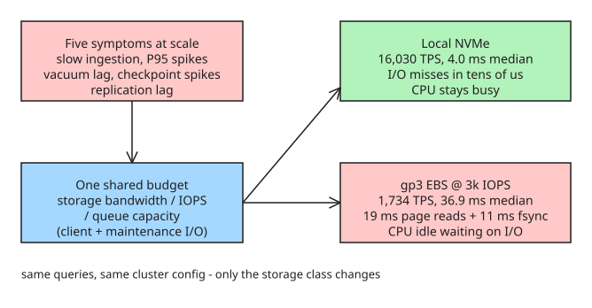

# Postgres Isn't Slow, Your Storage Is — NVMe vs EBS Benchmarks and Production Patterns

A POSETTE 2026 talk (Sai Srirampur, ClickHouse) benchmarks the same 3.3-billion-row PostgreSQL workload on local NVMe versus baseline gp3 EBS (3,000 IOPS) and shows how storage class — not query tuning — is the root cause of five familiar scaling symptoms:

1. **Slow ingestion** — UPDATE/UPSERT-heavy jobs stretching from seconds to minutes.
2. **Inconsistent read latency** — P95 jumping from milliseconds to seconds.
3. **VACUUM falling behind** — bloat accumulating as UPDATE/UPSERT throughput grows.
4. **Checkpoints stealing I/O** — recurring latency spikes instead of invisible maintenance.
5. **Logical replication lag** — WAL decoding slow, replication slots compounding.

These look unrelated, but they share one budget: the storage's bandwidth, IOPS, and queue capacity. Client queries, heap/index writes, WAL sync, checkpoints, VACUUM, and logical-decoding spills all compete for it. When the working set outgrows `shared_buffers` plus the OS page cache, every cache miss becomes physical I/O, and slow storage makes *all* of the above symptoms appear at once.

## The benchmark

Setup (the only variable is storage class):

- Eight identical clusters: 4× instance-store NVMe, 4× baseline gp3 EBS @ 3,000 IOPS.
- `m6id.4xlarge` instances: 16 vCPU, 64 GiB RAM, `shared_buffers` = 16 GiB.
- 482 GiB `pgbench_accounts` heap, 3.3 billion rows.
- Same workload: 5 minutes of highly concurrent random UPDATEs, 64 clients, 16 worker threads:

```sql
\set aid random(1, 3300000000)
UPDATE pgbench_accounts SET abalance = abalance + 1 WHERE aid = :aid;
```

Results:

| Metric | EBS (gp3, 3k IOPS) | Local NVMe | Gap |
| --- | --- | --- | --- |
| Median throughput | 1,734 TPS | 16,030 TPS | **9.24×** |
| Median transaction latency | 36.9 ms | 4.0 ms | ~9× |
| VACUUM over 10 GB bloat | 964 s | 366 s | 2.6× |
| Drain 10 GB logical-replication backlog | 238 s | 139 s | 1.7× |

Where the 37 ms of EBS transaction latency went:

| Component | EBS | NVMe |
| --- | --- | --- |
| Page reads | ~19 ms | 0.3 ms |
| WAL `fsync` at commit | ~11 ms | 1.5 ms |
| Lock/scheduler overhead | ~5 ms | 0.2 ms |
| CPU work | ~2 ms | ~2 ms (same) |

Most of the extra latency is *waiting on storage*, not PostgreSQL doing more work. A mid-run `pg_stat_activity` snapshot confirms it: 29 of 64 backends on EBS were waiting on `IO:DataFileRead` vs 9 on NVMe (~45% vs ~14%). A ~240 s CPU profile is counterintuitive: the NVMe host accumulated 2,253 CPU-seconds (~9.4 busy cores) while the EBS host only 251 (~1 core) — EBS processes spent far more time *off-CPU* waiting on storage. NVMe's win is not eliminating I/O, it's making each miss cheap so the CPU stays busy doing useful work.



Caveat: the numbers hold for *this* workload on *this* EBS configuration; a different gp3 provisioned IOPS value would change the gap. The point is the mechanism: once storage is the bottleneck, the same five symptoms appear regardless of the query.

## Running NVMe-backed Postgres in production

Instance-store NVMe dies with the node, cannot be snapshotted via the EBS API, and its capacity depends on instance type. The production architecture moves durability out of the node and into the cluster:

1. **Quorum synchronous replication with two standbys**: `synchronous_standby_names = 'ANY 1 (standby1, standby2)'` — a transaction commits after *either* standby durably acknowledges its WAL, not the slower of the two. Spread standbys across AZs.
2. **Continuous backups to object storage**: physical base backups + continuous WAL archiving (e.g. WAL-G) in a *separate failure domain* (ideally a second regional copy). This targets RPO in seconds and point-in-time recovery within the retention window.
3. **Plan capacity per instance type**: the available NVMe size is a property of the chosen `m6id`-class instance, so storage sizing is part of instance selection.

Replication and backups solve different problems: standbys give rapid failover; base backups + WAL archive protect against corruption, operator error, and cluster-wide failure — and double as the recovery foundation for PITR, isolated branches, resizing, replica seeding, and DR. Public examples: Instacart runs Postgres on NVMe for a latency-sensitive search workload; Datadog has discussed local-NVMe PostgreSQL instances.

## Diagnostic takeaway

When Postgres "stops scaling", inspect the database *and* the storage together: slow ingestion, unpredictable P95, vacuum pressure, disruptive checkpoints, and replication lag can all be the storage layer hitting its limit — check `pg_stat_activity` wait events (`IO:DataFileRead`) and fsync times before tuning queries.

## References

- [Postgres Isn't Slow. Your Storage Is (ClickHouse blog, POSETTE talk recap)](https://clickhouse.com/blog/posette-talk-recap-postgres-isnt-slow-your-storage-is)
- [POSETTE 2026 talk page](https://posetteconf.com/2026/talks/postgres-isn-t-slow-your-storage-is/)
- [Instacart: how Instacart built a modern search infrastructure on Postgres](https://tech.instacart.com/how-instacart-built-a-modern-search-infrastructure-on-postgres-c528fa601d54)
- [Datadog on local-NVMe PostgreSQL instances (PGConf US 2025)](https://postgresql.us/events/pgconfus2025/sessions/session/2064/slides/204/)
