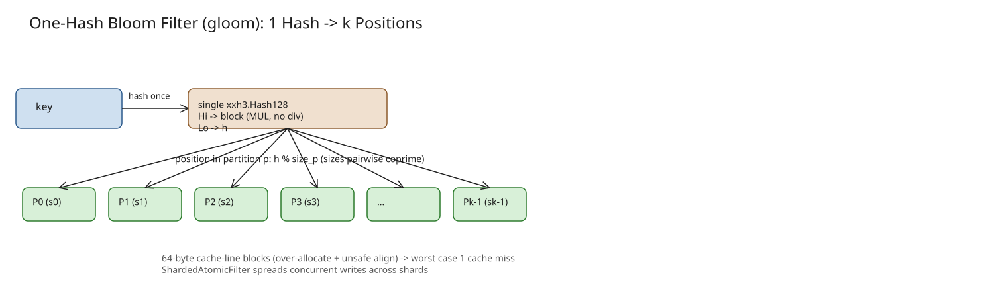

# One-Hash Bloom Filters: Single Hash, k Coprime Partitions, Cache-Aligned Blocks (gloom)

A [bloom filter](https://en.wikipedia.org/wiki/Bloom_filter) answers *"is key X in this set?"* with either
*"definitely not"* or *"probably"* — you pick a false positive rate, add keys, check later. Small memory for large
sets, computationally cheap: a database may keep an in-memory bloom filter and check it before hitting slow disk.

In the **Bluesky** backend, bloom filters save **millions of queries per second** against the Scylla database for
blocks, mutes, labels, and more — *"does user X block user Y?"* is often answered without touching the database. The
production positive rate sits around **1%**, meaning 99% of lookups skip the database entirely.

## From k hashes to two to one

- **Traditional**: an array of bits + k independent hash functions; add a key by setting the k bits at the k
  locations, check by requiring all k bits set.
- **Double hashing** (Kirsch & Mitzenmacher, 2008): derive the i-th location as `(hash_1 + i*hash_2) % n` —
  effectively the same false positive rate as k independent hashes.
- **One hashing** (Lu et al.): split the bit array into **k partitions of fixed, pairwise-coprime sizes** (no two
  sizes share a common factor other than one); hash the key **once** to `hash`; the bit position in partition p is
  `hash % size_p`. One hash yields k bit positions to check, used exactly like any other bloom filter.

## Production history at Bluesky

1. `bits-and-blooms/bloom` (Daniel Lemire) — double-hash Go implementation: runs 128-bit murmur3 twice to get four
   64-bit values, combined to produce all k locations. Used for a long time.
   - Problem: **not internally thread-safe** — all access wrapped in a `sync` mutex. The Bluesky backend loads all
     blocks/mutes/list items on process start while a real-time atproto firehose consumer inserts concurrently, so
     the race is real. pprof showed **mutex contention was the bottleneck of process launch: a single deploy took 90
     minutes to roll out**.
   - Fix: Jasmine forked it into **`atomic-bloom`** (`jazware/atomic-bloom`), using `sync/atomic` CPU instructions
     for the same logic without mutexes → **deploys dropped from 90 minutes to about 15**.
2. **`jcalabro/gloom`** — the one-hash implementation (OHBF) in Go. Live in the Bluesky backend for 9+ months and
   used in **jetstream** (Bluesky's high-performance sync service).

### Amdahl's Law caveat

For Bluesky specifically, going from two hashes to one did **not** help: contention was the original bottleneck, not
the number of hash functions — by Amdahl's law there was no noticeable speedup. The one-hash design is worth
*knowing* and using where hash cost dominates.

## API

```go
import "github.com/jcalabro/gloom"

// Thread-safe atomic bloom filter:
//   - expected capacity of 1 million items
//   - approximate false positive rate of 1%
f := gloom.NewAtomic(1_000_000, 0.01)

// f.TestString(str) -> bool   // "probably in the set"
// f.AddString(str)            // add key
```

## Under the hood

```go
hash  := xxh3.Hash128(key) // 128-bit hash
block := hash.Hi % numBlocks // high 64 bits pick the block
h     := hash.Lo            // low 64 bits are the hash checked per partition
```

Three performance techniques on top of the single hash:

1. **64-byte blocks matching the CPU cache line size.** Go's allocator doesn't guarantee those allocations are cache
   aligned, so gloom slightly over-allocates and uses `unsafe` to align them. Together with the block layout this
   guarantees that in the **worst case a lookup takes only one cache miss**.
2. **Fast block selection** (Lemire's [modulo-reduction alternative](https://lemire.me/blog/2016/06/27/a-fast-alternative-to-the-modulo-reduction/)):
   pick the block with a **single `MUL` instruction** instead of an expensive division.
3. **`ShardedAtomicFilter`**: spreads writes across many backing filter shards, reducing the chance that multiple
   cores fight over the same data — important on a large fleet of top-of-line bare-metal servers.

## Related

- Roaring bitmaps (Lemire) are the other data structure that "makes the world go around" for high-throughput
  membership work.
- See also the production context: in-memory negative caches in front of a distributed database.

## References

- [One Hash Bloom Filters (Jim Calabro, Bluesky)](https://calabro.io/ohbf)
- [jcalabro/gloom (Go OHBF implementation)](https://github.com/jcalabro/gloom)
- [jazware/atomic-bloom (lock-free double-hash bloom)](https://github.com/jazware/atomic-bloom)
- [Kirsch & Mitzenmacher, "On the Equivalence of Bloom Filters" (2008)](https://www.eecs.harvard.edu/~michaelm/postscripts/rsa2008.pdf)
- [Lu et al., One Hashing (bloom filter paper)](https://yangtonghome.github.io/uploads/One_Hashing.pdf)
- [Lemire, fast alternative to modulo reduction](https://lemire.me/blog/2016/06/27/a-fast-alternative-to-the-modulo-reduction/)
- [bits-and-blooms/bloom](https://github.com/bits-and-blooms/bloom)

## Diagram

