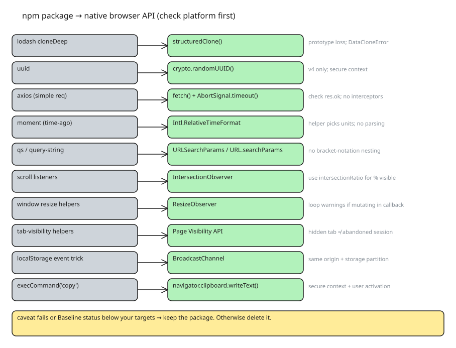

# Ten Browser APIs That Replace npm Packages (and When They Can't)

Browsers keep adding built-in APIs that absorb work once done by small packages. The rule of thumb: **check the platform first, then decide**. All examples below were tested in the Chrome DevTools console; support is expressed as Baseline status ("Widely available" = supported across major browsers for a while).

## The mapping

| npm package | native replacement | caveat that keeps the package alive |
| --- | --- | --- |
| lodash `cloneDeep` | `structuredClone()` | functions/DOM nodes uncloneable (`DataCloneError`); class instances lose their prototype |
| `uuid` | `crypto.randomUUID()` | v4 only; requires secure context (HTTPS/localhost); v1/v5/v7 still need `uuid` |
| axios (simple GET) | `fetch()` + `AbortSignal.timeout()` | no rejection on 4xx/5xx — check `res.ok`; Chrome 103–123 raised `AbortError` instead of `TimeoutError` |
| moment (time-ago) | `Intl.RelativeTimeFormat` | does not pick units for you — small helper needed; parsing/arithmetic/timezones still need a library |
| `qs` / `query-string` | `URLSearchParams` / `URL.searchParams` | no bracket-notation nested serialization |
| scroll listeners | `IntersectionObserver` | `isIntersecting` is binary; use `intersectionRatio` for "≥ N% visible"; `loading="lazy"` may be enough for images |
| window `resize` helpers | `ResizeObserver` | mutating size inside your own callback risks ResizeObserver-loop warnings |
| tab-visibility helpers | Page Visibility API | a hidden tab ≠ an abandoned session — manage background work, don't end sessions |
| `localStorage` + `storage` event trick | `BroadcastChannel` | messages only cross same-origin contexts in the same storage partition |
| `document.execCommand('copy')` / clipboard.js | `navigator.clipboard.writeText()` | secure context + user-activation required (call from a click handler) |

## Worked examples

**Deep clone** (Baseline since March 2022 — Chrome 98, Firefox 94, Safari 15.4):

```js
// Before
import cloneDeep from 'lodash/cloneDeep';
const copy = cloneDeep(user);
// After
const copy = structuredClone(user);
```

**UUID** (Baseline since March 2022):

```js
const id = crypto.randomUUID(); // '36b8f84d-df4e-4d49-b662-bcde71a8764f'
```

**Request with timeout** (`AbortSignal.timeout()` is Baseline Newly available since April 2024 — Chrome 124, Firefox 100, Safari 16; expected Widely available 18 Oct 2026):

```js
try {
  const res = await fetch('/api/users', { signal: AbortSignal.timeout(5000) });
  if (!res.ok) throw new Error(`HTTP ${res.status}`);
  const data = await res.json();
} catch (err) {
  if (err.name === 'TimeoutError') { /* >5 s */ } else { throw err; }
}
```

**Time-ago** (`Intl.RelativeTimeFormat` Widely available since March 2023):

```js
const DIVISIONS = [
  { amount: 60, unit: 'second' }, { amount: 60, unit: 'minute' },
  { amount: 24, unit: 'hour' }, { amount: 7, unit: 'day' },
  { amount: 4.34524, unit: 'week' }, { amount: 12, unit: 'month' },
  { amount: Infinity, unit: 'year' },
];
const rtf = new Intl.RelativeTimeFormat('en', { numeric: 'auto' });
function timeAgo(date) {
  let duration = (date - Date.now()) / 1000;
  for (const { amount, unit } of DIVISIONS) {
    if (Math.abs(duration) < amount) return rtf.format(Math.round(duration), unit);
    duration /= amount;
  }
}
timeAgo(new Date(Date.now() - 3 * 60 * 1000)); // '3 minutes ago'
```

`numeric: 'auto'` yields natural phrases like "yesterday" instead of "1 day ago", and localization is built in.

**Query strings** (Widely available):

```js
const params = new URLSearchParams({ q: 'web apis', page: 2 });
params.toString(); // 'q=web+apis&page=2'
new URL('https://example.com/search?q=web+apis&page=2').searchParams.get('q'); // 'web apis'
```

**Visibility** (Widely available since September 2021 — Chrome 58, Firefox 55, Safari 12.1):

```js
const observer = new IntersectionObserver((entries) => {
  entries.forEach((entry) => {
    if (entry.isIntersecting) {
      entry.target.classList.add('visible');
      observer.unobserve(entry.target);
    }
  });
}, { threshold: 0.2 });
document.querySelectorAll('.card').forEach((el) => observer.observe(el));
```

`threshold` controls when the callback fires; for "at least 20% visible" test `entry.intersectionRatio >= 0.2`. Same API covers infinite scroll, scroll-triggered animation, lazy loading, and visibility analytics.

**Element sizing** (Widely available since January 2023 — Chrome 64, Firefox 69, Safari 13.1):

```js
const ro = new ResizeObserver((entries) => {
  for (const entry of entries) console.log(entry.contentRect.width);
});
ro.observe(element);
```

**Pause background work in hidden tabs** (long established everywhere):

```js
document.addEventListener('visibilitychange', () => {
  if (document.hidden) {
    video.pause();
    // stop polling here too
  } else {
    // tab visible again: resume or refresh
  }
});
```

**Cross-tab messaging** (Baseline since March 2022 — Chrome 54, Firefox 38, Safari 15.4):

```js
// Tab 1
const channel = new BroadcastChannel('app-sync');
channel.postMessage({ type: 'theme-changed', theme: 'dark' });
// Tab 2
const channel = new BroadcastChannel('app-sync');
channel.onmessage = (event) => console.log(event.data);
```

Works across tabs, windows, iframes, and workers that share the origin and storage partition — a classic use is logging out all tabs when a session ends.

**Copy button** (`writeText()` Widely available since March 2020):

```js
copyButton.addEventListener('click', async () => {
  try {
    await navigator.clipboard.writeText('Copied!');
  } catch (err) {
    console.error('Copy failed:', err);
  }
});
```

## Decision checklist

1. Is the built-in API Baseline Widely available for your browser targets?
2. Does your use case hit a listed caveat (secure context, v4-only UUIDs, no nested serialization, prototype loss, partition scoping)?
3. If both answers point native, delete the package; if either fails, keep the package.

This is not an argument against dependencies — it is about knowing what the platform already ships before adding a package nobody audited.

## Diagram



## References

- [10 Browser APIs That Can Replace npm Packages (and When They Can't) — DEV.to](https://dev.to/loknath_patel_aafc07267d5/10-browser-apis-that-can-replace-npm-packages-and-when-they-cant-1gl3)
- [web-platform-dx web-features data (Baseline statuses)](https://github.com/web-platform-dx/web-features)
